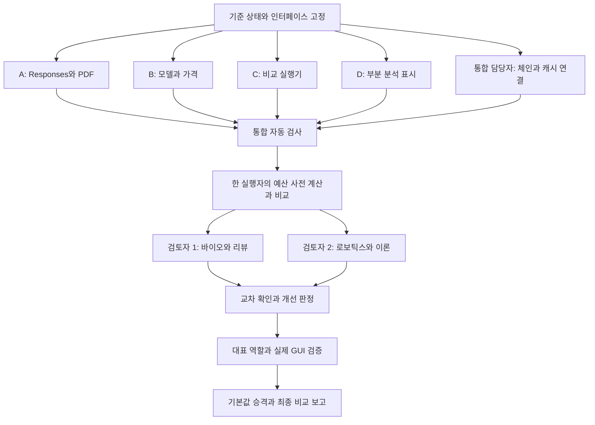

# GPT-6 Luna 원본 PDF 전환과 비교 검증 Implementation Plan

> **For agentic workers:** When implementation is requested and required approvals are satisfied, execute task-by-task using an available workflow. Prefer superpowers:subagent-driven-development or superpowers:executing-plans when available; otherwise use an equivalent workflow with the same approval gates. Steps use checkbox (`- [ ]`) syntax for tracking.

**Goal:** 기존 요약 계약을 보존하면서 GPT-6 Luna와 원본 PDF 입력을 연결하고, 같은 PDF를 사용한 GPT-5.6 Luna 비교에서 정확성, 비용과 속도의 개선 여부를 실제 산출물로 보여준다.

**Architecture:** 기존 Responses 어댑터, 역할 레지스트리, 가격 함수와 분석 체인을 확장한다. 파일별 단일 소유권을 둔 병렬 작업 후 한 통합 담당자가 연결과 모델 승격을 맡는다. 모델 비교는 제품 설정을 바꾸지 않는 별도 프로세스에서 수행하고, 기존 생성 함수와 엄격한 출력 검사를 사용한다.

**Tech Stack:** 현재 Electron/React/TypeScript/FastAPI, OpenAI Python SDK 3.6.0, pytest, Vitest. 의존성 업그레이드나 새 프레임워크는 요구하지 않는다.

**Spec:** [GPT-6 Luna 조사와 수정 제안](../../../.scratch/sasoo-accuracy/research/gpt-6-luna.md), [사용자가 정한 입력과 모델 비교 정책](../../../.scratch/sasoo-accuracy/issues/04-input-comparison-policy.md), [기존 1.0.1 생성과 GUI 계약](../specs/2026-09-22-v1.0.1-summary-and-reading-design.md), [6편 원문 기준](../../validation/2026-09-22-v1.0.1-paper-evidence.md).

## Global Constraints

- 이 문서는 2026-09-23에 작성한 계획과 실행 기록이다. 작성 당시에는 제품 코드와 유료 생성을 실행하지 않았으며, 실행 후 체크박스는 증거로 확인된 작업만 표시한다. 조건 미성립으로 실행하지 않은 작업은 별도 표기한다.
- 사용자 지시: 원본 PDF 우선, 정확성 통과 후 비용과 속도 비교, 필요시 출력 상한 확대. 과거 문서의 16,000 고정 규칙은 이 합의로 대체됐다. 16,000은 첫 비교의 대조 조건이다.
- 누적 검증 예산 US$1, 기존 장부 US$0.3568868, 확인 당시 잔액 US$0.6431132. 앱 단가 추정이며 공급자 청구액이 아니다. 실행 직전에 다시 합산한다. 예산 증가와 추가 자동 분석은 허가된 것으로 간주하지 않는다.
- 기존 여섯 요약 필드, `section_answers` 최대 12, `transfer_checks` 최대 8, `source_refs` 최대 4, `reported/inferred/not_reported`, neutral deep-dive system, strict schema와 duplicate key/C0 거절을 보존한다.
- 원문 입력 누락에 따른 부분 분석과 잘못되거나 불완전한 생성 응답을 구분한다. 후자는 실패다. 기존 실패와 원응답, 과거 모델명과 비용 기록을 수정해 성공으로 만들지 않는다.
- 모델의 비용/성능 개선은 측정 결과다. 아래의 40%/25%는 계획의 사전 판정 제안이며 사용자가 직접 지정한 수치나 보장된 결과가 아니다.
- 비교에서 정답 문서, 검토자 코멘트, 실패 목록이나 manifest의 기준 답변을 모델에게 주지 않는다. 기존 페르소나와 설명 수준을 유지하며 심층 분석에 과거 비판자 system을 복원하지 않는다.
- API 키와 인증 헤더, 개인 데이터는 로그/커밋/인계에 남기지 않는다. 사용자의 공급사 설정을 자동으로 바꾸지 않는다.
- 이미 수정된 앱 코드, 미추적 strict schema/GUI 파일, 무관한 2026-09-07 문서는 보존한다. remote push, 태그, 공개 릴리스는 이 계획에 포함하지 않는다.
- 한국어 사용자 문구에 가운뎃점을 쓰지 않는다. 코드 주석은 짧은 영어로 쓴다.

---

## 1. 성공 판정과 최종 제출물

필수 품질 조건은 GPT-6 Luna가 제공된 PDF 범위에 대한 기존 6편 기준 전체를 통과하는 것이다. 형식 통과, 중대한 오류 0건만으로 다른 기존 실패를 완화하지 않는다. UR5 명칭 오타, 잘못된 부재 주장, 핵심 질문 누락과 근거 귀속도 그대로 검사한다. 필요한 보충자료가 미제공이라는 사실과 제공 PDF의 누락은 구분한다.

같은 원본 PDF를 쓴 두 세대의 비교가 완료된 뒤 다음 중 확인된 개선을 제시한다.

| 개선 주장 | 사전에 정하는 판정 조건 | 최종 표현 |
|---|---|---|
| 비용 | 6편 실제 사용량 기반 비용 합계 40% 이상 감소, 정확성 퇴보 없음. 캐시 조건을 같게 환산한 비용도 함께 확인 | 같은 정확성 기준을 통과하며 이 6편에서 비용 X% 감소 |
| 정확성 | 5.6 PDF 결과의 서로 다른 중대한 오류 2개 이상 해소, 6 결과에 새로운 오류 없음 | 원문 위치, 두 응답과 판정을 연결한 개선 사례 |
| 속도 | 논문별 시간 비율의 중앙값이 0.75 이하, 정확성 퇴보 없음 | 이 실행 조건에서 관측된 생성 시간 감소. 단회 6편으로 일반적인 속도 우월성을 주장하지 않음 |

6 Luna가 정확하지만 개선 기준에 미달하면 `comparison_complete_no_clear_gain`이다. 결과가 불리하다는 이유로 기준을 바꾸거나 좋은 반복만 선택하지 않는다. 시간 개선만으로 결론을 내릴 때에는 실패 유형 3편의 역순 반복까지 같은 방향인지 확인한다.

최종 산출물은 다음 경로에 보존한다. 실행 결과는 [최종 비교 보고](../../validation/2026-09-23-gpt-6-luna-comparison.md)를 따른다.

- `docs/validation/2026-09-23-gpt-6-luna-comparison.md`: 사용자가 읽을 결론, 6편 전수 비교표, 개선과 퇴보, 원문 전후 사례, 검증 범위.
- `docs/validation/assets/gpt-6-luna/primary-16k/`: 요청 명세, dry-run, 실행별 JSON, JSONL 원장, 사용량 CSV, 익명 검토와 판정.
- `docs/validation/assets/gpt-6-luna/qa/`: 실제 GUI, API, 캐시 재시작과 대표 역할의 증거, 검사 대상 소스 해시.
- 별도 24k/32k 실험은 `cap-24k/`, `cap-32k/`에 저장한다. 첫 비교를 덮어쓰지 않는다.

## 2. 파일 소유권과 병렬 실행

하나의 통합 작업공간에서 파일별 단일 소유자가 작업한다. 서브에이전트별 브랜치를 합치는 단계는 두지 않는다. 현재 dirty 상태가 출발점이며 HEAD만 가진 새 worktree로 시작하면 기존 구현이 빠진다. 다른 환경으로 옮길 때에도 현재 tracked 변경과 필요한 untracked 파일을 먼저 복원하고 해시를 대조한다.

| 담당 | 배타적 쓰기 범위 | 전달물 |
|---|---|---|
| A: Responses/PDF | `sasoo/backend/services/llm/openai_client.py`, `services/llm/test_openai_client.py`, `services/llm/test_interactions_client_routing.py` | PDF 변환, 동일 요청 토큰 count, 사용량 보존, 단일 시도 옵션과 단위 검증 |
| B: 모델/가격 | `sasoo/backend/services/models.py`, `services/pricing.py`, `services/test_pricing.py`, `services/test_model_pins.py` | 후보 ID, 두 세대 요금, 캐시/장문/시도별 비용 함수와 검증 |
| C: 비교 실행기 | 새 `sasoo/backend/tools/luna_compare.py`, 새 `sasoo/backend/tools/test_luna_compare.py` | dry-run, 예산 예약, 실제 생성 함수 호출, 불변 기록, 블라인드 검토 자료와 CSV |
| D: 부분 분석 표시 | `sasoo/frontend/src/lib/summaryContent.ts`, `lib/summaryContent.test.ts`, `components/DeepDiveSummary.tsx`, `components/DeepDiveSummary.dom.test.tsx`, `lib/strings.ts` | 부분 입력 경고, 구형 결과 호환, DOM 검증 |
| 통합 담당자 | `sasoo/backend/services/analysis_execution.py`, `services/document_context.py`, `services/test_document_context.py`, `services/model_registry.py`, `services/test_model_registry.py`, `api/analysis_routes.py`, `api/test_analysis_routes.py`, `api/report_service.py`, `api/test_report_service.py`, `api/figure_service.py`, `services/gemini_parser.py`, `services/test_gemini_parser.py`, `services/odl_parser.py`의 비용 전달 필요 지점, 계획과 최종 검증 기록 | 체인 연결, 캐시, 비용 소비부, API/내보내기, 통합 검사와 최종 판정 |

소유 범위에서 앞부분이 생략된 경로는 같은 `sasoo/backend/` 또는 `sasoo/frontend/src/` 아래다. `analysis_execution.py`와 `api/test_analysis_routes.py`는 통합 담당자만 수정한다. A~D가 전달한 뒤에만 `models.py`, `test_model_pins.py`, `strings.ts`의 승격 수정 소유권을 통합 담당자에게 넘긴다.

공통 dispatch 지시문:

```text
당신의 쓰기 범위는 담당표에 지정한 파일뿐이다. 다른 작업자와 같은 작업공간을 사용한다.
다른 사람의 변경을 되돌리지 말고 현재 dirty 코드 위에 최소 변경을 추가한다.
git add/commit/switch/stash/reset/clean/merge와 유료 모델 호출을 실행하지 않는다.
공유 인터페이스를 바꿔야 하면 먼저 통합 담당자에게 제안하고 종속 편집을 멈춘다.
허용 범위 밖의 파일은 읽기만 한다. 완료 시 변경 파일, 공개 인터페이스, 검사 명령/결과,
시작 및 종료 파일 해시, 미검증 항목을 전달하고 파일 소유권을 반납한다.
```



A~D와 통합 담당자는 아래 계약을 기준으로 병렬 구현한다. A/B 완료 전에는 종속 통합 검사를 통과했다고 보고하지 않는다. 전체 테스트는 한 번에 한 프로세스만 실행하고, 작업자는 자기 파일의 좁은 검사만 실행한다. 파일 충돌 위험과 테스트의 전역 mock 간섭을 함께 줄인다.

## 3. 시작 전에 고정할 연결 계약

### PDF와 요청

A는 `openai_client.load_pdf_part(pdf_path: Path) -> dict[str, str]`를 제공한다. 단일 PDF의 원본 바이트를 읽고 base64로 만든다. 빈 파일, `%PDF-` 헤더가 없는 파일, 50,000,000바이트 이상 파일을 API 호출 전에 거절한다. 상한은 보수적인 50 MB 적용값이다. 파일 이름에는 basename만 넣는다.

```python
{
    "type": "document",
    "mime_type": "application/pdf",
    "filename": "paper.pdf",
    "data": "JVBERi0=",
    "detail": "high",
    "sha256": "source-byte-sha256",
}
```

`sha256`는 앱 내부 값이며 wire input에 넣지 않는다. 이 파트는 다음 형태로 변환한다. `uri="files/..."`인 기존 Gemini 문서 파트는 OpenAI에서 계속 거절한다.

```python
{
    "type": "input_file",
    "filename": part["filename"],
    "file_data": "data:application/pdf;base64," + part["data"],
    "detail": "high",
}
```

`call_interaction()`과 `stream_interaction()`에 검증용 keyword `single_attempt: bool = False`, `service_tier: str | None = None`을 추가한다. single_attempt=True인 호출만 SDK `max_retries=0`과 어댑터 1회 시도를 적용한다. 기존 제품 호출의 기본 재시도 정책은 바꾸지 않는다. C의 요청은 `service_tier="default"`를 명시한다. 설치 SDK의 요청 타입 문서에서 이 값이 Standard 가격/성능임을 확인했다. 실제 응답 tier도 기록하고 다른 요율의 응답을 Standard 비용으로 확정하지 않는다. 지역 가산이 필요한 계정은 사전 예약에 반영한다.

A의 `count_input_tokens(prompt, *, model, system_instruction=None, thinking_level=None, previous_interaction_id=None, response_schema=None, strict_schema=False) -> int`는 비동기 함수로 제공한다. 생성과 같은 입력/지시문/strict schema 변환 결과로 SDK `responses.input_tokens.count`를 호출한다. 생성 요청에서 count API가 받는 필드만 전달한다. count의 권한과 비용 조건도 첫 실행 전에 확인한다.

기존 비스트리밍 호출의 `max_output_tokens` 전달은 유지하고, `stream_interaction()`에도 `max_output_tokens: int | None = None`을 추가한다. 역할 smoke의 채팅에도 출력 상한을 명시해야 전체 예산을 예약할 수 있다. None인 기존 제품 호출에는 요청 키를 추가하지 않는다.

사용량 결과에는 기존 키 외 `tokens_cache_write`, `response_model`, `response_status`, `incomplete_reason`, `service_tier`를 보존한다. 캐시 상세 사용량이 없으면 0으로 확정하지 않고 None으로 남긴다. 스트리밍의 기존 필수 `done` 키는 유지하고 추가 메타데이터를 허용한다. SDK 사용량의 output_tokens에는 reasoning이 이미 포함돼 있다.

### 모델과 비용

B는 먼저 `MODEL_GPT6_LUNA = "gpt-6-luna"`를 추가하고 운영 `MODEL_LUNA = "gpt-5.6-luna"`는 유지한다. 새 후보를 포함한 모든 상수에 단가 항목이 있어야 한다.

```text
calc_cost(
    model: str, input_tokens: int, output_tokens: int, *,
    as_of: date | None = None,
    cached_input_tokens: int = 0,
    cache_write_tokens: int = 0,
) -> float

calc_result_cost(result: Mapping[str, object], *, model: str | None = None) -> float
```

첫 함수의 새 인자는 선택적이다. 일반 입력은 `input_tokens - cached_input_tokens - cache_write_tokens`로 계산하며 음수, 중복 합계와 잘못된 타입을 거절한다. 5.6과 6의 입력 272,000 초과 요율을 요청 단위로 적용한다. 일반 입력/캐시 읽기/캐시 쓰기/출력 요율은 각각 5.6의 `0.20/0.02/0.25/1.20`, 6의 `0.10/0.01/0.125/0.50` USD/100만 토큰이다. 장문 입력 세 요율은 2배, 출력은 1.5배다. [직접 확인한 모델 명세](https://developers.openai.com/api/docs/models/gpt-6-luna)

두 번째 함수는 기존 `cost_usd_prior_attempts`가 있으면 그 시도별 합계를 그대로 반환한다. 없으면 result의 model, tokens_in/out/cached/cache_write로 첫 함수를 호출한다. stream의 model이 없을 때만 명시적 model 인자를 사용한다. OpenAI의 캐시 상세가 빠지면 일반 요율로 확정하지 않고 전체 입력 cache-write의 보수적 상한을 반환한다. 검증 기록은 이를 `upper_bound`로 구분해 비용 우월성 확정에 쓰지 않는다. input/output usage 자체가 없는 실패는 비용 0으로 저장하지 않는다.

기존 Gemini 요율/기간 구간과 과거 DB에 저장된 금액을 바꾸지 않는다. 미등록 모델의 기존 표시 폴백을 전체 앱에서 제거하는 별도 변경은 하지 않는다. C는 `model in PRICING`을 생성 전 필수 조건으로 검사한다.

### 체인, 캐시와 부분 입력

통합 담당자는 `_run_chain_stage`, `_run_visual`, `_run_recipe`, `_run_deep_dive`, `_plan_visualizations`, `_run_visualizations`에 `openai_pdf_part: dict[str, str] | None = None`을 전달한다. `run_full_analysis`의 OpenAI 준비 단계와 deep-dive provider 분리 경로에서 로컬 PDF를 준비한다. Gemini URI와 OpenAI PDF 파트를 섞지 않는다. `_run_synthesis`는 기존 구조화 결과를 소비하는 경로를 유지하며 원본을 중복 주입하지 않는다.

`_run_deep_dive`, `_run_visual`, `_run_recipe`와 `_run_chain_stage`에는 `single_attempt: bool = False`와 검증용 `max_output_tokens: int | None = None`을 추가한다. None은 기존 stage cap을 사용한다. single_attempt=True일 때 형식 결함은 `_raw`와 `_parse_error`로 남기고 새 호출 없이 실패 처리한다. incomplete/실패/취소도 완성 응답으로 복구하지 않는다. `run_full_analysis(paper_id, *, single_attempt=False)`의 검증 전용 옵션은 `_run_screening`의 결함 재시도에도 적용한다. 도해 등 별도 자동 호출이 이 옵션만으로 통제된다고 가정하지 않는다.

캐시는 기존 함수를 재사용한다. `_phase_cache_key`에 keyword `source_signature: str = ""`, `max_output_tokens: int | None = None`을 추가하고 조합 문자열에 포함한다. source_signature는 실제 제공한 PDF 해시와 detail, 또는 실제 제공한 텍스트 해시와 절단 범위를 담는다. `compute_input_hash`의 provider/model/effort 격리는 보존한다. 새 캐시 엔진이나 DB 마이그레이션은 만들지 않는다.

모델 JSON 검증이 끝난 뒤 저장 payload에 앱 메타데이터 `_input_coverage`를 추가한다. 원응답은 별도로 보존하며 생성 schema에 이 필드를 요구하지 않는다.

```json
{
  "_input_coverage": {
    "mode": "text",
    "status": "partial",
    "missing": ["원본 PDF를 제공하지 못해 수식과 그림의 판독 범위를 확인하지 못했습니다"],
    "pdf_sha256": null
  }
}
```

PDF를 제공한 경우 mode=`pdf`, status=`provided_pdf`, missing에는 알려진 입력 누락만, pdf_sha256에는 실제 해시를 기록한다. `provided_pdf`는 모든 내용을 정확히 판독했다는 판정이 아니다. 과거 결과에 메타데이터가 없으면 입력 범위 미확인으로 읽는다. D는 partial을 눈에 보이는 “부분 분석” 경고로 표시하고, 통합 담당자는 내보내기에도 같은 범위를 반영한다. 원문 실패 시 자동 생성 호출을 추가하지 않는다.

## Task 0: 기준 상태 보존과 작업 시작

**Owner:** 통합 담당자. **Files:** 위 소유권 표의 현재 파일, `.scratch/sasoo-gpt6-migration/baseline.json`(신규).

- [x] `git status --short`, HEAD와 소유권 표의 시작 해시를 기록한다. 현재 기준 HEAD는 `16bdcdc671d8525baf16319bf6ea5c97bcbbc813`이지만, 이 커밋만이 출발 코드가 아니다. 수정/미추적 파일을 포함한 현재 상태를 기준으로 한다.
- [x] 작업 대상의 기존 파일과 현재 diff를 별도 OS 임시 디렉터리에 복사한다. 사용자 파일을 이동하거나 stash하지 않는다. 새 파일 경로의 기존 존재 여부도 기록한다.
- [x] 기존 원문과 장부를 재확인한다.

```bash
git status --short
git rev-parse HEAD
shasum -a 256 -c docs/validation/assets/v1.0.1-summary-reading/papers/SHA256SUMS
```

- [x] 알려진 실패, 모델/입력 정책, 소유권과 위 연결 계약을 읽고 A~D를 병렬 dispatch한다. 작업자는 스킬 `omo:programming`과 필요한 언어별 규칙을 적용한다. D는 `omo:frontend`를 추가한다.
- [x] 모델 기본값/사용자 설정/기존 증거에 쓰는 작업자가 없는지 확인한다. 완료 기준은 출발 파일 무결성과 겹치지 않는 소유권이 기록된 상태다.

## Task 1: A의 PDF 요청과 사용량 연결

**Files:** A 소유 범위. **Consumes:** 연결 계약. **Produces:** load_pdf_part, count_input_tokens, single_attempt, 사용량 메타데이터.

- [x] 아래 회귀 테스트와 PDF 크기/형식 거절, Gemini URI 거절 테스트를 추가해 현재 구현에서 실패하는 것을 확인한다.

```python
def test_pdf_data_is_sent_as_input_file():
    from services.llm.openai_client import _translate_parts
    part = {"type": "document", "mime_type": "application/pdf",
            "filename": "paper.pdf", "data": "JVBERi0=",
            "detail": "high", "sha256": "audit-only"}
    sent = _translate_parts([part])[0]["content"][0]
    assert sent == {"type": "input_file", "filename": "paper.pdf",
                    "file_data": "data:application/pdf;base64,JVBERi0=",
                    "detail": "high"}
```

- [x] PDF 변환과 같은 요청을 만드는 내부 builder를 구현한다. count와 create가 같은 instructions, input, reasoning, text.format과 previous_response_id를 사용하는지 mock으로 대조한다. count API에 max_output_tokens/store 같은 미지원 인자를 보내지 않는다.
- [x] `single_attempt=True`에서 네트워크 오류 1회 뒤 종료하고 SDK retry도 0인지 검증한다. 원래 호출 기본값의 재시도 테스트는 유지한다. incomplete_reason과 cache_write 사용량, response_model 보존을 검사한다.
- [x] 기존 stream의 누락 완료 처리에 새 사용량을 붙일 때 사용량을 모르는 상태를 0원 완료로 확정하지 않는다. 반환 키 검사는 필수 키 보존과 추가 메타데이터 허용을 검사하도록 바꾸며 누락된 필수 키를 허용하지 않는다.

```bash
cd sasoo/backend
./.venv/bin/python -m pytest services/llm/test_openai_client.py services/llm/test_interactions_client_routing.py -q
```

- [x] 명령 결과와 request/count 동일성 증거를 전달하고 소유권을 반납한다. 실제 API 호출은 C의 단일 실행자에게 남긴다.

## Task 2: B의 모델 후보와 가격 계산

**Files:** B 소유 범위. **Produces:** 후보 상수, calc_cost 확장, calc_result_cost.

- [x] 캐시 입력이 이중 과금되지 않는 아래 사례와 272000/272001 경계, 음수/초과 cache, reasoning 중복 미합산 테스트를 추가한다.

```python
def test_gpt6_cache_categories_are_disjoint():
    from services.pricing import calc_cost
    assert calc_cost("gpt-6-luna", 100_000, 10_000,
                     cached_input_tokens=20_000,
                     cache_write_tokens=30_000) == 0.01395

def test_gpt6_full_request_long_context_rates():
    from services.pricing import calc_cost
    assert calc_cost("gpt-6-luna", 272_000, 10_000) == 0.0322
    assert calc_cost("gpt-6-luna", 272_001, 10_000) == 0.0619002
```

- [x] 공식 두 세대 단가와 캐시/장문 계산을 기존 함수에 추가한다. 미등록 모델 폴백은 선택된 fallback 모델의 요율 규칙과 일관되게 처리한다. 새 실험은 명시적 등록이 없으면 중단한다.
- [x] 서로 다른 두 시도를 합친 토큰에 장문 요율을 적용하지 않는 calc_result_cost 테스트, 캐시 상세 누락의 상한 처리 테스트를 추가한다. 과거 ledger 파일을 변경하지 않고 5.6 ID가 계속 가격표에 남는지 확인한다.

```bash
cd sasoo/backend
./.venv/bin/python -m pytest services/test_pricing.py services/test_model_pins.py -q
```

- [x] 운영 MODEL_LUNA가 여전히 5.6임을 확인하고 전달한다. 모델 승격은 Task 7에서 통합 담당자가 수행한다.

## Task 3: 통합 담당자의 체인, 캐시와 비용 소비부

**Files:** 통합 담당자 소유 범위. **Consumes:** A/B 인터페이스. **Produces:** 실제 앱 경로의 PDF 전달과 결과별 입력 범위.

- [x] 기존 API 테스트에 최초 PDF 호출, previous_response_id 후속 호출, 캐시 이후 PDF+restart_context 재첨부, provider 분리 후 독립 PDF 시작을 추가한다. mock에 실제 전달된 input_file을 검사한다. API `/run`과 캐시 기반 재분석을 사용하며 존재하지 않는 단계별 모델 지정 endpoint를 만들지 않는다.
- [x] 원본 PDF가 있는 OpenAI 실행에서 doc_text 15만 자와 선택 그림 8장 경로를 PDF로 대체한다. 후속 단계는 같은 공급사의 response ID를 잇는다. 캐시 히트로 ID가 없으면 원본과 이전 단계 digest를 다시 제공한다.
- [x] 아래 캐시 격리 검사를 추가하고 실제 키 생성에 적용한다.

```python
def test_native_pdf_changes_cache_identity():
    from services.analysis_execution import _phase_cache_key
    base = dict(model="gpt-6-luna", thinking="high",
                system_instruction="same", prompt="same",
                max_output_tokens=16_000)
    text_key = _phase_cache_key(**base, source_signature="text:hash:150000")
    pdf_key = _phase_cache_key(**base, source_signature="pdf:hash:high")
    assert text_key != pdf_key
    assert pdf_key != _phase_cache_key(**base, source_signature="pdf:changed:high")
```

- [x] single_attempt과 cap override를 생성 단계에 전달한다. 결함 응답을 감지하면서 재시도만 끄는지 검사한다. 검증을 끄거나 깨진 JSON을 성공으로 바꾸어 단일 시도를 만들지 않는다.
- [x] `_result_cost`는 B의 calc_result_cost에 위임한다. retry 비용은 개별 result로 계산해 합친다. `analysis_routes`, `figure_service`, `gemini_parser`의 OpenAI 호출과 stream 비용도 같은 helper로 연결한다. `odl_parser`가 상위 parser에서 이미 계산한 `_usage.cost_usd`를 받으면 다시 불완전한 토큰으로 계산하지 않는다. Gemini/offline parser 경로는 보존한다.
- [x] PDF 없는 경우나 알려진 텍스트 절단은 `_input_coverage.status="partial"`로 저장하고 내보내기에 반영한다. 실제 누락 범위를 알 수 없으면 그 불확실성을 적는다. 원본이 첨부됐다는 이유만으로 과학적 검증 통과를 저장하지 않는다.

```bash
cd sasoo/backend
./.venv/bin/python -m pytest api/test_analysis_routes.py api/test_deep_dive_schema.py api/test_report_service.py services/test_document_context.py services/test_gemini_parser.py services/test_summary_contract.py -q
```

- [x] 변경한 소스 해시와 호출 경로 테스트를 기록한다. A/B 완료 후 종속 검사까지 통과해야 이 Task를 완료한다.

## Task 4: C의 재현 가능한 비교 실행기

**Files:** 새 tools/luna_compare.py와 tools/test_luna_compare.py. **References:** 기존 [검증 실행기](../../validation/assets/v1.0.1-summary-reading/run-model-validation.py), [원장](../../validation/assets/v1.0.1-summary-reading/models/all-usage.json). 기존 스크립트는 역사적 증거로 보존한다.

- [x] 기존 실행기의 입력 준비, neutral system 선택, strict validation과 DB/cache 격리 방식을 재사용한다. 기존 도구 전체를 복사하지 않는다. public CLI는 아래 네 mode로 한 파일에 구현한다. 생성 플래그가 없으면 기본은 dry-run이다.

```text
--mode dry-run|run|review-pack|report
--scope deep-dive|core-chain|role-smoke
--campaign PATH
--papers theory,robotics2,review,bio1,bio2,robotics1
--models gpt-5.6-luna,gpt-6-luna
--input-mode pdf
--effort high
--explanation-level undergrad
--max-output-tokens 16000
--budget-total-usd 1
--run-paid-approved-usd-1
```

이 CLI는 현재 존재하지 않는다. Task 4의 산출물이며 아래 명령은 구현 이후 실행한다. scope 기본값은 deep-dive이며 고정 6편 비교에 사용한다. core-chain은 한 논문의 실제 `_run_visual → _run_recipe → _run_deep_dive`와 response ID 연결, role-smoke는 한 논문의 그림 판독과 채팅 스트리밍을 검사한다. 뒤 두 scope는 비교 cohort와 분리해 QA로 기록한다. API 키를 인자로 받거나 로그에 출력하지 않는다. 모델 후보는 프로세스 안의 `_stage_choice`를 한 번의 실행 단위로 교체해 실제 `_run_deep_dive`에 전달하고 사용자 설정 DB는 쓰지 않는다.

- [x] 순수 함수 `reserve_cost_usd(model: str, input_tokens: int, output_cap: int) -> float`를 B의 정확한 요율로 구현한다. 전체 입력 cache-write, 할인 없음, 해당 요청 장문 구간, 출력 상한을 계산한다. 다음 테스트는 생성하지 않고 통과해야 한다.

```python
def test_one_attempt_reserves_known_upper_bound():
    from tools.luna_compare import reserve_cost_usd
    assert reserve_cost_usd("gpt-5.6-luna", 100_000, 16_000) == 0.0442
    assert reserve_cost_usd("gpt-6-luna", 100_000, 16_000) == 0.0205
```

- [x] `dry-run`은 모델/단가/PDF 해시/요청 조립을 검사하고 명시적으로 token-count API를 사용해 두 모델의 실제 입력 수를 기록한다. 생성 API는 0회다. 토큰 count 자체가 불가능하면 byte 수로 PDF 토큰을 대체하지 않는다. 로컬 단위 테스트에서는 count도 mock 처리한다.
- [x] run은 dry-run 요청 해시와 설정이 같고 전체 필수 비교 예약이 잔액 안에 있을 때만 시작한다. 현재 사용액에 기존 원장과 새 캠페인 원장을 정확히 한 번씩 합산한다. 비정상 종료 후 재시작도 완료/미정산 요청을 재발행하지 않는다.
- [x] SDK, 어댑터, 결함 복구가 모두 단일 시도인지 실제 call count mock으로 검사한다. 요청 직전에 `reserved`를 원장에 쓰고 완료 후 reported usage로 정산한다. usage 없는 오류는 `unsettled`로 남기고 예약을 해제하지 않으며 다음 유료 호출을 막는다.
- [x] core-chain과 role-smoke에도 같은 요청 직전 예약/정산 코드를 사용한다. 체인의 다음 입력은 이전 response ID까지 포함해 count하며 이전 문서가 다시 과금될 수 있음을 계산한다. 단계별 cap은 명시하고, 무제한 출력이나 도해 생성까지 허용하는 요청은 이 실행기에서 발행하지 않는다. 실제 호출 수가 예정 범위를 넘으면 전송 전에 실패시킨다.
- [x] C의 프로세스에서 생성 직전 요청을 감싸는 공통 경로로 `single_attempt=True`, `service_tier="default"`를 적용한다. 비교용 설정을 사용자 설정이나 제품 전역 기본값으로 저장하지 않는다. count용 요청 지문은 같은 모델 입력으로 계산하고 service tier는 별도 실행 지문에 포함한다.
- [x] 원장 파일은 한 프로세스만 연다. 다른 실행자가 동일 campaign을 실행하면 독점 파일 잠금으로 거절한다. `fcntl.flock` 또는 같은 목적의 표준 라이브러리 기능을 사용하며 별도 DB/작업 큐는 만들지 않는다. JSONL은 append-only다.
- [x] 생성마다 PDF/request/schema/system/model/effort/cap/code 해시, 요청 모델과 응답 모델, SDK, service tier, 시작/종료/경과 시간, status/incomplete_reason, raw output과 사용량을 저장한다. PDF base64, API 키와 인증 헤더는 저장하지 않는다. 이미 기록된 실행을 좋은 결과로 덮어쓰지 않는다.
- [x] usage 없는 실패, budget 부족, 가격 미등록, PDF 해시 불일치, resume 설정 불일치, 신규 오류를 숨기는 malformed 결과의 거절 테스트를 포함한다.

```bash
cd sasoo/backend
./.venv/bin/python -m pytest tools/test_luna_compare.py -q
```

- [x] review-pack은 생성 없이 출력 라벨을 무작위로 가리고 대응표를 통합 담당자에게만 보관한다. report는 모든 실행의 CSV/Markdown을 만든다. 논문당 최초 paired run과 반복 결과를 다른 행으로 보존한다.

## Task 5: D의 부분 입력 표시와 통합 자동 검사

**Files:** D 소유 범위. **Consumes:** `_input_coverage` 계약. **Produces:** 부분 입력 표시와 기존 요약 동작 보존.

- [x] summaryContent에 `readInputCoverage(data: Record<string, unknown>)`를 추가한다. status가 partial이면 누락 설명을 읽고, 메타데이터 부재는 legacy, 잘못된 새 메타데이터는 unknown으로 분리한다. 원문 범위 미확인을 full_pdf로 기본값 처리하지 않는다.

```typescript
it('keeps text-only input visibly partial', () => {
  const result = readInputCoverage({ _input_coverage: {
    mode: 'text', status: 'partial', missing: ['수식 판독 미확인'], pdf_sha256: null,
  }});
  expect(result.kind).toBe('partial');
});
```

- [x] DeepDiveSummary의 본문 앞에 부분 분석 경고와 누락 범위를 표시한다. provided_pdf는 원본 입력 사실만 표시하고 정확성 보증 문구를 쓰지 않는다. 기존 질문/짧은 답, 펼침 설명/근거, 스크롤과 내보내기 흐름을 유지한다. 모델명 변경은 아직 하지 않는다.
- [x] DOM 테스트에서 경고 노출, 잘못된 메타데이터, 구형 결과, 기존 펼침 상태를 검사한다. 탭 이동이나 표시 때문에 생성 요청이 생기지 않아야 한다.

```bash
cd sasoo/frontend
pnpm exec vitest run src/lib/summaryContent.test.ts src/components/DeepDiveSummary.dom.test.tsx
pnpm tsc --noEmit
```

- [x] A~D 종료 후 통합 담당자가 아래 전체 검사를 한 번씩 수행한다. 실패 시 담당 파일 소유자를 다시 지정하고 해당 변경과 관련된 검사만 반복한다. 새 변경 없이 전체 검사를 계속 반복하지 않는다.

```bash
cd sasoo/backend
./.venv/bin/python -m pytest services api models tools/test_luna_compare.py -q
```

```bash
cd sasoo/frontend
pnpm test
pnpm tsc --noEmit
pnpm lint
pnpm build
```

## Task 6: 공정한 6편 비교와 병렬 원문 검토

**Owner:** 통합 담당자만 유료 실행. 원문 검토는 R1/R2 서브에이전트에 배타적 산출물 경로를 준다. 제품 코드는 이 구간에서 동결한다.

- [x] 비교군 A는 기존 revision-3의 5.6 텍스트 결과, B는 새 5.6 PDF, C는 새 6 PDF다. 주 비교는 B/C다. 과거 A와 새 C의 차이를 모델만의 효과로 발표하지 않는다. A의 재실행에 예산을 먼저 쓰지 않는다.
- [x] B/C 모두 동일 원본 PDF/hash, high effort, PDF detail high, strict schema/지시문, undergrad 설명 수준, 16k cap, 도구 없음, Standard tier, 새 대화로 고정한다. application cache를 끄고 provider cache 사용량은 기록한다. 모델별 input token 차이는 실제 측정치로 보존한다.
- [x] 아래 mode를 실행해 필수 12회에 더해 대표 역할/실제 체인 검증 비용 여유를 먼저 확보한다. SDK count와 응답의 세부 사용량이 충분하지 않으면 확정 비용 개선을 주장하지 않는다.

```bash
cd sasoo/backend
./.venv/bin/python tools/luna_compare.py --mode dry-run \
  --campaign ../../docs/validation/assets/gpt-6-luna/primary-16k \
  --models gpt-5.6-luna,gpt-6-luna --input-mode pdf --effort high \
  --explanation-level undergrad --max-output-tokens 16000 --budget-total-usd 1
```

- [x] 실제 예약이 통과하면 같은 인자에 `--mode run --run-paid-approved-usd-1`을 사용한다. 논문 순서는 Bell B→C, DP C→B, review B→C, bio1 C→B, bio2 B→C, UR5 C→B다. 호출을 직렬로 실행하고 각 쌍을 가까운 시간에 측정한다.
- [x] 단일 시도 가정의 예시 예산은 요청당 입력 100k일 때 B 6편 US$0.2652, C 6편 US$0.1230, 합계 US$0.3882다. 세 실패 유형의 역순 반복 6회는 추가 US$0.1941이다. 실제 토큰 수로 사전 계산하기 전에는 실행 가능하다고 확정하지 않는다.
- [x] 첫 결과가 나오는 동안 검토자는 원문 기준을 읽는다. R1은 bio1/bio2/review, R2는 UR5/DP/Bell을 담당한다. 출력이 준비되면 각각 6개 익명 응답을 검토한다. R1은 `reviews/bio-review.md`, R2는 `reviews/robotics-theory-review.md`만 작성한다.
- [x] 모든 기준 질문, 새 사실 주장, 출처, basis와 누락을 원문과 비교한다. 개선 사례와 오류, 애매한 reported/not_reported 판정은 서로 교차 확인하고 통합 담당자가 원문으로 최종 조정한다. 모델명/가격은 판정 고정 후 공개한다. 원문에 있는 사실을 not_reported로 돌린 응답은 성공이 아니다.
- [x] 실제 개선이 확인될 때만 DP의 실물/시뮬레이션 범위와 idle 전처리 귀속, Bell 식과 가정, 리뷰 후반 Discussion/Appendix를 전후 사례로 선택한다. Bell은 기존 원문 기준의 독립 수학 검산도 재현한다. 바이오의 기존 통과 항목도 회귀 확인한다.
- **미실행(조건 미성립):** 16k 응답 12개가 모두 완료되어 출력 상한 확대 근거가 없었다. 원래 조건: 출력 부족이 입증되고 잔액이 있을 때에만 별도 24k/32k campaign을 실행한다. 한 모델만 상한을 늘린 결과를 같은 조건 비교에 섞지 않는다. 상한 변경 후 모든 6편을 재검증하지 않았다면 그 상한을 검증된 공용 기본값으로 승격하지 않는다.
- **미실행(속도 단독 승격 판단 없음):** 정확성 조건 미달로 승격하지 않아 역순 반복은 수행하지 않았다. 최초 6쌍의 관측치만 보고한다. 원래 반복 조건: 반복은 필수 실험과 대표 역할 예산을 남긴 뒤 실시한다. 3편의 두 모델을 역순으로 반복하고 최초 응답을 대체하지 않는다. 비용/정확성/속도 모두 표본과 조건의 한계를 함께 기록한다.

**실행 결과:** 최초 12회 전부 형식 유효, 최종 엄격 원문 판정 B 1/6, C 0/6으로 `candidate_failed`. 모델 공개 후 Q6 기준 일관성 감사와 정정 시점을 최종 보고서/원검토에 기록했다. 기존 실패와 최초 판정을 보존했다.

## Task 7: 대표 역할, 실제 GUI, 기본값 승격

**Owner:** 통합 담당자. A/B/D의 소유권 반납 후에만 해당 파일을 다시 수정한다.

- [x] C의 core-chain/role-smoke scope로 격리된 검증 프로세스에서 `--models gpt-6-luna --papers robotics2`를 사용해 실제 핵심 체인 `visual → recipe → deep_dive`, 채팅 스트리밍과 원본 그림 판독을 점검한다. 역할별 기존 effort를 유지하고 심층 분석만 high 비교 조건을 사용한다. 모든 추가 생성은 같은 누적 예산 원장과 단일 시도 설정을 거친다. stage 단독 실험을 full run 증거로 표기하지 않는다.
- [x] 실제 `/run` 경로, 캐시 재시작, provider 분리 배선은 통합 테스트와 GUI 시나리오로 확인한다. 전체 실행에서 추가되는 그림 생성 등 다른 모델 호출까지 예산을 통제할 수 있을 때에만 live full run을 실행한다. 통제할 수 없으면 실행하지 않고 live core-chain과 full-run mock의 검증 범위를 명시한다.
- [x] `SASOO_APP_DATA_ROOT`를 OS 임시 디렉터리의 절대 경로로 설정한 검증 앱을 사용한다. 기존 사용자 DB나 API 키를 복사해 공개 산출물에 넣지 않는다. 실제 생성 응답을 격리 DB에 넣어 GUI에서 표시한다. 이 주입을 GUI에서 생성한 결과라고 표시하지 않는다.
- [x] 실제 Electron 1400×900와 1024×680에서 원본 PDF/수식/근거 링크, 요약 펼침 상태, 부분 입력 경고, 실패 응답, 과거 결과를 확인한다. 표시된 모델명과 비용을 저장 기록에 대조하고 콘솔 오류와 네트워크 요청을 기록한다. 읽기 조회/탭 이동의 생성 요청은 0회여야 한다.
- **미실행(승격 조건 미달):** 최종 C 0/6, 대표 그림 내용 오류와 엄격 CJK 미달을 보존하고 기본값 5.6을 유지했다. 원래 조건: C 6편 정확성, B/C 공정 비교와 개선 기준, 대표 역할과 GUI가 통과하면 `MODEL_LUNA = MODEL_GPT6_LUNA`로 승격한다. 레지스트리 effort는 유지하고 표시 문자열을 GPT-6 Luna로 맞춘다. 5.6 과거 가격/결과/fixtures는 보존한다.
- [x] 모델 핀/레지스트리/캐시/프런트 타입과 빌드를 변경 범위에 맞게 재검사하고 앱을 재시작해 실제 GUI의 모델 표시를 확인한다. 사용자의 ai_provider는 바꾸지 않는다. 비교 시점 소스 해시와 승격 변경 diff, 최종 소스 해시를 연결하고 이전 실험 기록의 해시를 고쳐 쓰지 않는다.

```bash
cd sasoo/backend
./.venv/bin/python -m pytest services/test_model_pins.py services/test_model_registry.py services/test_pricing.py services/test_document_context.py -q
```

```bash
cd sasoo/frontend
pnpm tsc --noEmit
pnpm build
```

- [x] 미달이면 운영 기본값은 5.6을 유지하고 원인을 기록한다. 원본 PDF 구현이 별도로 검증됐다면 해당 변경과 모델 승격 여부를 구분해 전달한다. 모델 성능이 부족한 상황을 prompt 반복 수정으로 억지로 통과시키지 않는다.

**검증 결과:** 유료 core-chain 3회/대표 역할 2회는 완료 및 사용량 보존을 확인했다. full-run/provider/cache 경로는 통합 테스트, 실제 생성은 core-chain/대표 역할 범위다. 최종 OS-native GUI 32개 상태/91개 기술 검사는 통과했다. 기능/구조 PASS와 엄격 CJK REVISE(보조 표현 분리 2유형)를 별도로 보고하며 GUI 전체 시각 통과로 표시하지 않는다.

## Task 8: 개선 보고와 원래 릴리스 게이트 연결

- [x] 비교표에는 논문, 모델, 반복, 입력 범위, schema/완료 상태, 6개 질문 충족, 오류/누락/basis, 입력/캐시/출력/reasoning 토큰, 비용 상태, 시간과 근거 링크를 넣는다. 실패도 합계와 표에 포함한다.
- [x] 비용은 `1 - sum(C)/sum(B)`, 시간은 논문별 `t_C/t_B`의 중앙값과 범위로 제시한다. provider 캐시를 포함한 실제 사용량 추정 비용과 캐시 중립 환산을 구분한다. reasoning 토큰을 출력에 다시 합산하지 않는다.
- [x] “기존 제품 A에서 바뀐 점”, “같은 PDF의 B/C 차이”, “미확인/퇴보”를 별도로 적는다. 6편 전체 표, 실제 원문과 두 응답을 연결한 사례, GUI 증거를 제공한다. 개선 사례가 없으면 만들지 않는다.
- [x] 판정은 `improvement_demonstrated`, `comparison_complete_no_clear_gain`, `candidate_failed`, `candidate_validated`, `comparison_incomplete_budget` 중 근거에 맞게 기록한다. candidate_validated는 C 6편만 통과한 상태이며 전체 B/C 비교나 기본값 승격을 대신하지 않는다.
- **조건 미발생:** 누적 US$0.58928133, 미정산 0건이므로 예산 증액/추가 승인은 필요하지 않았다. 원래 조건: 예산 부족/미정산 실패가 있으면 유료 종속 작업을 멈추고 부족액, 완료 범위와 다음에 필요한 호출을 구체화한다. 독립적인 코드/문서 검증은 마친다. 추가 승인은 완성된 변경과 예산 계산을 제시한 뒤 필요한 범위에 대해서만 요청한다.
- **미실행(정확성 조건 미달):** 버전 동기화와 macOS 패키지 검증은 진행하지 않았다. 원래 조건: 원래 1.0.1 Task 6의 남은 기준까지 모두 통과한 경우에만 [기존 계획의 Task 7](2026-09-22-v1.0.1-summary-and-reading.md)에 따라 버전 동기화와 macOS 로컬 패키지 검증을 이어갈 수 있다. 이 모델 비교 계획 자체는 패키지 통과를 보장하지 않는다. 실제 패키징 전 Python 3.12 등 프로젝트 릴리스 조건을 확인하며 기존 venv를 무단 교체하지 않는다.
- [x] Windows/공개 릴리스는 실행하지 않은 것으로 남긴다. 커밋이나 PR 인계가 요청된 실행에서는 통합 담당자만 Git을 조작하고, 그 정확한 최종 소스에 대해 필요한 review-work/runtime audit을 수행한다.

**최종 기록:** 구현/비교/검증 실행을 종료하고 실패를 포함한 최종 보고를 작성했다. `candidate_failed`, 기본 모델 5.6 유지, backend 1063 tests +223 subtests, frontend 299 tests, 실제 GUI 32상태/91기술검사 통과, 독립 기능/구조 PASS와 엄격 CJK REVISE를 분리했다. 추가 유료 호출/범용 한국어 조판 확장/승격/패키징은 수행하지 않았다.

## 4. 실행자가 중단 없이 이어가기 위한 규칙

- A~D는 동일한 전역 프롬프트/스키마를 독립 수정하지 않는다. 모델 비교 전에 source/request fingerprint를 고정한다.
- 실패한 입력이나 출력은 실패 원인과 비용을 남긴다. 이미 지출한 실행을 다시 “예산 시작 0”으로 잡지 않는다.
- 추가 호출보다 기존 산출물 읽기, 원문 검토, UI와 테스트를 병렬화한다. 유료 호출은 중앙 실행자 하나만 발행한다.
- 사용자가 이미 정한 원본 PDF/출력 확대/비용과 속도 선호를 재질문하지 않는다. 계정 접근 불가, 예산 초과 또는 새로운 제품 결정만 분리해 다룬다.
- 완료 보고에는 구현 여부, 검사 대상 소스 해시, 실제 호출과 비용, 5.6 대비 관측 개선, 실패와 미실행 범위를 함께 적는다. “최신 모델로 변경됨”만으로 목표 완료라고 하지 않는다.

## 실행 종료 시 검증 범위

최종 검사에서 r6 검증 이후의 추가 프런트엔드 편집을 발견했다. 해당 변경은 보존했으며 299개 프런트엔드 테스트와 GUI 판정은 기록된 r6 스냅샷에만 적용한다. 현재 후속 편집본은 미재검증이다. 백엔드/모델 입력 해시는 일치했고 실제 비교/원문 판정/예산 기록은 유효하다. 상세 파일 해시와 별도 보존한 r6 빌드는 [후속 변경 기록](../../validation/assets/gpt-6-luna/qa/post-validation-source-drift.json)을 따른다.
