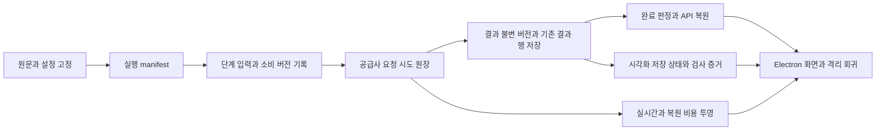

# 실행 이력, 시각화 검증, 비용 추적 구현 계획

**목표:** 분석 실행이 실제로 사용한 결과와 요청별 지출을 복원하고, 시각화 저장 상태와 검증 상태를 구분한다. 마지막 수정 기준의 전체 회귀와 격리 Electron 검사까지 완료한다.

**구조:** 기존 `analysis_runs`는 논문별 큐와 워커 조율에 그대로 사용한다. 별도 실행 manifest, 불변 결과 버전, 요청 원장을 추가하고, 실시간과 복원 화면은 동일한 조회 함수를 사용한다. 과거 행의 출처나 요청을 추정하지 않는다.

**기술:** SQLite와 aiosqlite, FastAPI와 Pydantic, Electron과 React, pytest, Vitest, Playwright.

**관련 명세:** `docs/superpowers/plans/2026-11-03-completion-gaps-followup.md`, `docs/validation/2026-11-03-ai-scientist-v3-completion-contract.md`, 사용자가 지정한 네 가지 잔여 항목.

## 범위와 제약

- 기존 미커밋 변경, 기존 DB와 논문 파일, 유료 요청 원장과 결과물을 보존한다. 삭제, 정리, 일괄 스테이징, 릴리스는 하지 않는다.
- 테스트는 임시 DB와 합성 논문, 가짜 공급사만 사용한다. 네트워크 공급사 호출, 유료 재시도, 과거 결과 재생성을 하지 않는다.
- 단계별 `input_hash`는 각 프롬프트의 캐시 키다. 서로 다른 단계의 해시를 같아야 한다고 비교하지 않는다.
- 과거 데이터는 읽고 기존 캐시 정책대로 재사용한다. 출처, 격리 증거, 요청 ID가 없다는 이유만으로 자동 재생성하거나 정보를 채워 넣지 않는다.
- 형식상 완료, 출처 일치, 도구 실행 검사, 원문 근거와 과학적 정확성은 서로 다른 판정이다. 한 판정을 다른 판정의 증거로 취급하지 않는다.
- 기존 사용자에게 보이는 금액 계약을 조사한 후 하위 호환 필드를 명시한다. 알 수 없는 값은 0으로 바꾸지 않는다.

## 확인된 현재 상태와 설계에 미치는 영향

1. `analysis_results.id`는 결과 행의 식별자다. `_store_visualization_progress`와 재생성 API는 같은 행을 갱신할 수 있으므로 ID 하나만으로 당시 내용을 재현할 수 없다.
2. `analysis_runs`는 `paper_id`를 기본 키로 하고 `generation`을 워커 소유권 확인에 사용한다. 큐 재등록과 재시도 때 행이 갱신되므로 불변 실행 이력으로 사용하지 않는다. 현재 워커는 `run_full_analysis(paper_id)`에 generation을 전달하지 않으므로 배선 변경이 필요하다.
3. 실행 완료와 상태 API는 현재 단계별 최신 행을 조합한다. 서로 다른 실행의 최신 행이 섞일 수 있다. 새 실행은 manifest가 가리킨 정확한 버전으로 완료와 복원을 판정해야 한다.
4. 현재 HTML 체크는 `sandbox="allow-scripts"` 프레임, CSP, 프레임 출처와 nonce 확인을 사용한다. API는 코드 해시가 맞는 클라이언트 보고를 저장한다. 코드 해시는 대상 일치의 근거이지 검사 환경의 격리나 검사 보고 자체의 신뢰성을 입증하지 않는다. 격리 보장은 별도로 입증해야 한다.
5. 시각화 요청에는 앱이 생성한 ID와 비용 기록이 일부 있으나 일반 단계는 `interaction_id`와 행 단위 비용, 합산된 재시도 사용량만 남을 수 있다. `interaction_id`는 응답 또는 체인 식별자이며 실제 전송 시도별 ID라고 가정할 수 없다. 시각화 행 내부의 중복 제거만으로 여러 행의 중복은 해결되지 않는다.
6. 현재 상태 집계는 라이브 합계와 복원 시 최신 단계 합계가 다르고, 일부 캐시 경로에서 과거 비용이 라이브 총액에 더해진다. 동일한 원장 투영으로 대체해야 한다.

## 전체 데이터 흐름

**선행 관계:** 결과 버전과 실행 identity를 먼저 만든다. 요청 원장의 실행 연결과 시각화 검증 결과의 버전 연결은 그 identity를 사용한다. 마지막 통합 회귀는 세 기능이 모두 연결되고 마지막 수정이 끝난 뒤 실행한다. 각 단계의 집중 테스트는 해당 단계에서 먼저 실행한다.

## 1. 불변 실행 manifest와 실제 소비 결과

### 1.1 식별자와 저장 모델

기존 테이블을 재해석하지 않고 마이그레이션으로 다음 논리 테이블을 추가한다. 실제 컬럼 타입과 인덱스는 아래 계약을 유지한다.

| 테이블 | 핵심 필드와 의미 | 불변성 |
| --- | --- | --- |
| `analysis_executions` | `execution_id` UUID, `paper_id`, 원문 서명, 설정 식별값, 생성 시각, 상태. 사용자 실행 1개를 식별 | identity와 입력 식별값은 생성 후 불변. 상태는 fenced 전이 또는 별도 이벤트 투영 |
| `analysis_execution_attempts` | `attempt_id`, `execution_id`, worker `generation`, 시작과 종료, 중단 원인 | 재시작 시 새 attempt. 이전 시도 덮어쓰기 금지 |
| `analysis_result_versions` | `version_id`, `paper_id`, `phase`, 기존 `analysis_results.id`, 결과 바이트 SHA-256, 불변 결과 스냅샷 또는 불변 blob 참조, 생성 시각 | append-only. 같은 결과 행의 다른 시점은 다른 버전 |
| `analysis_execution_stage_events` | `event_id`, `execution_id`, `attempt_id`, 단계, `produced` 또는 `reused` 또는 `skipped` 또는 `failed`, 결과 `version_id`, 이벤트 순서 | append-only. 중간 저장과 최종 저장의 순서 보존 |
| `analysis_execution_inputs` | 단계 이벤트 ID, 입력 역할, 실제 소비한 `version_id`, 순서, 체인 또는 명시 입력 구분 | append-only. 같은 실행의 정확한 소비 관계 |

- 기존 결과 행과 스냅샷의 생성 또는 갱신, 해당 stage event는 한 SQLite 트랜잭션에서 묶는다. 캐시 재사용 기록은 **캐시 조회 결과의 실제 행과 내용**을 같은 트랜잭션에서 검증한 후 기록한다. 조회와 기록 사이 내용이 바뀌면 재조회한다.
- 결과 행과 버전 간 연결에는 `(paper_id, phase, result_id, content_hash)`를 함께 확인한다. 결과 행이 나중에 수정돼도 스냅샷에서 재현한다. 결과 행이 지워지거나 파일을 복구할 수 없으면 이력은 읽을 수 있는 범위를 표시하되 출처 검증은 실패 또는 미확인으로 둔다. 기존 행을 복구한 척 새로 만들지 않는다.
- 시각화 JSON의 코드와 경로뿐 아니라 실제 소비되는 이미지 바이트도 SHA-256과 불변 참조로 고정한다. 동일 경로의 파일이 교체돼도 과거 버전이 달라지지 않아야 한다. 파일 쓰기와 DB 커밋이 원자적이지 않으므로 임시 파일 작성, 내용 검증, 원자적 이름 확정, DB 참조 순서와 크래시 복구를 테스트한다. 기존 파일을 덮어쓰거나 삭제하지 않는다. 저장 공간이 부족하면 검증 불가 또는 실행 실패로 기록하고 허구의 스냅샷을 만들지 않는다.
- 불변 버전은 JSON 문자열의 정해진 UTF-8 바이트를 해싱한다. 직렬화 규칙과 버전을 명시하고, 원본 바이트와 정규화한 표현을 혼동하지 않는다. 중복 제거 시 실제 해시와 바이트를 재확인한다.
- 원문 서명은 PDF 바이트 SHA-256과 실제 사용한 텍스트 또는 추출물의 서명, 파서 버전 및 입력 범위를 구분해 기록한다. PDF 또는 텍스트가 없으면 그 부분은 `unknown`이다. 입력 준비와 소비 사이 파일이 바뀌면 새 서명으로 재시작하거나 충돌로 중단한다.
- 설정 식별값은 적용된 provider, 단계별 model과 effort, 프롬프트 또는 스키마 버전, 입력 제한, 관련 시각화 설정, 설명 수준과 실제 적용 프로필의 버전된 정규 표현을 SHA-256으로 계산한다. API 키, 토큰, 환경 변수 전체는 저장하거나 해시에 포함하지 않는다. 비밀이 아닌 사용자 입력도 원문 복제 없이 필요한 식별값만 저장한다. 단계별 설정과 실행 공통 설정을 구분한다.

### 1.2 무엇을 기록하고 언제 연결할 것인가

1. 요청이 수락된 논리 실행마다 `execution_id`를 만든다. 자동 복원은 같은 execution의 새 attempt로 기록하고, 사용자가 새 분석을 시작하면 새 execution으로 기록한다. 큐 진입 후 원문 로드 전 중단도 실행 상태로 남긴다. 시작 전에 확정할 수 없는 원문 서명은 최초 확정 이벤트로 기록하고 이후 변경하지 않는다.
   복원할 때 현재 원문 또는 설정이 고정된 값과 다르면 기존 execution을 다른 입력으로 이어가지 않는다. 기존 실행을 `input_conflict`로 보존하고, 새 분석은 사용자의 별도 실행 동작으로 시작한다. 설정이 바뀌었지만 고정된 실제 설정을 안전하게 복원할 수 있다면 그 설정으로만 이어갈 수 있으며, 불가능하면 충돌로 처리한다.
2. 워커는 `(execution_id, attempt_id, generation)`을 명시적으로 전달한다. 프로세스 내 legacy 실행도 독립 attempt identity를 가진다. 전역 `paper_id` 기반 가변 상태나 `ContextVar`만으로 출처를 추측하지 않는다.
3. 실제 단계 호출 직전에 실제 프롬프트와 체인에 들어가는 결과 버전 목록을 고정한다. 서버 체인의 `previous_interaction_id`가 포함하는 이전 결과와 명시적으로 전달한 텍스트를 구분한다. 캐시 히트는 그 단계의 과거 결과를 `reused`로 기록하고 현재 입력을 그 결과의 원래 생성 입력으로 소급해서 적지 않는다.
4. 특히 심층 분석의 명시 입력에 시각 결과 A와 레시피 B가 들어가면 해당 단계의 `analysis_execution_inputs`가 정확히 A와 B의 `version_id` 및 역할을 가리킨다. 스크리닝 또는 인용 요약과 체인도 실제 전달된 경우에만 별도로 기록한다. 실패 결과가 필터되어 전달되지 않았다면 소비 입력에 넣지 않는다.
5. 시각화 계획과 각 체크포인트, 최종 결과는 결과 버전과 계획 ID를 연결한다. 병렬로 실행되는 citation/visual, synthesis/visualization 사이에는 실제 데이터 의존성이 없으면 서로의 결과를 기록하지 않는다. 단계의 입력은 병렬 작업 종료 후 최신 행 조회로 추론하지 않는다.
6. 완료와 복원은 선택한 execution의 stage event 및 버전만 사용한다. 버전 해시, 논문 소유권, 원문과 설정 식별값, 실제 단계 입력 관계를 검증한다. 누락은 `unverified`, 서로 다른 원문이나 잘못된 소유권은 `conflict`다. 둘 다 검증된 실행 완료로 표시하지 않는다.
7. manifest가 없는 기존 결과는 기존 구조적 완료 상태와 별도로 `provenance=unknown`을 표시한다. 최신 행 조합은 과거 읽기 호환에만 쓰고 특정 실행의 증거로 승격하지 않는다.

### 1.3 동시성, 취소, 장애

- generation fence는 heartbeat만이 아니라 결과와 manifest의 실제 쓰기 트랜잭션에서도 확인한다. 오래된 worker가 fence를 잃으면 결과, 입력 연결, 상태를 갱신하지 못한다. 이미 발행된 요청의 비용 증거는 별도로 보존하되 다른 실행의 성공 결과로 연결하지 않는다.
- fence 검사는 `BEGIN IMMEDIATE` 안에서 현재 `(paper_id, generation, attempt_id, status)`를 조건으로 확인하고 같은 트랜잭션에서 결과 및 연결을 쓴다. 확인 후 별도 커밋에서 쓰는 시간차 검사는 허용하지 않는다. generation이 없는 기존 in-process 경로는 DB에서 발급한 독립 소유 토큰으로 같은 불변 조건을 제공한다.
- 같은 논문의 동시 시작, 서로 다른 논문의 동시 실행, 중단 뒤 복구, 동일 입력 캐시 재사용, 파일 저장 후 DB 실패, DB 저장 직전 프로세스 종료를 각각 격리 DB와 합성 파일로 재현한다.
- 완료 판단은 `all(structural_checks settled) AND provenance verified AND execution terminal success`로 한다. 레거시 읽기 응답의 `unknown`은 별도 필드로 표현하고 강제 재실행으로 변환하지 않는다. 취소와 실패는 완료로 덮어쓰지 않는다.

### 1.4 파일과 검증

- 추가 후보: `sasoo/backend/models/analysis_manifest.py`, `sasoo/backend/services/analysis_manifest.py`, `sasoo/backend/services/test_analysis_manifest.py`.
- 수정 후보: `models/database.py`, `services/analysis_execution.py`, `services/analysis_worker.py`, `models/analysis_runs.py`, `services/analysis_results.py`, `api/analysis_routes.py`, `models/schemas.py` 및 관련 테스트.
- 먼저 실패 테스트: A/B 소비 관계, 같은 행 ID의 변경 전후 버전 보존, 원문만 변경, 설정만 변경, 단계별 input_hash가 서로 달라도 정상, 다른 논문 버전 참조 거부, 캐시 hit, 시도 중단과 재개, generation 교체, 두 실행 동시, commit 전후 장애.
- 통과 기준: 재시작 후 선택한 execution에서 A와 B의 당시 결과와 해시를 정확히 읽는다. 최신 단계 행을 교체해도 과거 실행의 결과는 바뀌지 않는다. 허용되지 않은 worker 쓰기는 0건이다. 레거시는 읽히고 unknown이며 공급사 호출은 0건이다.

## 2. 저장과 도구별 검증 상태

### 2.1 공통 계약

각 시각화 버전의 저장 여부와 검증 증거를 독립 필드로 노출한다.

| 구분 | 값 | 의미 |
| --- | --- | --- |
| `storage_status` | `saved`, `missing` | 해당 버전의 코드 또는 이미지 바이트가 실제 저장되고 해시 확인이 가능한지 |
| `verification_status` | `verified`, `unverified`, `failed` | 아래 도구별 **명시된 검사 범위**의 최신 유효 증거 |
| `verification_scope` | 버전된 검사 종류와 검사한 대상 | 무엇을 검사했고 무엇은 검사하지 않았는지 |

- `timeout`, 검사 미실행, 검사기 미지원, 격리 조건 미입증은 `unverified`와 구체적인 사유다. 실제 오류가 확인된 경우만 `failed`다. 파일 없음은 저장 실패이며 검증 실패와 구별한다.
- UI의 표준 문구는 저장 상태 `저장됨` 또는 `저장 확인 불가`, 검사 상태 `검증됨`, `미검증`, `검증 실패`로 통일하고 바로 옆에 검사 범위와 사유를 표시한다. 예를 들어 `검증됨: Mermaid 구문 검사`, `미검증: HTML 격리 검사 미지원`, `검증됨: 이미지 파일 디코딩 검사`다.
- 모든 증거는 불변 `version_id`, 대상 SHA-256, 검사기 버전, 범위, 시간과 결과에 결속한다. 재생성이나 편집으로 바이트가 바뀌면 이전 증거는 새 버전에 적용되지 않는다. 과거 증거는 삭제하지 않는다.
- API와 화면의 표시는 같은 필드를 사용한다. `verified`는 과학적 정확성, 원문 일치, 접근성 전체 또는 보안 무결성의 보증이 아님을 검사 범위 문구로 명시한다.
- 실패 또는 미검증 결과를 자동 유료 재생성하지 않는다. 기존 캐시 차단 정책과 사용자가 명시적으로 실행하는 재생성 정책은 각각 회귀 검사한다.

### 2.2 도구별 의미

- **HTML:** 격리 환경에서 코드가 실행되고 지정된 제한된 입력 검사를 통과했다는 범위만 `verified`다. 값의 과학적 정확성은 별도다. 프레임으로부터 받은 기존 `passed` 보고는 코드 해시와 일치해도 격리 증거가 없으면 레거시 `unverified`로 남긴다. 기존 실패 보고는 출처와 범위를 표시한 제한된 실패 증거로 유지한다.
- **Mermaid:** 실제 사용 버전의 Mermaid 파서로 구문 검사한 경우에만 `verified`이며 범위는 `Mermaid 구문 검사`다. 렌더 성공, 구조나 논문 내용의 타당성까지 의미하지 않는다. 검사하지 않은 과거 코드는 `unverified`다.
- **이미지:** 바이트를 읽어 해시와 디코딩을 확인한 경우에만 `verified`이며 범위는 `이미지 파일 디코딩 검사`다. 그림의 내용, 원문 일치와 과학적 타당성은 검사하지 않는다. 경로 문자열만 있으면 `saved`로 판정하지 않는다.

### 2.3 HTML 격리의 필수 통과 조건

기존 프레임의 CSP만으로 격리 완료를 가정하지 않는다. 전용 검사 실행기를 별도 보안 경계로 설계하고 플랫폼별로 실제 동작을 증명한다. 실행기는 기본적으로 모든 네트워크 접근과 사용자 데이터 접근을 거부하고, 입력 HTML과 검사 프로브, 빈 임시 작업 영역만 제공한다. 앱 프로필, 인증 정보, 로컬 파일, loopback 서비스, 클립보드, 창 열기와 외부 프로토콜, 다운로드, 권한 요청에 접근하지 못해야 한다. 네트워크 차단은 HTTP(S), WebSocket, DNS, 프레임 이동과 리다이렉트, 서비스 워커 등 가능한 경로를 포함한다.

- 앱 권한을 가진 메인 프로세스가 검사 증거를 생성한다. 생성 코드가 임의의 `passed`를 API에 게시하거나 검사기의 nonce를 모방해 검증됨으로 바꾸지 못하게 한다. 코드 해시, 실행 ID, 검사기 버전과 완료 이벤트를 확인한다.
- 무한 루프와 메모리 과다 사용에 대해 검사 대상과 독립된 감시자가 시간과 자원 상한을 적용하고 해당 검사만 종료한다. 메인 UI가 멈추지 않아야 한다. 프레임이 항상 독립 프로세스라는 가정에 의존하지 않는다.
- 플랫폼별 격리 및 공격형 테스트가 통과하지 못하면 해당 플랫폼에서는 HTML 실행 검사를 시행하거나 `verified`로 승격하지 않는다. 지원하지 않는 OS는 `unverified`와 사유를 표시한다. 기존 코드와 이미지는 읽을 수 있게 보존한다.
- 보안 테스트는 임시 사용자 데이터의 랜덤 표식과 별도 로컬 테스트 서버를 사용한다. `fetch`, 이미지와 CSS, WebSocket, 프레임 이동, 새 창, 리다이렉트, `file:` 및 사용자 데이터, loopback, service worker, 임의 메시지 위조, 무한 루프를 각각 시도하고 서버 접근과 표식 노출이 없음을 확인한다. 격리 실패 시 테스트는 반드시 실패해야 한다.

### 2.4 파일과 검증

- 수정 후보: `models/schemas.py`, `api/analysis_routes.py`, `services/analysis_completion.py`, `frontend/src/lib/api.ts`, `frontend/src/components/HtmlVisualization.tsx`, `frontend/src/components/synthesis/DiagramCard.tsx`, 관련 Electron 보안 및 검사기 모듈.
- 테스트: 새 버전 교체 후 과거 증거 무효, 위조 보고 거부, timeout, 미지원 환경, 유효 및 무효 Mermaid, 손상 및 정상 이미지, 존재하지 않는 파일, 레거시 결과. API 값과 Electron 문구가 각 경우에 일치하는지 확인한다.

## 3. 요청 단위 비용과 실시간 및 복원 집계

### 3.1 먼저 할 조사와 범위 확정

각 provider 호출, SDK 내부 및 서비스 레벨 재시도, 스트리밍, 이미지 설명과 렌더, Mermaid 수정, HTML 생성, synthesis와 visualization planning에서 다음을 표로 기록한다: 전송 직전 제어 지점, 실제 시도 수, 앱 ID를 만들 수 있는 시점, 응답 ID와 사용량을 얻는 시점, 전송 여부가 불확실한 예외, 현재 저장 위치. SDK가 숨기는 재시도가 있으면 계측 가능하게 설정하거나 각 전송을 노출하는 경로를 설계한다. 검증되지 않은 SDK의 요청 ID를 청구 ID로 취급하지 않는다.

기존 레코드는 다음처럼 구분한다.

| 기록 | 복원할 수 있는 것 | 복원하지 않는 것 |
| --- | --- | --- |
| 전송별 고유 ID와 usage가 있는 새 원장 | 시도별 확인된 사용량과 계산 비용 | 공급사 청구서 확인 없이 실제 청구 확정 |
| 기존 시각화 `requests` | ID와 금액이 실제로 존재하는 범위 | ID가 같다는 근거 없는 다른 행의 병합 |
| 기존 단계의 행 단위 `cost_usd` 또는 합산 재시도 | 해당 행의 과거 알려진 합계 | 개별 요청 수, 각 시도의 금액과 청구 상태 |
| ID 또는 usage가 없는 행 | 근거가 없다는 사실 | 0원, 요청 성공, 재사용 금액의 정확한 합계 |

### 3.2 원장과 집계 계약

- 각 **물리적 전송 시도**에 앱 생성 `request_attempt_id` UUID를 전송 전에 하나씩 발급한다. 논리 요청 ID와 attempt 번호, execution/attempt/stage, provider, model, 요청 종류, 생성 시각을 연결한다. provider가 준 응답 ID는 별도 필드이며, 중복 가능성 및 네임스페이스를 명시한다.
- 전송 전 durable intent를 기록하고 전송 직전 `may_have_been_sent`를 보수적으로 기록한다. 프로세스가 경계에서 죽으면 실제 전송 여부와 비용은 `unknown`이다. 전송 전 명백한 로컬 실패만 `not_sent`다. timeout, 취소와 연결 오류는 공급사 미청구의 증거가 아니다.
- 로컬 기록과 외부 공급사 전송은 하나의 원자 트랜잭션이 아니다. 따라서 intent 기록만으로 정확히 한 번의 외부 실행을 보장할 수 없다. 공급사가 제공하는 멱등성 또는 조회 기능이 실제로 지원되고 확인된 경우에만 해당 기능을 이용하고, 그렇지 않으면 불명 상태를 남겨 자동 재발행하지 않는다.
- 상태 변화와 usage 수신은 append-only 이벤트로 남긴다. usage가 충분한 경우 가격표 버전과 통화, 계산 근거를 저장한다. 금액은 정밀한 decimal 표현으로 저장하고 표시 시에만 반올림한다. 예산 예약액과 실제 사용량 기반 추정액, 공급사 청구 확인액은 서로 다른 값이다.
- 같은 `request_attempt_id`의 동일 이벤트는 멱등적으로 한 번만 반영한다. 서로 다른 재시도는 다른 ID라 각각 집계한다. 같은 ID의 금액, provider 또는 소유 실행이 충돌하면 충돌을 보존하고 그 비용은 unknown으로 표시한다. ID가 없는 과거 항목은 임의의 유사성으로 병합하지 않는다.
- 캐시 재사용은 새 request attempt가 아니다. execution과 재사용 결과 버전 사이에 reuse event를 기록한다. `new_known_usd`, `new_unknown_count`, `reused_known_usd`, `reused_unknown_count`, 식별 불가 과거 행 수를 따로 계산한다. 같은 요청을 한 실행에서 여러 번 참조해도 비용을 한 번만 계산하며, 다른 실행의 재사용 합계는 지출이 아니다.
- 기존 `total_cost_usd`와 화면 의미를 조사하고 문서화한다. 전환 시 기존 필드를 조용히 다른 의미로 바꾸지 않는다. 새 응답에는 알려진 합계와 미확인 건수, 완전성 플래그를 함께 제공하고 전체가 0이라고 단정하는 표시는 금지한다. 비용이 전혀 발생하지 않은 것으로 **입증된** 경우의 0은 유지한다.
- 새 계약의 `new_known_usd`와 `reused_known_usd`는 확인된 항목만 합친 부분합이며, 각각의 `*_unknown_count`와 `*_complete`를 반드시 함께 반환한다. 알 수 없는 항목이 하나라도 있으면 화면에 `확인된 금액`과 `미확인 N건`을 함께 표시한다. 과거 행의 요청 수조차 확인할 수 없으면 요청 건수 대신 `과거 금액 미확인`으로 별도 표시한다.
- 모든 화면과 supervisor 예산 조회가 같은 원장 투영을 사용한다. 라이브와 복원은 같은 execution, 같은 커밋 시점에서 같은 값이다. 실행이 진행 중일 때는 미확정 시도를 미확인으로 포함한다. 월별 집계는 요청 시각 기준이고 늦게 저장된 체크포인트를 중복 계산하지 않는다.
- 이전 데이터는 컷오버 마커와 출처가 확인된 연결을 사용해 새 원장과 이중 집계하지 않는다. 식별 불가능한 기존 행은 `legacy aggregate`로 보존한다. 여러 행에 복사된 과거 ID의 범위와 충돌은 별도 표시하고, 서로 다른 논문의 `legacy-1-mermaid`처럼 합성된 ID를 전역 식별자로 취급하지 않는다.

### 3.3 연결점과 검증

- 추가 후보: `models/request_ledger.py`, `services/request_accounting.py`, 격리 원장 테스트.
- 수정 후보: `services/llm/interactions_client.py`, `services/llm/openai_client.py`, `services/llm/gemini_client.py`, `services/viz/figure_gen.py`, `services/analysis_execution.py`, `services/pricing.py`, `services/analysis_supervisor.py`, `api/settings.py`, `api/analysis_routes.py`, 관련 schema와 화면.
- 가짜 공급사에서 두 재시도, 중복 이벤트, 상충 이벤트, 전송 전 실패, 전송 여부 불명, usage 없는 완료, 정상 0 사용량, 취소, 지연 응답, checkpoint와 재시작, 서로 다른 두 논문의 레거시 합성 ID 충돌, 월 경계를 검사한다.
- 같은 커밋 시점에서 라이브 상태와 프로세스 재시작 후 복원 결과를 비교한다. 예상 금액은 테스트에서 독립 계산한다. 재사용은 신규 비용 0건, 알려진 과거 비용은 reuse 합계, 알 수 없는 금액은 unknown으로 남아야 한다. 공급사 청구서가 없는 테스트에서 청구 확정이라고 표시하지 않는다.

## 4. 최종 회귀와 격리 Electron

### 4.1 실행 순서

1. 기존 변경과 테스트 자료 목록을 읽기 전용으로 기록한다. 임시 DB, 임시 라이브러리와 Electron profile을 새로 만들고 실제 사용자 DB와 경로가 다름을 검증한다. 키와 외부 네트워크를 차단하고 생성 및 변경 API를 기본 차단한다. 테스트가 필요한 저장 요청만 합성 환경에서 명시적으로 허용한다.
2. 각 기능의 집중 pytest와 Vitest를 실행한다. 위조 보고와 네트워크/데이터 접근 차단 테스트가 실제로 실패할 수 있는지 양성 대조도 둔다.
3. 마지막 코드 변경 후 `cd sasoo/backend && ./.venv/bin/python -m py_compile main.py`와 `./.venv/bin/python -m pytest services api models tools/test_luna_compare.py`를 실행한다. 원장, manifest, 격리 실행기가 다른 경로에 테스트를 두면 그 테스트도 명시적으로 포함한다.
4. `cd sasoo/frontend && pnpm test`, `pnpm tsc --noEmit`, `pnpm lint`, `pnpm build`를 실행하고 Electron 코드가 변경됐다면 `cd sasoo && pnpm build:electron`도 실행한다.
5. 현재 개발 Electron과 FastAPI를 격리 실행한다. 기존 근거 파일을 덮어쓰지 않는 새 임시 하네스를 사용한다. 완료, 중단, 복원, 레거시 출처 미확인, 저장됐으나 미검증, 검증 실패, 안전한 범위의 검증 완료, 비용 미확인, 캐시 재사용을 확인한다. 1024와 1440 너비, 키보드 초점과 스크롤, 콘솔과 네트워크, API 응답 및 DB 값 중 최소 한 항목을 화면과 대조한다.
6. 이전 하네스의 `closeDevTools()` 호출로 대상이 종료된 사례를 회피하되, 실제 앱의 장애를 무조건 무시하지 않는다. 하네스와 앱 중 어느 쪽이 종료됐는지 로그와 재현으로 분리한다.
7. 실패가 있으면 원인을 수정하고 관련 집중 테스트를 재실행한 뒤 영향을 받은 전체 검사를 **마지막 수정 기준**으로 다시 실행한다. 수집된 로그와 결과, 사용된 Python/Node 버전, 격리 방법, 미검증 항목, 원본 보존 확인을 별도 validation 보고서에 남긴다.

### 4.2 최종 완료 조건

- 네 항목의 집중 테스트와 전체 백엔드, 프런트엔드, 타입, lint, 빌드, 격리 Electron 검사가 모두 마지막 수정 후 통과한다.
- 원문 변경, 설정 변경, 중단과 복원, 캐시 재사용, 두 동시 실행, fence 상실 및 변경 가능한 결과 행의 과거 버전이 격리 DB에서 검증된다.
- 저장과 검증 상태가 API 및 화면에서 일치하고 HTML 격리의 공격형 검사가 지원 플랫폼에서 통과한다. 미지원 플랫폼은 미검증으로 남는다.
- 동일 ID 중복과 충돌, 재시도, 중간 저장과 재시작에 대해 신규 및 재사용 비용과 unknown 건수가 실시간과 복원에서 일치한다.
- 합성 테스트와 실행 검사 성공을 실제 공급사 청구, 논문 내용의 정확성 또는 패키지 릴리스의 증거로 제시하지 않는다. 유료 요청 수는 0이다.

## 구현 단계별 중단 조건

1. 과거 성공 결과를 덮어쓰거나 버전 스냅샷 없이 ID를 재사용해야만 manifest가 동작한다면 구현을 완료로 표시하지 않는다.
2. HTML 검사 대상이 외부 네트워크나 사용자 데이터에 접근할 수 있거나, 검증 보고를 위조할 수 있으면 `verified` 표시를 중단하고 미검증으로 남긴다.
3. 요청 경계에서 재시도 또는 전송 여부를 관측할 수 없다면 해당 금액을 unknown으로 표시한다. 요청 수와 비용을 추정해 채우지 않는다.
4. 중단이나 장애 후 이미 발행된 요청의 결과와 비용이 불확실하면 자동 재발행하지 않는다. 과거 증거를 보존하고 복구 가능한 상태를 표시한다.
