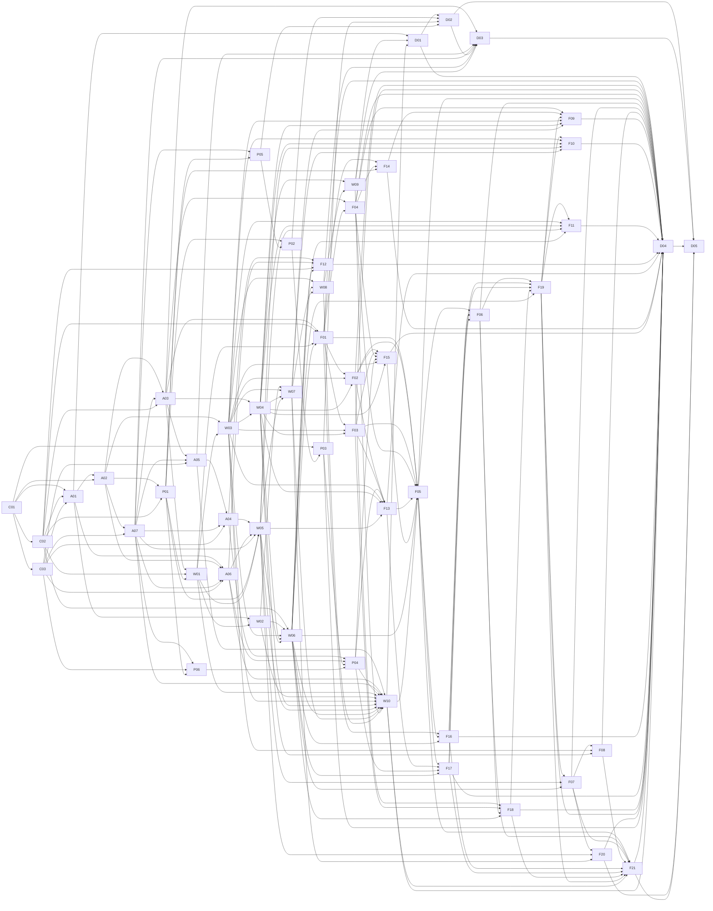

# Sasoo Rust 백엔드 구현 계획

> 상태: **계획 작성 완료, 제품 구현 실행 권한 없음**. 작성일 2026-11-14. 이 문서의 모든 구현/검증 체크박스는 미래 작업이다. 기존 2026-11-13 계획과 미커밋 구현을 보존하고 현재 파일을 다시 읽어 갱신했다. 기존 실행 보고서의 통과 수는 이번 검증으로 인용하지 않는다. `writing-plans`의 과제 분해 형식을 적용하되 자동 실행, 설치, commit/push 단계는 넣지 않는다.

**목표:** Electron과 React, 기존 HTTP/SSE/파일 계약과 사용자 자료를 유지하면서 Python API/분석 실행부를 같은 Rust 실행 파일의 서버/워커 모드로 단계적으로 이식한다.

**구조:** Rust 서버는 API, 접수, 작업 조율, 짧은 SQLite transaction을 맡는다. 별도 Rust worker process는 고정된 분석 단계 그래프를 실행한다. 기존 SQLite `analysis_runs`를 조율 큐로 보존하고 실행/요청/사용량/산출물 이력을 additive 테이블로 보완한다. PDF는 공통 adapter 뒤에서 Xberg의 고정 release를 우선 평가한다.

**기술 선택 제안:** Tokio, Axum, rusqlite, reqwest REST adapter, Serde, JSON Schema Draft 2020-12, Decimal, OS credential store, Xberg. `sasoo/backend-rust/`와 core `Cargo.lock`은 이미 존재하는 미커밋 기반 구현이다. 실제 연결 범위는 아래 현황표를 따르며, Xberg/provider/worker가 연결됐다는 뜻은 아니다.

**명세:** 계획 작성 메타프롬프트 (로컬 이력 자료: `../prompts/2026-11-13-sasoo-rust-backend-planning-metaprompt.md`). 이번 정적 조사 시점은 2026-11-14, 현재 HEAD는 `1440342a2ddcd7eaa674c6df7a6704b64ceded01`이다. 이 HEAD만을 깨끗한 기준선으로 간주하지 않는다.

## 1. 결론, 범위와 증거의 수준

이 구조로 이식을 추진할 수 있도록 아래에 52개 독립 과제를 정의한다. 여섯 묶음은 개발 범위의 분류이며 런타임의 직선 상태 기계가 아니다. PDF 품질과 target 배포 gate가 실패하면 기존 ODL/PyMuPDF/pdfplumber 경로를 유지한다. Xberg를 평가 후보로 정한 것은 운영 엔진 선정이나 교체 완료가 아니다.

| 구분 | 이번에 확인하거나 정한 내용 | 이번에 입증하지 않은 내용 |
| --- | --- | --- |
| 현재 확인된 사실 | 현재 소스/fixture/프런트 소비, Git HEAD/작업 상태, 실제 release workflow, 공식 고정 tag 문서 | 실제 HTTP 응답, 장애 재현, DB 호환 실행, 키 복호화, GUI 동작 |
| 설계 제안 | 같은 실행 파일 두 모드, 저장 권한 fencing, 불변 실행 설정, request/usage 원장, PDF 평가와 전환 절차 | Rust 컴파일/성능, 모델 품질, 설치본 성공 |
| 필요한 실측/결정 | PDF corpus의 원문 채점, OS별 native/model 배포, 동시성/예산 정책, 양방향 DB/키 호환 | 기존 테스트 통과 수의 재사용, 실제 공급사 동등성, 과학적 정확성 |

이번 작업에서는 제품 코드를 import하거나 실행하지 않았고 DB/키/라이브러리를 열지 않았다. 패키지 설치, 모델 다운로드/추론, migration, 유료 API, 서비스 시작/종료, commit/push도 수행하지 않았다. 소스와 문서의 정적 읽기 및 계획 문서 검사만 이번 증거다. 아래의 테스트 명령과 기대 결과는 **향후 구현 시 실행할 명령**이며 실행/통과 보고가 아니다.

기존 네 조사 문서(이식 검토 (로컬 이력 자료: `../../research/2026-11-13-sasoo-rust-migration-assessment.md`), 워커/PDF 제안 (로컬 이력 자료: `../../research/2026-11-13-rust-worker-pdf-design.md`), Rust PDF 조사 (로컬 이력 자료: `../../research/2026-11-13-pdf-engines-rust-native.md`), AI PDF 조사 (로컬 이력 자료: `../../research/2026-11-13-pdf-engines-recent-ai.md`))를 읽었다. 운영 연결 여부와 버전은 현재 소스/고정 upstream 소스로 다시 구분했다. 예를 들어 AGENTS.md의 CI Node 20 설명과 달리 실제 `.github/workflows/release.yml:105-124`는 pnpm `10.34.5`, Node `24`, Python `3.12`를 사용한다.

### 2026-11-14 현재 파일과 계획의 차이

이전 계획 (로컬 이력 자료: `2026-11-13-sasoo-rust-backend-implementation-plan.md`)과 실행 보고서 (로컬 이력 자료: `../../validation/rust-backend/execution.md`)는 과거 기록이다. 파일이 존재한다는 점과 현재 연결을 정적으로 확인했으며, 보고서의 테스트 통과 수/성능/실행 결과를 이번에 재검증하지 않았다. 모든 아래 과제는 기존 구현을 재사용하는 경우에도 **미래 gate 미통과**로 읽는다.

| 현재 소스 근거 | 현재 확인한 범위 | 이번 계획의 처리 |
| --- | --- | --- |
| `sasoo/backend-rust/src/main.rs:17-35`, `src/http/mod.rs:22-67` | worker는 Unsupported, server는 SASOO_RUST_ISOLATED_ROOT 필수, ApiState에는 DB/services가 없음. OpenAPI 경로 선언은 실제 handler 구현 증거가 아님 | A01 보완, A04-A06 factory/HTTP 연결, W02-W10 뒤 worker 연결, D01까지 production 선택 금지 |
| `sasoo/backend-rust/src/storage/db.rs:53-87`, `src/storage/migrations.rs:225-328` | bounded DB 기반/owner/backup/migration 함수 존재, synthetic 보호 범위 | A02/A07에서 재검증. 신규 설치 빈 DB 초기화는 A07의 명시 격리 factory와 D03의 승인 전환 factory로 구분 |
| `sasoo/backend-rust/src/storage/credentials.rs:49-62,186-228`, `src/http/settings.rs:25,75`, `src/http/papers.rs:234,320,329` | credential/settings/paper service 함수 존재, HTTP dispatch 미연결 | A03/A04/A05/A06의 새 router/422 계약 tests로 연결 입증 |
| `sasoo/backend-rust/src/pdf/mod.rs:13-36`, `src/pdf/types.rs:235`, `src/pdf/coordinates.rs:6` | 문서/좌표 모델과 legacy 응답 import 존재, extract_document는 Unsupported, helper process 미연결 | P01 보완 후 P05/P02/P03. 파일 존재만으로 실제 추출 완료라 하지 않음 |
| `sasoo/backend-rust/src/analysis/config.rs:31-69`, `src/runtime/accept.rs:35-80`, `src/storage/executions.rs:21-65` | 불변 snapshot/원자 접수 일부 존재, 공개 /run와 claim/spawn 없음 | W01 보완 후 W02-W10. 원자 접수 성공 != 분석 실행 성공 |
| `sasoo/contract-fixtures/rust-backend/inventory.json`, `http.json`, `sse.json` | source inventory/일부 합성 HTTP 관찰 자료, lifespan:not_run인 HTTP 기록과 별도 startup-isolation 기록. SSE는 gap | C01/C03에서 source hash/coverage를 재확인, 과거 합성 관찰과 이번 실행을 구분 |
| `sasoo/scripts/evaluate-pdf-engines.py:1,151-167`, `pdf/{corpus,annotations,rubric}.json` | stored evidence validator만 존재. corpus/원문 annotation 없음, threshold/budget 미정 | P03에 별도 measurement runner, 원문 독립 검수와 채택 판단을 분리 |
| `sasoo/contract-fixtures/rust-backend/dependency-resources.json` | core lock 존재, xberg_in_graph=false, engine_selection=retain_legacy, profile requirements_complete=false | P05에서 자원/빌드 입력을 고정한 뒤 P02 target probe. 선언 hash는 다운로드 실증 아님 |
| `sasoo/frontend/src/lib/pdfHighlight.ts:12,31`, 설치된 `sasoo/frontend/node_modules/pdfjs-dist/build/pdf.mjs:907` | 전자는 convertToViewportRectangle을 호출하고 후자에서는 convertToViewportPoint를 찾음. 현재 테스트는 rectangle method를 가진 fake를 사용 | P01 추가 호환 과제: 실제 설치 API/네 모서리 transform와 screenshot 비교. 정적 API 차이는 확인했으나 실제 GUI 장애는 이번에 관찰하지 않음 |
| `sasoo/electron/backend-process-launcher.ts:17-20,68-118`, `sasoo/scripts/build-backend.js`, `.github/workflows/release.yml:103-133` | launcher/build는 여전히 Python/PyInstaller/JRE 경로. actual Node=24, pnpm=10.34.5, Python=3.12 | 기존 선택 보존, D01-D05에서 명시 Rust 선택/별도 bundle을 검증 |

기존 graphify 그래프는 호출 관계 탐색에만 읽기 전용으로 사용하고 현재 원본 파일을 다시 읽었다. graph 갱신/LLM 추출/제품 import는 수행하지 않았다. 이번 작업의 source hash 보존 검사 대상은 backend/Rust/Electron/frontend/src/scripts/fixtures/workflows/연구/계획의 선택한 텍스트 파일이며, 실제 사용자 DB/키/ignored 파일 전체 backup을 만들었다는 뜻이 아니다.

### 과제 크기 재검토

기존 여섯 묶음과 43개 과제를 출발점으로 삼았다. C01에서 격리 runtime capture(C03), A02에서 owner/backup/migration(A07), A03에서 settings HTTP(A05), A04에서 파일 HTTP(A06), P02에서 dependency/resource 준비(P05), F07에서 HTML 실행 보고(F20), F19에서 최종 graph(F21), D04에서 설치본 acceptance(D05)를 분리하고 legacy helper 실제 process bridge(P06)를 추가해 총 52개로 만들었다. 각각 다른 실패 입력과 완료 증거를 가지므로 이웃 과제를 통과시키면서 하나만 보류할 수 있다. W03 원장, W04 admission, W05 publication은 서로 독립된 안전 경계이며 합치지 않는다. 각 과제의 두 테스트가 같은 구현을 반복 검사하면 합치고, 서비스 단위/실제 HTTP/실제 설치처럼 증거가 다른 경우에만 분리한다.

### 전체 제약

- Electron/React와 PDF.js, Mermaid, KaTeX, 생성 HTML iframe의 실행 환경을 유지한다. Tauri/native UI 전환은 범위 밖이다.
- SQLite 큐를 유지한다. 외부 queue service, 마이크로서비스, 여러 PDF 엔진의 자동 전환은 초기 구현에 넣지 않는다.
- 기존 미커밋 파일, DB/키/라이브러리, 성공/유료/부분 산출물은 보존한다. reset/stash/clean/광범위 덮어쓰기와 원본 자료 삭제를 하지 않는다.
- 전환기 Python PDF helper와 ODL의 Java는 허용하되 **중간 이식**이다. 최종 Python 제거는 모든 Python 실행 의존성 제거를 별도 확인한 뒤에만 선언한다. Rust 작성 여부와 native/model runtime 제거 여부도 별개다.
- 모델명/effort/prompt/schema/단가를 이식과 함께 최신화하지 않는다. 과거 provenance/cost가 없으면 unknown으로 남긴다.
- API 서버만 schema/defaults/조율 상태를 관리한다. worker는 migration하지 않는다. 한 live DB에는 한 schema/queue owner만 둔다.
- 2~3묶음은 실행 작업이 없는 격리 CRUD/업로드 milestone이다. 분석 자동 실행/재개, 실행 중 취소/삭제는 W10 이전에 연결하지 않는다. 이 milestone을 최종 동등성이라고 부르지 않는다.

### 검토에서 특히 고정할 다섯 경계

| 입력/사건 | 기대 동작 | 검증 소유 과제 |
| --- | --- | --- |
| 공급사 성공 직후 DB busy/프로세스 crash | 저장만 재시도하고 유료 요청을 다시 보내지 않음, 모르는 usage는 unknown | W03, W04, W08 |
| delete/cancel/lease 회수와 늦은 결과의 경합 | 결과/최신 포인터/완료 공개 거절, 늦은 비용은 보존, paper/폴더 자동 재생성 금지 | W05, W07, W08 |
| CJK/%/공백 파일명과 회전/CropBox/UserUnit | HMAC/파일 헤더/좌표 변환의 의미 보존 | C02, A04, P01, P03 |
| legacy NULL, 잠긴 keyring, 커스텀 library의 fallback | 자료가 없는 것처럼 초기화하지 않음, 새 키/새 출처/0원 생성 금지 | A02, A03, D03 |
| EOF, terminal incomplete, usage 부재와 부분 checkpoint | 각각 구분하고 완료/캐시로 승격하지 않음 | W06, F02, F03, F07, F09, F10 |

## 2. 현재 소스에서 확인한 계약과 의도한 개선

모든 `file:line`은 저장소 루트 기준이며 이 조사 시점의 위치다. 파일 이름이 제안처럼 보이더라도 아래 현재 근거에 든 파일만 현행 구현이다.

| 현재 근거 | 관찰된 의미 | 이식 방침 |
| --- | --- | --- |
| `sasoo/backend/api/analysis_routes.py:147-251` | paper → key → PDF 준비 → 중복 → 예산 → queue/reconcile 후 202. 실제 body는 `{paper_id,status:"started",message}` | 순서/오류/202 경계 보존. PDF 준비를 worker로 이전하는 변경은 별도 결정이며 기본 계획에 포함하지 않음 |
| `sasoo/backend/models/analysis_runs.py:38-94` | 원자 queue 중복 방어, `UPDATE ... RETURNING` claim, generation/attempt 증가 후 spawn | 보존하고 claim/spawn 사이 crash 처리를 보완 |
| `sasoo/backend/models/analysis_runs.py:105-128,212-250` | heartbeat/finalize는 generation 검사. stale requeue는 generation 증가 없음 | 회수 transaction에서 generation 폐기와 상태/attempt 검사 추가는 **개선** |
| `sasoo/backend/services/analysis_execution.py:466-504,4050-4054` | 일반 result INSERT, paper 완료 UPDATE에는 전체 fencing 없음 | 모든 공개 commit의 paper/attempt/generation/cancel 검사는 **개선** |
| `sasoo/backend/services/analysis_manifest_store.py:1-5,43-92` | 불변 version/input/event 저장 primitive는 실험용, 운영 pipeline 미연결 | 알고리즘 참고만 하고 W05/W06에서 운영 연결/검증하는 **개선** |
| `sasoo/backend/services/analysis_execution.py:3730-3732,3791-3795,3944` | 기본 provider만 초기 선택, 일부 설정은 실행 중 재조회 | 전체 설정 snapshot 고정은 **개선**. secret value는 제외 |
| `sasoo/backend/services/analysis_supervisor.py:319-365` | production quit는 running 재queue, generation 증가, 알려진 child 종료. dev reload/API crash와 다름 | 정상 종료 정책 보존, 재기동 후 이전 worker 식별/정리의 빈틈은 **개선** |
| `sasoo/backend/api/papers.py:481-518`, `models/database.py:640-653` | DB 삭제 뒤 파일 제거, 실제 worker 중단은 heartbeat 의존. 일부 경로 helper는 mkdir | tombstone/늦은 저장 금지는 **개선** |
| `sasoo/backend/services/concurrency.py:69-105` | cap은 process 내부 loop별 semaphore | 앱 전체 provider admission, chat 여유, PDF 메모리 제한은 **개선** |
| `sasoo/backend/services/llm/openai_client.py:222-246,347-390` | incomplete/EOF/usage 부재를 NULL과 상태로 보존 | 요청/terminal/usage 의미 보존 |
| `sasoo/backend/services/llm/gemini_client.py:203-207,349-360` | 일부 usage 부재와 EOF를 0/done으로 합성 | unknown 보존으로 바꾸는 부분은 **안전 개선**이며 wire/저장 차이를 명시 |
| `sasoo/backend/main.py:88-106,157-174,276-277` | Python startup/import에도 경로 생성, defaults/migration/reconciler 쓰기가 있음 | 비교 서버도 실제 자료에서 실행 금지, 격리 fixture 환경에서만 향후 실행 |

### API 전체 목록과 기능 추적표

이번에 제품 모듈을 import하지 않고 Python AST로 다시 집계한 정적 선언은 39 operations/33 paths이며 OpenAPI fixture는 38 operations/32 paths다. inventory의 method/path 집합과 대칭차는 0, inventory가 기록한 5개 route source의 SHA-256은 현재 파일과 일치했다. 저장된 HTTP 사례는 23개이며 operation의 capture_status는 partial 5개/gap 34개다. 이 숫자는 정적 읽기/저장 자료 집계다. 차이는 `include_in_schema=False`인 static 경로다. 이것은 정적 집계이며 서버 실행 결과가 아니다. FastAPI 자동 `/docs`, `/redoc`, `/openapi.json`, OPTIONS/HEAD, trailing slash redirect는 C01의 별도 관찰 항목이다. 각 행의 모든 method/path가 계약 fixture에 들어가야 한다.

| ID/기능과 전체 route | 현재 근거 | 소비/기존 회귀 근거 | 구현/미래 테스트/완료 기준 |
| --- | --- | --- | --- |
| H1 `GET /`, `GET /health`, `POST /shutdown` | `sasoo/backend/main.py:298,308,352` | `electron/python-manager.ts:194`, `backend/api/test_hmac_vector_contract.py`, Electron health/quit tests | A01,D01 / `http_shell`, `shutdown` / proof, token, 상태/오류/body 일치 |
| H2 `GET /static/library/{requested_path:path}` | `backend/main.py:321` | `frontend/src/lib/api.ts:516`, `backend/api/test_security_boundaries.py` | A06 / `files_contract`,`files_http_contract` / DB paper 범위, traversal/symlink, HMAC/Range/Unicode |
| P1 `POST /api/papers/upload` | `backend/api/papers.py:182` | `frontend/src/lib/api.ts:597-649`, `backend/api/test_papers_efficiency.py`, `services/test_naming_service.py` | P04,F15,F13 / `upload_contract` / PDF 검증, metadata/domain/name/readiness/provider stub |
| P2 `GET /api/papers`, `GET /api/papers/{paper_id}` | `backend/api/papers.py:297,377` | `api.ts:651-672`, `hooks/usePapers.ts`, `backend/api/test_papers_params.py` | A04,P04 / `papers_contract` / 제목/저자/태그/notes 검색, sort/page/completed_count, refresh 의미 |
| P3 `GET /api/papers/{paper_id}/pdf` | `backend/api/papers.py:392` | `components/PdfViewer.tsx`, `backend/api/test_security_boundaries.py` | A06,P01 / `files_contract` / PDF bytes/MIME/filename/Range/좌표 연결 |
| P4 `PATCH /api/papers/{paper_id}`, `DELETE /api/papers/{paper_id}` | `backend/api/papers.py:434,481` | `api.ts:677-694`, `backend/api/test_papers_params.py`, `api/test_discussion.py` | A04(유휴),W07,W10 / `papers_contract`,`cancel_delete` / null 무시, domain-agent, 늦은 저장 차단 |
| A1 `POST /api/analysis/{paper_id}/run`, `POST .../cancel`, `GET .../status`, `GET .../results` | `backend/api/analysis_routes.py:147,254,292,422` | `api.ts:697-720`, `hooks/useAnalysis.ts:325-377`, `api/test_analysis_routes.py`, `models/test_analysis_runs.py` | W01-W10 / `run_contract` / 202/409/402, 상태 mapping, latest 실패/부분 보존 |
| A2 `GET .../figures`, `GET .../tables` | `analysis_routes.py:462,496` | `api.ts:727-733`, `FigureGallery`,`TableGallery`, `services/test_artifact_refresh_contract.py` | P01,P04,W05 / `artifact_contract` / ID/설명/원본/bbox/부분 실패 보존 |
| A3 `GET .../recipe` | `analysis_routes.py:529` | `api.ts:798-800`, `RecipeCard.tsx`, `services/test_evidence_verifier.py` | F06,F16 / `recipe_contract`,`citation_contract` / absent evidence=NULL, 원본 blob 보존, 재현 확인과 과학 검증 구분 |
| V1 `GET .../mermaid`, `POST .../mermaid/repair`, `GET .../visualizations`, `POST .../visualizations/{viz_id}/regenerate`, `POST .../visualizations/{viz_id}/html-check` | `analysis_routes.py:564,755,626,826,949` | `api.ts:810-857`, `VisualizationGallery`,`MermaidRenderer`, `api/test_visualization_runs.py` | F07,F20,F21 / `visualizations_contract`,`html_check_contract` / run token/ID/hash, stale 409, partial retry/실행 검증 구분 |
| S1 `GET .../synthesis`, `POST .../synthesis` | `analysis_routes.py:991,1004` | `api.ts:859-880`, `components/synthesis`, `services/test_synthesis.py` | F19,F21 / `synthesis_contract` / native PDF chain/cache restart, 조회 404/생성 저장 구분 |
| R1 `GET .../report` | `analysis_routes.py:1064`, `api/report_service.py:15` | `api.ts:701-702`, `lib/reportExport.tsx`, `api/test_report_bytes_contract.py` | F12 / `report_bytes` / 정확한 UTF-8, unknown와 subtotal, legacy/partial |
| E1 `POST .../figures/{figure_id}/explain`, `POST .../figures/{figure_id}/explain/stream` | `analysis_routes.py:1094,1104`, `api/figure_service.py:412-694` | `api.ts:741-793`, `api/test_figure_stream.py`, `lib/api.figureStream.test.ts` | F10 / `figure_explain` / REST/SSE 공유 job, reader 종료 후 수명, terminal/usage/ID |
| I1 `POST .../paperbanana` | `analysis_routes.py:1113`, `services/viz/figure_gen.py` | 직접 frontend wrapper 미발견. `services/test_figure_gen.py`,`test_pricing_images.py` | F08 / `images_contract` / 기존 공개 route, 이미지/비용/고유 파일 유지 |
| X1 `POST .../experiment-plan`, `GET .../experiment-plan` | `analysis_routes.py:1176,1302` | `api.ts:882-910`, `api/test_analysis_routes.py`, `services/test_instruction_contract.py` | F11 / `experiment_plan` / 연구 맥락/출처/비용/저장/실패 |
| C1 `POST .../chat`, `GET .../discussion`, `POST .../discussion/reset`, `DELETE .../discussion` | `analysis_routes.py:1369,1671,1701,1707` | `api.ts:1039-1105`, `ChatPanel`, `api/test_chat_reading_context.py`,`api/test_discussion.py` | F09 / `chat_discussion` / selection/context, persist true/false, reset/interrupted |
| T1 `GET /api/settings`, `PUT /api/settings`, `GET /api/settings/cost` | `backend/api/settings.py:281,327,428` | `api.ts:389-473,1111-1125`, `components/settings`, `api/test_settings.py`,`test_settings_storage_guard_refactor.py` | A03,A05,W03-W04,F01 / `settings_contract`,`pricing_contract` / mask/clear/profile/path/month/unknown |
| G1 `GET /api/agents`, `GET /api/agents/{name}` | `backend/api/agents.py:30,37`, `services/agents/md_loader.py` | `frontend/src/lib/agents.ts`, `api/test_agents.py`, `services/test_selection_context.py` | F04 / `agents_contract` / bundled+override, raw_md/name/enabled/404. HTTP agent CRUD는 새 기능으로 추가하지 않음 |

위 표의 `...`는 같은 `/api/analysis/{paper_id}` prefix다. `backend/`, `frontend/`, `electron/`, `api.ts`의 축약 경로는 각각 `sasoo/backend/`, `sasoo/frontend/`, `sasoo/electron/`, `sasoo/frontend/src/lib/api.ts` 기준이다. 검색 SQL의 네 대상은 `title,authors,tags,notes`다(`sasoo/backend/api/papers.py:320-323`).

### HTTP/SSE/파일에서 schema만으로 잡히지 않는 계약

1. CORS 허용 origin은 `localhost/127.0.0.1`의 3000/5173/8080, `app://.`, `null`이다. production token 미설정은 503, invalid bearer는 401이며 현재 401에는 CORS 헤더가 없다(`main.py:198-270`, `api/test_openapi_contract_snapshot.py:23-34`). OPTIONS/health 면제와 인증 middleware 순서를 보존한다.
2. health는 `HMAC-SHA256(token,"sasoo-health-v1")`, asset은 `HMAC-SHA256(token,"sasoo-asset-v1:"+decoded_path)`의 hex다. asset query token은 static/PDF 경로만 인증한다. URL decoding/Unicode/%/경로 구분자/중첩 경로를 동일 vector로 고정한다.
3. static은 DB에 있는 paper folder 아래만, resolve 후 root 밖 symlink는 거절한다. PDF는 `application/pdf`, ASCII fallback `filename`과 RFC 5987 UTF-8 `filename*`를 유지한다(`papers.py:392-431`). 저장된 합성 HTTP fixture에는 Range/If-Range/206/416/HEAD/ETag 사례가 있다. 이번에는 fixture의 기록과 현재 소스를 읽었으며 실제 HTTP를 재실행하지 않았다. A06은 원본 캡처와 격리 재캡처를 비교하고, 설치본 파일 제공 성공을 별도 확인한다.
4. Pydantic Optional 응답의 explicit null, `PATCH`/settings `exclude_none=True`의 null 무시, 빈 문자열/키 clear/`...` mask 무시를 구분한다. `analysis_focus`의 입력 객체와 응답 JSON 문자열을 임의 통일하지 않는다. 400/401/402/403/404/409/422/503의 detail 모양, validation 배열, default/enum/extra-field/204/redirect는 HTTP fixture로 고정한다.
5. `GET /mermaid`는 유료 생성을 수행할 수 있고 detail/figures/tables는 refresh 예약, discussion 조회도 reset append 가능성이 있다. GET을 모두 읽기 전용이라고 취급하지 않는다. method 변경은 별도 공개 계약 결정이다. 중복 GET 요청은 F07의 request identity로 다루되 원격 exactly-once는 주장하지 않는다.
6. chat SSE는 meta/token/done/error이며 done 전 EOF는 실패다. UTF-8 chunk 분할, 마지막 newline 부재, CRLF, malformed/duplicate terminal, unknown event를 명시한다(`api.ts:1000-1030`). HTTP 200과 EOF는 성공 근거가 아니다. chat disconnect의 interrupted 저장과 figure reader disconnect 후 shared job 생존은 서로 다른 정책이다.
7. `status`는 저장 산출물 검증 후 worker 진행상태를 overlay한다. non-completed progress는 최대 99, UI는 기존 running/analyzing/completed/error/cancelled와 resource version을 사용한다. 새 내부 상태를 legacy enum 칼럼이나 프런트에 그대로 넣지 않는다.

## 3. 런타임 상태, 식별자와 저장 권한

### 식별자/상태의 제안

`PaperId=i64`는 기존 논문 ID다. `ExecutionId=UUID`는 사용자 접수 한 번, `AttemptId=UUID`는 worker 시도 한 번, `Generation=i64`는 분석 저장 권한을 무효화하는 단조 증가 token이다. `PaperEpoch=i64`는 재분석/원본 교체/삭제로 논문 입력이 바뀌었음을 표시하는 별도 version이다. 실행 재시도는 같은 execution의 새 attempt이고 사용자 재분석은 새 execution이다. UUID와 generation을 서로 대체하지 않는다. 기존 `analysis_runs.paper_id`는 현재 조율 row로 유지하며 감사 이력이 아니다.

내부 상태는 `Queued, Claimed, Running, Cancelling, RecoveryPending, NeedsReconciliation, PausedForQuit, Completed, Error, Cancelled, Deleted`다. `Staging`/`Published`는 stage artifact 상태이며 job 상태와 별개다. `RequestOutcome={NotDispatched,InFlight,Completed,Incomplete,Failed,OutcomeUnknown}`와 `UsageState={Known,Unknown,Conflicting}`도 직교한다. 예를 들어 completed 응답에 usage가 없을 수 있으며 이를 성공 비용 0으로 바꾸지 않는다.

`analysis_runs`에는 구버전이 이해하는 status만 쓰고 새 execution/attempt 테이블에 내부 상태를 둔다. 세부 mapping은 `http/dto.rs::legacy_status()` 한곳에 둔다. `NeedsReconciliation`은 기존 error와 actionable reason으로 표시하며 자동 유료 재시도 대상으로 삼지 않는다. queued/claimed/recovery의 대기 상태는 기존 running 표시와 progress<100으로 매핑하되 영구 복구 대기를 숨기지 않는다.

### 정상 경로

| 전이 | guard/원자 경계 | DB/파일/usage 효과 | 기존 UI/재시도 |
| --- | --- | --- | --- |
| 미접수/terminal → preflight | paper/key/PDF 준비/중복/예산의 현재 순서 | 아직 새 실행 없음. PDF 준비의 기존 파일 효과는 attempt staging으로 보호 | 실패는 202 전 해당 HTTP 오류. 기존 성공 결과 보존 |
| preflight → Queued | 마지막 중복/논문/취소/설정 revision 검사를 짧은 tx에서 재확인 | paper analyzing+queue+execution snapshot 원자 저장 | 202 started. spawn/분석 완료를 뜻하지 않음 |
| Queued → Claimed | 원자 claim, cap/backoff/취소/논문/예산 조건 | generation 증가, attempt/lease/spawn intent 저장 후 tx 종료 | running. HTTP/PDF 중 write tx 없음 |
| Claimed → Running | spawn 성공과 attempt identity handshake | birth identity/pid/heartbeat 기록. PID 기록 실패만으로 재spawn 금지 | running. process 시작과 건강/완료는 별개 |
| Running → stage Staging | 입력/PDF/config/plan version 고정 | attempt 전용 파일, hash/manifest/response spool. 최신 파일 덮어쓰기 없음 | 부분 진행. 아직 checkpoint 아님 |
| Staging → Published checkpoint | schema/필수 파일/계획 ID/결과 ID/전체 입력 검사 후 같은 FS rename, 짧은 tx의 fence | immutable version+최신 pointer+stage event를 함께 commit | 유효 부분 결과 읽기. provider 재호출 없이 저장 retry 가능 |
| Running → Completed | 모든 필수 stage가 검증되고 completion 정책 충족, 마지막 공개 fence | 결과 포인터/완료 상태/manifest를 같은 tx에서 갱신 | completed/100. 구조적 완료이며 과학적 정확성 보장은 아님 |

### 중간 사건: 취소/삭제/종료/재설정

| 사건/전이 | 허용 시점과 guard | DB/파일/usage 효과 | UI/재개 |
| --- | --- | --- | --- |
| queued cancel → Cancelled | claim과 경쟁하는 CAS에서 cancel 승리 | generation 폐기, run/paper 상태 동시 변경, 신규 request 없음 | 현행 cancelled. 사용자 /run만 새 execution |
| claimed/running cancel → Cancelling → Cancelled | request admission 및 publication 직전에도 flag 확인 | 신규 유료 요청/공개 차단. 진행 중 remote/blocking은 별도 추적하고 늦은 usage 보존 | 현행 cancelling 응답. 실제 중단 관측 전 종료를 단정하지 않음 |
| 임의 존재 paper delete → tombstone → Deleted | UI DELETE 권한, fence tx 먼저 | tombstone+generation 폐기 후 read 404, queue seed 금지. 파일 정리는 durable intent 뒤 수행. request/usage는 FK cascade 대상 아님 | 늦은 pointer/file 재생성 불가. cleanup 실패는 기록하고 임의 재분석하지 않음 |
| 정상 production quit → PausedForQuit → Queued | 서버 quiescing을 먼저 durable 기록 | 새 admission 차단, generation 폐기, checkpoint/response spool 보존, worker 종료 확인. 정상 quit가 실패 attempt 예산을 소비하지 않도록 보정 | 다음 시작 known-safe checkpoint만 재개 |
| dev reload → Running 유지 | reload 원인과 기존 worker identity/lease 확인 | schema owner만 교체, fresh worker 중복 spawn 금지 | 현재 정책 보존. 실제 dev launcher에는 `--reload` 없음 |
| API crash 후 새 서버 → 기존 Running 채택 | 새 server owner lock, 기존 worker birth identity/lease/control handshake 확인 | worker별 secret 아닌 제어 capability 재연결. API token 새 발급과 worker 권한을 구분 | fresh worker를 살려 중복 유료 요청 금지 |
| 설정/agent/profile/key 회전 | 실행 중 언제든 설정 UI 변경 가능 | 현재 execution snapshot은 불변. secret은 SecretRef로 읽고 요청 전 key epoch/가용성 검사. 새 키를 snapshot/log에 복사하지 않음 | 새 실행부터 새 설정. 키 폐기 후 신규 요청은 명시 오류 |
| chat/figure reader disconnect | stream 소비 중 | chat은 interrupted 맥락 제외, figure는 shared job 유지. request lifetime/permit은 실제 producer 종료까지 | reconnect/조회 정책은 각각 F09/F10 fixture로 유지 |

### 장애와 복구

| 사건/전이 | 판단 조건 | DB/파일/usage 효과 | retry/중단 조건 |
| --- | --- | --- | --- |
| claim 후 spawn 실패 → Queued/Error | spawn 결과가 실패로 확정, request 미발송 | 해당 attempt 실패 기록, claim 폐기, backoff/상한 적용 | non-dispatched만 안전 재시도. spawn 성공 후 PID 저장 실패와 구별 |
| spawn 후 handshake 전 API crash | process 존재/birth identity/attempt handshake를 대조 | 기존 spawn intent 채택 또는 폐기, duplicate 방지 | PID만으로 kill/reclaim 금지. 확인 불가면 RecoveryPending |
| worker crash/lease 만료 → RecoveryPending | lease는 사망 증거가 아님 | 회수 tx에서 generation 폐기. 이전 heartbeat/commit이 running을 되살리지 못함 | durable request의 dispatch/terminal/spool을 먼저 조정 |
| RecoveryPending → Queued | 미발송 확정 또는 검증된 checkpoint/응답으로 잔여 실행 가능 | 새 attempt, 저장 재시도/안전한 미실행 stage만 계획 | 이미 발송된 불명 요청을 새 provider 호출로 바꾸지 않음 |
| RecoveryPending → NeedsReconciliation | 발송됐을 수 있으나 terminal/응답 불명 | outcome_unknown, usage unknown, 예약 비용/permit 보수적 유지 | provider 조회 기능이 실제 지원/식별되면 조회. 아니면 사용자 판단 전 재과금 금지 |
| 공급사 성공 후 DB 저장 실패 | 응답/usage spool 존재 | 불변 response 파일+request ID로 로컬 idempotent append | 저장만 재시도, provider 호출 수 증가 0 |
| 응답 EOF/incomplete/usage 부재 | terminal, content, usage를 개별 검사 | incomplete/unknown usage/remote unknown을 별도 보존 | EOF를 done 또는 0으로 합성하지 않음. 부분 결과 읽기와 완료 승격 분리 |
| 파일 쓰기/rename/DB commit 중 crash | artifact hash/manifest와 DB 참조 비교 | old pointer 유지 또는 검증된 새 version만 노출. 미참조 성공/유료 파일은 보존 | pointer-only 복구. 원격 재호출/자동 삭제 없음 |
| heartbeat DB lock/절전/시계 변화 | bounded busy retry, monotonic 경과와 wall clock/boot identity 대조 | clock jump만으로 worker 사망 확정 금지, lease 회수는 fence 폐기부터 | 안전 시간 안 갱신 불가하면 새 admission/공개 중단. timeout은 실측 후 고정 |
| 예산 경합/비용 조회 실패 | 앱 전체 예약+known 비용+unknown exposure를 함께 검사 | 신규 요청 승인은 원자 처리. unknown을 0으로 합산하지 않음 | 조회 실패에도 drain을 계속하는 현행과 달라지는 정책을 W04에서 명시 |
| 디스크 full/커스텀 경로 offline/권한 오류 | staging/fsync/rename/read 검증 실패 | 최신 성공 파일/DB pointer 보존, 오류 상세 기록 | 다른 경로에 조용히 새 라이브러리를 만들지 않음 |

### 여섯 수명 항목의 충분성 검토

| 기존 항목 | 단독으로 빠지는 경계 | 보완 과제 |
| --- | --- | --- |
| 접수 | 202 전 PDF 실패, 최종 중복 검사, 설정 고정, budget reservation | C01,W01,W04 |
| claim | claim commit와 spawn/handshake/PID 기록 사이 crash | W02,W08 |
| 실행 | remote dispatch 불명, usage 미확인, 앱 전체 cap, 조건부 stage 병렬화 | W03,W04,F02-F06 |
| 공개 | 파일/SQLite 공통 tx 부재, analysis/operation/import별 fence, 부분 입력/계획 ID/완료 검증 | W05,W06 |
| 취소 | queued 경합, 삭제 tombstone, remote/blocking lifetime, permit 반환 | W03,W04,W07,W09 |
| 복구 | 정상 quit/API crash/dev reload 차이, orphan adoption, clock/DB lock, rollback 이후 자료 | W08,W09,D03 |

여섯 이름은 수명 관리의 상위 분류로는 유용하지만 위 경계의 독립 구현/검증을 대신하지 못한다. 따라서 아래 개발 과제를 52개로 나누며 과제 수 자체를 완료 기준으로 삼지 않는다.

## 4. Rust 파일 책임과 인터페이스

### 제안 디렉터리

아래는 **목표 파일 배치**다. 존재하는 파일은 검토/보완하며 새로 덮어 생성하지 않는다. 과제별 경로 상태와 아래 현황표가 현재 구현과 미래 구현을 구분한다. `R/`는 정확히 `sasoo/backend-rust/`를 뜻하고, 이후 `R/src/...`, `R/tests/...`는 이 prefix를 확장한 경로다. 하나의 crate와 하나의 `sasoo-backend` binary로 시작하며 별도 workspace service를 만들지 않는다.

```text
sasoo/backend-rust/
  Cargo.toml, Cargo.lock, rust-toolchain.toml
  src/main.rs, lib.rs, cli.rs, error.rs, types.rs
  src/http/{mod,auth,dto,files,papers,settings,agents,analysis,chat,figures,viz,experiment,report}.rs
  src/storage/{mod,db,paths,legacy,credentials,migrations,settings,executions,requests,artifacts}.rs
  migrations/0001_runtime.sql
  src/pdf/{mod,types,coordinates,resources,xberg,legacy_helper,provider_vision,artifacts,import}.rs
  src/runtime/{mod,accept,supervisor,worker,identity,ledger,admission,publish,checkpoint,cancel,reconcile,shutdown}.rs
  src/analysis/{mod,config,cache,prompts,schemas,pricing,agents,selection,metadata,discussion,graph,screening,citation,visual,recipe,deep_dive,synthesis,completion,experiment,report}.rs
  src/providers/{mod,types,openai,gemini,files,sse}.rs
  src/viz/{mod,plan,mermaid,html,html_check,images}.rs
  tests/*.rs, tests/support/{mod,fixture,clock,barrier,process,provider}.rs
  tests/fixtures/{contracts,legacy,provider,pdf}/
  examples/pdf_probe.rs
```

`storage`는 SQLite row/short transaction만, `runtime`은 소유권/요청/공개 수명만, `analysis`는 현재 분석 규칙만 맡는다. provider는 HTTP wire를, PDF는 원문 의미와 좌표를 맡는다. http handler가 임의 SQL/파일 공개/공급사 재시도를 하지 않도록 공개 함수만 호출한다. worker는 공개 loopback API를 통해 유료 요청을 대행시키지 않고 같은 DB의 앱 전체 admission을 사용한다.

### 공통 타입/함수 계약

아래는 구현 signature의 기준이다. `Result<T>`는 `Result<T,SasooError>`, `Json`은 `serde_json::Value`, `UtcMillis=i64`, `Hash256=[u8;32]`, `LocalRequestId=UUID`, `VersionId=UUID`다. UUID ID는 `types.rs`의 서로 다른 newtype으로 정의한다. `Db`는 clone 가능한 handle이며 sync rusqlite 작업은 제한된 DB 실행 thread에서 수행한다. `Clock`/`ProcessSpawner`/`Transport`는 테스트용 주입 경계이며 production factory는 각각 하나만 둔다.

| 소유 모듈 | 정확한 계약과 책임 |
| --- | --- |
| `types.rs`,`error.rs` (A01) | `CommitScope { paper_id:PaperId, execution_id:ExecutionId, attempt_id:AttemptId, generation:Generation }`; `PublicationScope={Analysis(CommitScope),Operation(OperationScope),Import(ImportScope)}`; `RunOutcome{disposition:RunDisposition,checkpoints:Vec<VersionId>}`와 `RunDisposition={Completed,Partial,Cancelled,RecoveryRequired,Error}`; `SasooError={NotFound,InvalidInput,Unauthorized,Forbidden,Conflict,BudgetBlocked,CredentialUnavailable,StorageBusy,Io,FenceLost,Incomplete,OutcomeUnknown,Unsupported,Internal}`. 외부 status/detail 매핑은 DTO별 fixture로 고정하고 내부 enum을 직접 JSON으로 노출하지 않음 |
| `cli.rs` (A01) | `parse_cli(args: &[OsString]) -> Result<Mode>`; `Mode::Server{host,port}`, `Mode::Worker{paper_id:PaperId,generation:Generation,attempt_id:Option<AttemptId>}`. 서버의 기존 `--host/--port`, 워커의 기존 `--analyze-paper/--run-generation`을 호환 입력으로 지원. `--attempt-id`는 새 내부 argv이며 키는 넣지 않음 |
| `storage/paths.rs`,`db.rs` (A02) | `resolve_paths(env:&RuntimeEnv, platform:Platform, mode:ModeKind)->Result<RuntimePaths>`; `open_db(paths:&RuntimePaths, access:DbAccess)->Result<Db>`; `DbAccess={ServerOwner,Worker,ReadOnly}`. 개발 기본 경로도 기존 `sasoo/backend/library`와 같게 고정 |
| `storage/credentials.rs` (A03) | `read_secret(provider:ProviderId)->Result<Option<SecretString>>`; `apply_secret_update(update:SecretUpdate, expected_epoch:KeyEpoch)->Result<KeyEpoch>`. Missing/Unavailable/Invalid/Unreadable은 내부 구분. `SecretRef {provider,epoch}`만 설정 snapshot에 포함 |
| `pdf/types.rs` (P01) | `DocumentArtifact { source_sha256, engine:EngineIdentity, pages:Vec<Page>, blocks:Vec<Block>, assets:Vec<AssetRef>, warnings:Vec<ExtractionWarning> }`; `Page {page_index0,page_number1,media_box,crop_box,rotation_deg,user_unit,source_space}`. `Block`는 text/heading/equation/table/figure와 native ID/read-order/provenance/nullable bbox를 보존. table cell은 row/column/rowspan/colspan/nullable bbox를 가짐 |
| `pdf/mod.rs`,`coordinates.rs` (P01-P02) | `extract_document(input:&PdfInput, options:&PdfOptions, cancel:&CancellationToken)->Result<DocumentArtifact>`; `to_pdf_user_space(bbox:EngineBox,page:&PageGeometry)->Result<Option<PdfUserBox>>`. `PdfUserBox`는 unrotated PDF default user space의 좌하단 원점이다. UserUnit=1일 때 좌표 1은 1/72 inch이며 UserUnit이 다르면 물리 point와 raw user-space 좌표를 구분한다. PDF.js에는 legacy 계약의 raw user-space 좌표를 전달하고 물리 point는 별도 값으로 보존 |
| `analysis/config.rs` (W01,F04) | `ConfigInput { schema_version, provider_roles, models, efforts, prompt_schema_hashes, raw_agent_hash, frozen_agent_catalog, agent_selection_policy_version, profile, focus, pdf_identity, limits, cache_version, secret_refs }`; 기존 `ConfigSnapshot`은 private ConfigInput/bytes/hash를 감싸고 `snapshot()/canonical_bytes()/sha256()`으로만 읽음; `resolve_config(input:&ConfigInput)->Result<ConfigSnapshot>`. full PDF hash와 설정 JSON 바이트/hash는 immutable, secret plaintext 제외 |
| `runtime/accept.rs` (W01) | `accept_run(db:&Db, input:AcceptInput)->Result<AcceptedRun>`; input은 paper/PDF 준비 receipt/config/설정 revision, output은 execution ID와 기존 202 DTO에 필요한 paper ID. 최종 중복 재확인과 paper+queue 저장을 같은 tx에서 수행 |
| `runtime/supervisor.rs`,`identity.rs` (W02) | `claim_next(db:&Db, now:UtcMillis, policy:&QueuePolicy)->Result<Option<Lease>>`; `spawn_claim(lease:&Lease, spawner:&dyn ProcessSpawner)->Result<WorkerIdentity>`; `Lease {scope:CommitScope,deadline:UtcMillis,claim:ClaimIdentity,worker:Option<WorkerIdentity>}`. ClaimIdentity는 spawn 전 attempt/nonce/boot ID, WorkerIdentity는 spawn 뒤 PID/birth metadata/handshake를 추가한 값 |
| `runtime/ledger.rs` (W03) | `prepare_request(scope:&RequestScope,spec:NewRequestSpec)->Result<PreparedRequest>`; `mark_dispatched(id:LocalRequestId)->Result<()>`; `append_outcome(id:LocalRequestId,outcome:&ProviderOutcome)->Result<()>`; `replay_spool(path:&Path)->Result<ReplayReceipt>`. `PreparedRequest{spec:RequestSpec}`는 W03가 발급한 ID가 포함된 값이고 `NewRequestSpec`에는 id가 없다. `RequestScope={Analysis(CommitScope),Operation(OperationScope),Import(ImportScope)}`다. 삭제돼도 ledger 식별자 유지 |
| `runtime/admission.rs` (W04) | `acquire_request(id:LocalRequestId,class:RequestClass,reservation:&BudgetReservation)->Result<RequestPermit>`; `release_request(permit:RequestPermit,settled:&RequestSettlement)->Result<()>`. worker별 semaphore가 아니라 공유 DB transaction으로 앱 전체 cap/예산 승인. permit은 unknown remote가 끝났다고 추정해 반환하지 않음 |
| `runtime/publish.rs` (W05) | `stage_artifact(scope:&PublicationScope,bytes:&[u8],spec:&ArtifactSpec)->Result<StagedArtifact>`; `publish_validated(scope:&PublicationScope,artifact:ValidatedArtifact)->Result<VersionId>`. Analysis는 current execution/attempt/generation/running, Operation은 paper epoch/operation active/expected versions, Import는 root revision/source/import active를 검사. 모두 취소/quiescing와 삭제 방어를 수행 |
| `analysis/completion.rs`,`runtime/checkpoint.rs` (W06) | `validate_stage(input:&StageValidationInput)->StageVerdict`; `load_checkpoint(scope:&CommitScope,key:&CheckpointKey)->Result<Option<ValidatedCheckpoint>>`; verdict는 Valid/Partial/SkippedWithReason/Invalid이며 과학적 검증 상태와 별개 |
| `runtime/cancel.rs` (W07) | `cancel_run(paper:PaperId)->Result<CancelReply>`; `tombstone_paper(paper:PaperId)->Result<DeleteReceipt>`; `drain_delete(receipt:&DeleteReceipt)->Result<CleanupReport>`. DELETE 감사/usage 원장을 cascade하지 않음 |
| `runtime/reconcile.rs`,`shutdown.rs` (W08-W09) | `reconcile_once(db:&Db,clock:&dyn Clock,registry:&WorkerRegistry)->Result<ReconcileReport>`; `quiesce(reason:ShutdownReason)->Result<ShutdownReceipt>`; reason은 ProductionQuit/DevReload/Recovery. crash는 실행 가능한 shutdown callback이 아님 |
| `providers/types.rs` (W03,F02-F03) | `NewRequestSpec {provider,model,input,instructions,schema,effort,previous_id,store,max_output_tokens,service_tier,source_identity}`; `RequestSpec`은 같은 필드에 W03 발급 `id`를 추가; `ProviderOutcome {remote_id,terminal,content,usage:UsageState,raw_response,received_at}`; `ProviderEvent={Token,Terminal,TransportError}`. `generate(spec:&RequestSpec,transport:&dyn Transport)->Result<ProviderOutcome>`와 `stream(spec:&RequestSpec,transport:&dyn Transport)->ProviderStream`은 각 provider 모듈 함수 |
| `analysis/graph.rs` (W06,F05-F06) | `run_graph(ctx:&RunContext,deps:&PipelineDeps)->Result<RunOutcome>`; `RunContext {scope,snapshot,document,cancel}`; `PipelineDeps`는 ledger/admission/publisher/각 phase 실행기를 가짐. phase executor는 `run_phase(phase:Phase,ctx:&RunContext,input:&StageInput)->Result<StageOutput>`의 동일 경계 |
| `http/dto.rs` (A01-W10) | 기존 JSON별 DTO를 C01 fixture에서 정의. `/run` StartedReply, status AnalysisStatus, figure/chat/viz DTO는 서로 다름. `legacy_status(state:&RunState,verdict:&StageVerdict)->LegacyStatus`를 UI mapping의 단일 소유자로 둠 |

공개 권한 타입은 A01 `types.rs`가 먼저 소유한다. `OperationScope {paper_id:PaperId,operation_id:UUID,paper_epoch:PaperEpoch,source_sha256:Option<Hash256>,expected_versions:Vec<ResourceVersion>,kind:OperationKind}`와 `ImportScope {import_id:UUID,source_sha256:Hash256,library_revision:i64}`를 정의한다. `ResourceVersion {resource_key:String,version_token:String}`은 실제 legacy row ID/해시 또는 새 version ID를 담는 불투명 비교 token이고 출처를 새로 발명하는 값이 아니다. OperationKind는 Extraction/Metadata/Chat/FigureExplain/Visualization/HtmlCheck/ExperimentPlan/Synthesis다.

W05가 `begin_operation(paper:PaperId,kind:OperationKind,expected:&[ResourceVersion])->Result<OperationScope>`와 `validate_staged`를 구현한다. `StageValidationInput`, `StagedArtifact`, `ValidatedArtifact`와 `ArtifactValidator` trait의 정의도 W05가 소유하고 W06은 그 trait에 실제 완료 검증기를 연결한다. `ArtifactValidator::validate(&self,input:&StageValidationInput)->StageVerdict`와 `validate_staged(staged:StagedArtifact,input:&StageValidationInput,validator:&dyn ArtifactValidator)->Result<ValidatedArtifact>`를 고정한다. StageVerdict enum은 C02 fixture를 근거로 A01 types.rs가 먼저 정의하고 W06은 판정 구현만 소유한다. W05의 synthetic validator로 독립 테스트하므로 W05→W06 역의존이 없다. W02는 ProcessSpawner, W03은 Transport/RequestSpec, W04는 Clock/자원 정책, W06은 RunContext/PipelineDeps/CheckpointKey를 소유한다. A01은 기본 DTO/newtype과 테스트 fixture loader만 먼저 만든다.

Analysis 공개는 active attempt/generation/running/cancel 검사를 받는다. Operation 공개는 **completed/idle paper에도 가능**하며 paper 존재/tombstone 부재/동일 paper_epoch와 source/expected version/operation active/취소/quiescing를 검사한다. Import 공개는 paper 생성 전 source/library revision/import active/취소/quiescing와 중복 조건을 검사하고, 오직 upload import만 새 paper row를 만들 수 있다. P04는 유휴/단일 owner 제한에서 Import/Extraction scope를 먼저 사용하고 W05에서 같은 공통 공개 경계로 연결한다. 재분석 시작/원본 교체/삭제는 paper epoch를 폐기하므로 오래된 채팅/설명/재생성/refresh 결과도 뒤늦게 현재 자료를 덮지 못한다. late usage append는 이 공개 권한과 독립이다.

`PageGeometry {media_box,crop_box,rotation_deg,user_unit,engine_to_pdf_user_space}`는 P01이 소유한다. `PdfInput {path:PathBuf,source_sha256:Hash256}`과 `EngineBox {coords:[f64;4],space:CoordinateSpace}`도 P01에서 정의하고 options는 고정 engine/profile/options hash를 갖는다. ConfigInput/AcceptInput의 DTO는 W01, WorkerRegistry는 W02가 소유하며 필요한 기존 DTO/receipt에 연결한다. 후속 과제의 함수명/필드명을 바꾸면 선행 계약과 영향 테스트를 함께 갱신한다.

screening 뒤 분야/agent가 결정되는 경우에도 실행 중 최신 .md/settings를 다시 읽지 않는다. W01 snapshot은 role별 provider/model과 profile, 선택 규칙 version, **후보 agent catalog의 원문/hash 전체**를 고정한다. F05가 screening 결과로 선택한 agent는 이 frozen catalog 안에서만 결정하고 선택 결과/hash/근거를 execution manifest에 append한다. 따라서 접수 시 아직 알 수 없는 분석 결과를 미리 아는 것처럼 snapshot에 넣지 않으면서 이후 입력을 재현할 수 있다.

### 현재 signature와 미래 확장의 일치 규칙

- 현재 `resolve_config`는 ConfigInput을 받아 private ConfigSnapshot을 만들고, `accept_run`은 `async fn accept_run(db:&Db,input:AcceptInput)->Result<AcceptedRun>`다. 이 이름/async 여부/필드 소유권을 보존한다. 현재 `PdfPreparationReceipt {paper_id,paper_epoch,source_sha256,extraction_version,ready}`를 재사용한다.
- 기존 `CredentialManager`/`PaperService`/`SettingsService`는 receiver를 갖는 service method다. 공통 표의 receiver 생략은 새 전역 singleton 함수를 만들라는 뜻이 아니다. 해당 과제에서 기존 method를 재사용한다. ApiState에는 A04-A06이 `Arc` service handle을 명시 주입하고 worker에는 API token/listener를 주입하지 않는다.
- W03의 `RequestScope`는 `type RequestScope = PublicationScope`로 한곳에서 alias한다. request ledger attribution은 삭제 뒤에도 유지하지만 이 alias만으로 공개 권한이 유지되지는 않는다. `RequestOutcome={NotDispatched,InFlight,Completed,Incomplete,Failed,OutcomeUnknown}`, `UsageState={Known(KnownUsage),Unknown{reason},Conflicting{event_ids}}`는 `R/src/providers/types.rs`가 소유한다. 현재 없는 타입이며 W03의 생성 대상이다.
- W02의 `WorkerIdentity {pid:u32,birth_token:String,attempt_id:AttemptId,boot_id:String,handshake_nonce:String}`는 PID와 출생 identity를 함께 검증한다. nonce는 capability이므로 원문 로그에 넣지 않는다. 실행 key 참조/OS key 접근 허용은 worker 전용 정책으로 분리한다.
- 새 `UtcMillis`와 legacy ISO timestamp의 encode/decode는 A02 소유다. 신규 테이블은 millis, 기존 analysis_runs는 기존 ISO 형식/UTC 의미를 유지하고 비교 전 정규화한다. 문자열 정렬만으로 서로 다른 offset/precision을 비교하지 않는다. `Generation`은 checked increment하며 overflow 시 중단한다.
- W04 `Clock`은 DB wall time과 process monotonic elapsed/boot identity를 제공한다. 다른 process의 Instant 값은 직접 비교하지 않는다. lease/busy timeout은 상호작용 실측 전 안전 보장이 아니다.
- HTTP 공개 계약은 202 body를 유지한다. execution/attempt ID는 내부 진단 자료다. 새로운 recovery/error reason의 UI 노출은 기존 DTO의 error/reason 경로로 제공하고 새 enum을 legacy 칼럼에 쓰지 않는다.

### SQLite와 파일의 일관성 설계

신규 `runtime_paper_epochs`, `runtime_operations`, `runtime_imports`, `runtime_executions`, `runtime_attempts`, `runtime_requests`, `runtime_usage_events`, `runtime_artifact_versions`, `runtime_latest`, `runtime_tombstones`, `runtime_delete_intents`, `runtime_server_state`, `runtime_permits` 테이블을 `migrations/0001_runtime.sql`의 제안 대상으로 둔다. 기존 papers/results/figures/tables/cache/discussion/experiment row와 원래 ID/NULL은 보존한다. 이름 자체가 기존 schema와 충돌하는지는 A02에서 검사한다. ledger는 paper 삭제와 독립적으로 남고 paper ID는 attribution이며 재생성 FK가 아니다.

claim/admission/publish/cancel/revoke에는 짧은 `BEGIN IMMEDIATE`와 조건부 UPDATE/rowcount를 사용한다. SQLite에는 동시 writer가 하나이므로 HTTP/모델/PDF/파일 복사 중 write tx를 유지하지 않는다. 각 DB connection의 WAL/busy timeout/FK 설정을 명시하고 기존 `busy_timeout=5000`은 출발값으로 기록하되 lease의 안전성을 뜻하지 않는다. [SQLite transaction 공식 문서](https://www.sqlite.org/lang_transaction.html)

취소와 dispatch의 순서는 DB CAS의 선후로 정의한다. 취소 commit이 먼저면 dispatch 승인/결과 공개가 모두 거절된다. dispatch 승인 commit이 먼저면 해당 요청은 이미 in-flight이며 취소 뒤 실제 패킷/과금이 없다고 보장하지 않는다. cancel API 200은 요청 접수이고 remote producer 종료 증거가 아니다. delete와 publish도 동일 transaction 경계에서 단 하나만 현재 권한을 얻는다.

mark_dispatched는 permit 획득 뒤 scope/cancel/quiescing를 재검사하는 짧은 CAS transaction이다. 그 commit이 요청을 in-flight로 분류하는 경계이며 HTTP 전송 자체와 원자적이지 않다. 이 경계 뒤 취소는 이미 승인된 요청을 가능한 범위에서 중단하지만 remote 처리/과금 부재를 보장하지 않는다. 경계 뒤 송신 전 crash도 outcome_unknown이 될 수 있다. 따라서 “취소 뒤 신규 요청 0”은 새 admission/dispatch 승인 0을 의미하며 기존 in-flight remote가 실제로 끝났다는 뜻이 아니다.

파일은 **최종 library와 같은 filesystem**의 비공개 attempt 디렉터리에 staging → fsync/필수 파일/hash 검증 → 새 immutable 경로로 rename → fenced DB pointer commit 순서다. 폴더는 우연히 기존 static 경로에 포함되더라도 DB 공개 manifest에 없는 version을 제공하지 않는다. custom library가 다른 volume이면 그 volume 안에서 staging한다. cross-filesystem rename을 atomic으로 간주하지 않는다. crash 뒤 미참조 파일은 검사/보존 대상으로 등록하며 성공/유료 파일을 자동 삭제하지 않는다. DELETE와 rename이 경합하면 공개는 거절하고 durable cleanup이 재생성된 unreferenced 파일을 추적한다. legacy URL과 figure/table ID는 adapter mapping으로 유지한다.

request는 발송 전 ID/설정/reservation을 durable 기록하고 response/usage는 attempt 또는 interactive operation 전용 spool에 저장한다. 결과 공개 권한을 잃어도 같은 request ID의 late usage append는 허용한다. 로컬 중복 기록을 dedup하는 것은 원격 공급사 실행의 exactly-once 보장이 아니다. dispatch 기록 후 실제 송신 전 crash도 결과 불명으로 보수적으로 분류할 수 있으며, 그 비용은 가용성 저하로 명시한다. transport가 non-dispatched를 입증하지 못하면 자동 재호출하지 않는다.

## 5. PDF 후보, 고정 자원과 평가 gate

### 현행 비교 기준의 버전 근거

이번에 package를 import하지 않고 `sasoo/backend/.venv/lib/python*/site-packages/*dist-info/METADATA`의 Name/Version만 읽었다. 개발 venv의 ODL은 2.5.7, PyMuPDF는 1.28.2, pdfplumber는 0.11.10, Starlette는 1.6.0이다. 이는 개발 환경의 설치 metadata이며 배포 앱에 포함된 버전/실제 runtime 성공 증거가 아니다. `sasoo/backend/requirements.txt:11`의 ODL 요구는 `>=2.0.2`이므로 요구 범위와 설치값을 혼동하지 않는다. C03은 실제 비교에 쓰는 binary/JAR/JRE/package hash까지 기록한다.

ODL 2.5.22는 현재 baseline과 다른 업데이트 비교군이다. 공식 release는 열 읽기 순서와 underline/leader 처리 수정 등을 명시한다. [공식 release](https://github.com/opendataloader-project/opendataloader-pdf/releases/tag/v2.5.22) MinerU는 Standard/Advanced의 추가 비교 필요성이 생길 때만 포함하며 Flash의 비어 있는 display equation 본문/이미지 fallback을 Standard와 같은 수식 품질로 간주하지 않는다. [공식 output contract](https://github.com/opendatalab/MinerU/blob/master/docs/en/reference/output_files.md) 이 두 비교군도 이번에 설치/실행하지 않았다.

### Xberg 고정 근거

2026-11-14 GitHub tag API를 다시 조회해 `v1.3.10`은 commit **`d926382a0c124dcac4562c7c61a5086d71a3aa68`**로 확인했다. root Cargo는 version `1.3.10`, edition `2024`, MSRV `1.92`, 코드 license MIT를 명시한다. default features는 `tokio-runtime,simd-utf8`이며 PDF/OCR 전체가 아니다. `pdf`는 `pdf-native`로 연결되고 PDFium은 별도 feature다. 아래 선택은 이 commit 소스 기준이며 main 기능을 섞지 않는다. root Cargo/고정 crate Cargo/README/config/model manager/native build/CI를 읽었으며 엔진/모델은 설치하거나 실행하지 않았다. [고정 Cargo](https://github.com/xberg-io/xberg/blob/d926382a0c124dcac4562c7c61a5086d71a3aa68/Cargo.toml), [고정 crate features](https://github.com/xberg-io/xberg/blob/d926382a0c124dcac4562c7c61a5086d71a3aa68/crates/xberg/Cargo.toml), [고정 README](https://github.com/xberg-io/xberg/blob/d926382a0c124dcac4562c7c61a5086d71a3aa68/README.md)

| 비교 profile | 최소 feature/외부 자원 | 선택과 중단 조건 |
| --- | --- | --- |
| X-native | `default-features=false`, `tokio-runtime,pdf` | 첫 디지털 PDF 기준. native PDF crate/폰트/이미지 관련 transitive 자원도 lock. 스캔 OCR/수식/ML table이 자동 제공된다고 쓰지 않음 |
| X-layout-table | X-native + `layout-detection`, runtime RT-DETR/TATR 명시 | 해당 feature는 ORT bundled를 포함. 선택 모델/native 자원 ledger를 작성. table cell/병합/좌표 없으면 운영 승격 불가 |
| X-ocr | X-native + `ocr` | Tesseract/Leptonica native 자원, 선택 언어 traineddata hash/license를 별도 고정. English bundle만으로 CJK OCR 충족 불가. 자동 language/model 다운로드를 허용하지 않음 |
| X-formula | X-native + `formula-recognition`(layout/OCR pipeline 포함), runtime `formula_model=Some(FormulaModel::LatexOcr)` (wire `latex_ocr`) 명시 | 기본 `formula_model=None`이면 feature가 있어도 수식 경로가 켜지지 않는다. 수식 model/revision/license/target와 출력 의미를 별도 검증. 이름만으로 정확한 수식 복원 보장하지 않음 |
| X-pdfium (필요할 때만) | `pdf`+`pdf-pdfium`, target별 `libpdfium` | feature 자체가 PDFium binary를 포함하지 않음. native보다 작은 extraction 범위와 실제 crop/좌표 이득을 확인한 경우만 비교 |
| 제외한 기본 확대 | `full`, Paddle/Candle/VLM 전부, 다른 문서 format, 자체 LLM enrichment/server | 필요성이 확인되기 전 활성화하지 않음. `layout-tract`는 해당 tag에서 TATR/SLANeXT/PP-DocLayout-V3 전체 대안이 아님 |

고정 tag 재검토에서 이전 계획과 기존 resource ledger의 runtime formula 이름 `RapidLatexOcr`가 실제 enum과 다름을 확인했다. 올바른 Rust 값은 `FormulaModel::LatexOcr`, config 문자열은 `latex_ocr`, 기본값은 `None`이다. P05는 `dependency-resources.json`의 해당 선언을 새 version에서 바로잡고 P02는 이 조합을 fixture로 검사한다. 이번에는 기존 ledger를 수정하지 않았다. [고정 layout config](https://github.com/xberg-io/xberg/blob/d926382a0c124dcac4562c7c61a5086d71a3aa68/crates/xberg/src/core/config/layout.rs)

`formula-recognition`은 `layout-detection`과 `ocr-pipeline`을 포함하지만 Tesseract backend feature `ocr`를 자동 포함하지 않는다. 따라서 formula-only 최소 profile과 scan/CJK OCR profile의 자원을 구분한다. 기존 resource ledger의 formula profile에 Tesseract/Leptonica/eng/kor가 묶인 선언은 선택 이유를 P05에서 재검토한다. 수식 인식과 일반 본문 OCR을 같은 기능으로 취급하지 않는다. `layout-detection`은 `ort-bundled`를 통해 build-time download feature를 끌어오므로 Cargo `--offline`만으로 build script의 외부 다운로드까지 막았다고 주장하지 않는다. 승인된 자원 cache/동적 로딩 전략을 resolved ort-sys 문서/소스와 대조하고 OS 수준 네트워크 차단 하의 build/load로 검증하기 전 해당 profile은 준비 완료가 아니다. [고정 features](https://github.com/xberg-io/xberg/blob/d926382a0c124dcac4562c7c61a5086d71a3aa68/crates/xberg/Cargo.toml)

layout-models의 코드상 고정 revision은 `c6bf493e2f7b0b9a29a5870da9880c14e20ff0a3`, paddleocr-onnx-models는 `bfaf0b492cfc1dee0c73245fc5860bfdcf2c3443`이다. RT-DETR Apache-2.0와 TATR MIT는 해당 model card 텍스트로 구분된다. PP-DocLayout-V3, formula, CJK traineddata 등 **선택할 모든 파일**의 개별 조건/해시가 채워지기 전 profile을 승인하지 않는다. 모델 파일은 이번에 다운로드하지 않았다. [고정 model manager](https://github.com/xberg-io/xberg/blob/d926382a0c124dcac4562c7c61a5086d71a3aa68/crates/xberg/src/layout/model_manager.rs), [고정 model card](https://huggingface.co/xberg-io/layout-models/blob/c6bf493e2f7b0b9a29a5870da9880c14e20ff0a3/README.md)

P02가 resource ledger에 옮길 최소 고정값은 다음과 같다. 아래 SHA-256은 upstream 소스의 **선언값**이며 로컬 다운로드/검증 결과가 아니다. 모델 크기/속도/메모리 acceptance로 환산하지 않는다.

| profile 자원 | 고정 파일/revision | 선언 SHA-256/조건 |
| --- | --- | --- |
| RT-DETR | 위 layout-models revision, `rtdetr/model.onnx` | `3bf2fb0ee6df87435b7ae47f0f3930ec3dc97ec56fd824acc6d57bc7a6b89ef2` |
| TATR | 위 layout-models revision, `tatr/model.onnx` | `c11f4033da75e9c4d41c403ef356e89caa0a37a7d111b55461e7d5ba856bb6b6` |
| RapidLaTeXOCR | release `v0.0.0`, `image_resizer.onnx` | `e0b075c39700f64d50400f39c8fc186bbb3b5d84d31864008313f376603aca9d` |
| RapidLaTeXOCR | 같은 release, `encoder.onnx` | `01bf5dc25539ca0cd5b1bd29296ea495977a6ba5f629dc4178277809d26e5e7d` |
| RapidLaTeXOCR | 같은 release, `decoder.onnx` | `bd695497bf1b22279b7626f5916c79226e1e244c84355f8da7edfd2d921d0072` |
| RapidLaTeXOCR | 같은 release, `tokenizer.json` | `1dc27b18d6a518d0d5ff3f4bb7bd98521fe80ad39e5b2a246d4109f1bb9d5019` |
| Tesseract source | `db0ec62f81b0737fbbe184d8fea40af5738f8eef` archive | `d2470cc33ee34deeae6fc47809d0b33a3623a4343d92ff317ac3b9903c507bad` |
| Leptonica source | `13275a278eb55b5746e33f95fbf5a2c8f604b3ab` archive | `0febcd4fc5cdc9c52d59509b45483d107f9f40922899e3f134ea615094ecbc77` |
| English tessdata_fast | `87416418657359cb625c412a48b6e1d6d41c29bd`, `eng.traineddata` | `7d4322bd2a7749724879683fc3912cb542f19906c83bcc1a52132556427170b2`. 한국어 traineddata는 미확인 |

수식 feature와 runtime `formula_model`을 함께 pin하고 model/license attribution도 별도 확인한다. Tesseract static vendored build는 CMake/C++와 build-time source 다운로드를 수반할 수 있으므로 승인된 source cache와 checksum을 준비하기 전 offline build 가능하다고 쓰지 않는다. Xberg CI의 ORT `1.24.2`, macOS deployment target `14.0`은 조사 출발점이며 현재 Sasoo 지원 OS를 그대로 만족한다는 근거가 아니다. [고정 수식 자원](https://github.com/xberg-io/xberg/blob/d926382a0c124dcac4562c7c61a5086d71a3aa68/crates/xberg/src/formula_recognition/mod.rs), [고정 native build](https://github.com/xberg-io/xberg/blob/d926382a0c124dcac4562c7c61a5086d71a3aa68/crates/xberg-tesseract/build.rs), [고정 layout config](https://github.com/xberg-io/xberg/blob/d926382a0c124dcac4562c7c61a5086d71a3aa68/crates/xberg/src/core/config/layout.rs), [고정 CI](https://github.com/xberg-io/xberg/blob/d926382a0c124dcac4562c7c61a5086d71a3aa68/.github/workflows/ci-rust.yaml)

현재 ODL/PyMuPDF/pdfplumber는 비교 baseline과 명시적 복구 경로다. requirements의 범위(`PyMuPDF>=1.25.0,<2.0.0`, `pdfplumber>=0.11.0`, `opendataloader-pdf>=2.0.2`)만으로 설치본 버전을 확정하지 않는다. 향후 C01에서 비교 환경 distribution/JAR/JRE의 실제 버전/hash를 캡처한다. **ODL 2.5.22는 별도 업데이트 비교군**이며 자동 채택하지 않는다. 해당 release에는 다단 읽기 순서 등의 변경이 있지만 Sasoo 품질 개선은 미측정이다. [공식 release](https://github.com/opendataloader-project/opendataloader-pdf/releases/tag/v2.5.22)

MinerU Standard/Advanced는 Xberg가 필수 표/수식 조건을 충족하지 못할 때 추가 비교할 후보이며 초기 dependency가 아니다. Flash의 display equation content 부재 가능성과 결과 package의 페이지/이미지 구조를 구분한다. 사용할 경우 master 대신 평가일의 commit/모드/license/model을 고정한다. RasgaPDF/PageSift/Docling 전체를 구현 대상으로 늘리지 않는다. [MinerU 출력 계약](https://github.com/opendatalab/MinerU/blob/master/docs/en/reference/output_files.md)

### 공급사 공식 계약 확인과 계획 적용

2026-11-14 [OpenAI Responses create](https://developers.openai.com/api/reference/resources/responses/methods/create), [Google Interactions](https://aistudio.google.com/docs/interactions-overview), [Google Files](https://aistudio.google.com/docs/files)를 확인했다. Responses와 Interactions의 상태 연결 ID/요청 필드/terminal/usage를 현재 Python payload와 함께 고정한다. 파일 업로드와 생성 요청은 별도 수명이며 파일 준비 성공을 생성 성공으로 간주하지 않는다. 공식 문서의 최신 모델 예제나 새 기본값을 기존 모델/prompt/effort에 대입하지 않는다. 요청/응답 fixture가 실제 provider 성공 증거를 대신하지 않는다. 원격 조회/취소는 해당 API와 저장 remote ID에서 실제 지원되는 범위만 사용하며, 지원을 가정해 outcome_unknown 자동 재호출을 만들지 않는다.

### crate/native/model pinning 정책

다음은 **계획 작성 시 문서로 확인한 버전을 출발점으로 삼는 제안**이며 dependency resolution/target compilation 성공을 뜻하지 않는다. core `Cargo.lock`과 미완성 resource ledger는 현재 존재한다. Xberg resolved graph, 배포 toolchain pin, 실제 native/model 자원 검증은 미래 과제다. P02에서 상충 MSRV/native dependency를 발견하면 무리하게 버전을 올리지 말고 원인과 대안을 기록하고 gate를 멈춘다.

| 의존성 | 고정 제안/필요 features | 근거와 gate |
| --- | --- | --- |
| Xberg | 위 commit `rev`, `default-features=false`, profile별 features, 같은 commit의 하위 crate | tag 이동 방지, 재현 가능. P02에서 exact resolved graph와 resource hashes 고정 |
| Rust | Xberg가 요구하는 `1.92` 이상, P02에서 실제 사용 compiler의 exact patch와 target을 `rust-toolchain.toml`에 pin | 이번에 compiler 설치/업데이트하지 않음. MSRV 선언과 빌드 성공 구분 |
| Tokio | `=1.54.1`, `rt-multi-thread,macros,process,signal,sync,time,fs,io-util,net` | worker/IO. blocking PDF는 runtime thread에서 직접 실행하지 않음. 시작된 spawn_blocking은 abort 불가. [공식 API](https://docs.rs/tokio/latest/tokio/task/fn.spawn_blocking.html) |
| Axum | `=0.8.9`, `json,multipart,http1,tokio` | HTTP/SSE shell. framework 기본 오류를 그대로 쓰지 말고 Python detail fixture에 맞춤. [공식 crate](https://docs.rs/axum/0.8.9/axum/) |
| rusqlite | `=0.42.0`, `bundled,backup` | 기존 SQLite 직접 제어, backup/짧은 tx. transitive native SQLite 중복 links 여부 P02 확인. [공식 crate](https://docs.rs/rusqlite/0.42.0/rusqlite/) |
| reqwest | `=0.13.5`, defaults 해제, `json,stream,multipart,native-tls`를 1차 검토 | 기존 기관 CA/OS trust 동작 대조. 명시 TLS builder와 feature 합산 검사, Linux OpenSSL은 별도 범위. [공식 TLS 문서](https://docs.rs/reqwest/0.13.5/reqwest/tls/) |
| JSON Schema/Decimal | `jsonschema=0.61.1`(remote reference fetch 비활성), `rust_decimal=1.43.0` | 이전 계획의 0.61.2 문서는 이번 조회에서 확인하지 못했으므로 공식 API가 확인된 0.61.1을 검증 출발 pin으로 제안한다. default-features=false, 외부 HTTP/file retriever 거부, 필요한 schema를 메모리 등록한다. Draft 2020-12 parity와 HALF_EVEN 8자리 비용은 fixture로 입증한다. 숫자/JSON wire는 legacy fixture로 검증. [schema](https://docs.rs/jsonschema/0.61.1/jsonschema/), [Decimal](https://docs.rs/rust_decimal/1.43.0/rust_decimal/) |
| 키 호환 | `keyring=3.6.3`, OS별 `apple-native`/`windows-native`; `fernet=0.2.2` 후보 | 기존 service/account/Fernet synthetic 양방향 검증 뒤 채택. 최신 keyring major로의 동시 전환은 하지 않음. Fernet crypto backend/native 자원 pin은 A03의 gate. [keyring features](https://docs.rs/crate/keyring/3.6.3/features), [Fernet](https://docs.rs/fernet/0.2.2/fernet/) |
| 공통 소형 crate | Serde/serde_json, UUID, SHA-256/HMAC, secrecy, cancellation/token, tempfile, tracing | 표준 기능만 사용, C02/A01에서 exact version/checksum/features를 `Cargo.lock`과 `dependency-resources.json`에 기록. 이름만으로 호환성을 주장하지 않음 |
| native/model | ORT/PDFium/Tesseract/Leptonica/JRE/JAR/모든 model file/언어 data | `origin URL,revision,filename,SHA-256,license,OS/arch,load path,download policy`를 P02 ledger에 한 파일씩 기록. 빈 칸이 있으면 해당 profile 배포 불가 |

### corpus와 판정

`sasoo/contract-fixtures/rust-backend/pdf/corpus.json`에는 fixture ID, 원본 full SHA-256, 사용 권한/출처, 원본 파일 위치, 문서 특징, target/hardware, engine/options/model hash를 기록한다. 현재 `sasoo/backend/services/document_manifest.py:51-64`의 짧은 hash/mtime signature는 legacy cache용으로 남기고 새 full hash와 별도 보관한다. 기존 hash를 치환해 cache miss/재과금을 유발하지 않는다.

| 필수 사례 | 원문 대조 자료/측정 | 수용 판단 방식 |
| --- | --- | --- |
| 다단/각주/읽기 순서 | 원문 사람이 지정한 block order, 누락/중복 문자와 구간 | 필수 근거 구간 누락/순서 오류가 제품 계약을 깨면 미채택. 전체 비율과 문서별 실패를 함께 기록 |
| 수식/아래첨자/단위 | 원문 식/기호/부호/지수/단위 token annotation | 의미를 바꾸는 수식/수치/단위 오류를 별도 결함으로 판정. 텍스트 유사도 하나로 합격시키지 않음 |
| CJK/스캔/OCR | 원문 검수 전사, OCR 여부/실패 페이지 | digital과 scan을 분리, CER/누락/생성 문구를 기록. 스캔 실패를 빈 본문 성공으로 보지 않음 |
| rotation 0/90/180/270, CropBox/UserUnit | 사람이 지정한 page/anchor/bbox, PDF.js overlay와 analytical transform corner vectors | point 거리/IoU와 화면 오차를 기록. 허용치는 기존 overlay hit target/제품 계약을 측정해 P03 채점 규칙에 먼저 고정 |
| 병합 셀/다중 페이지 표 | 원문 cell grid/rowspan/colspan/header/텍스트/단위 annotation | 셀/병합/읽기 순서/단위 각각 비교. Markdown이 보기 좋다는 이유로 통과시키지 않음 |
| 벡터 그림/캡션 | 원문 figure/caption 연결, PDF crop/hash/해상도/페이지 | figure ID/출처/근거 위치 보존, bbox 없는 결과는 unverified |
| malformed/암호화/대형 문서 | 오류/부분 산출물/프로세스 종료/readiness | API 생존/기존 성공 결과 보존, actionable 오류, 자동 다른 엔진/유료 fallback 없음 |
| 자원/target | wall time, CPU time, peak RSS, 설치 전체 크기, model cold/warm load, 취소/종료 지연 | 같은 hardware와 같은 corpus, 반복수/분산/계측 overhead/timeout/실패를 기록. 속도/메모리 한도는 실측과 지원 target 예산으로 결정 |

기존 엔진 출력은 비교 자료이며 정답이 아니다. 원본 PDF의 검수 annotation을 최소 한 독립 기준으로 사용한다. 좌표 변환은 analytical vectors와 실제 PDF.js overlay를 함께 확인한다. 품질/배포 수용 수치를 지금 임의로 만들지 않는다. P03 실행 전에 실제 원본 corpus와 annotation을 채운다. 현재 corpus.documents와 annotations.items는 빈 배열이며 rubric의 threshold/budget은 null이다. 현재 gate 상태는 blocked_pending_measurement다. annotation 규칙, 필수 항목, 불합격 사유, 운영자가 수용할 시간/메모리/설치 예산을 기록하고 **후보 결과를 본 뒤 합격선에 맞춰 바꾸지 않는다**.

측정 규약은 P03의 rubric에 다음처럼 구체화한다. 문자 오류율 CER은 정해진 정규화 뒤 원문 code point 전사의 Levenshtein 편집거리(S+D+I)를 정답 문자 수 N으로 나눈다. 빈 전사/스캔 실패는 분모를 임의 채우지 않고 별도 실패로 기록한다. 읽기 순서는 사람이 지정한 block 쌍의 역전 수/비교 가능 쌍 수와 누락/중복을 따로 기록한다. 표는 cell text, row/column, rowspan/colspan 일치와 다중 페이지 연결 오류를 분리한다. 수식/부호/아래첨자/단위의 의미 오류는 원문 대비 검수 항목 수와 오류 목록으로 남기며 CER로 대신하지 않는다.

bbox는 동일 page/좌표계로 변환한 뒤 영역 IoU(교집합 넓이/합집합 넓이), 대응 모서리 거리, 원문 영역 포함 여부를 보고한다. PDF default user unit 거리와 UserUnit을 곱한 physical point 거리를 둘 다 보존한다. 허용 오차는 원문 annotation 불확실성과 기존 UI hit target 측정에서 정하고, round-trip 부동소수 오차와 원문/엔진 오차를 분리한다. annotation 검수자가 일치하지 않는 항목은 uncertainty로 남겨 후보에 유리한 정답을 합성하지 않는다.

자원 측정은 같은 hardware/OS/power mode에서 cold/warm을 나누고 반복수/timeout을 후보 실행 전에 정한다. wall/CPU time, process tree의 peak RSS(모델/helper/native 포함 여부와 sampling 간격), 앱+native+model 설치 크기, 취소/종료 지연, 실패/검열 표본을 함께 저장한다. process별 peak의 단순 합은 실제 동시 peak가 아니므로 합산 방식을 명시한다. 계측 overhead와 분산을 기록하며 제작자 benchmark를 Sasoo 실측으로 대입하지 않는다.

gate 결과는 `adopt_for_declared_profiles / retain_legacy / blocked_pending_measurement` 중 하나와 target별 근거다. 필요한 좌표/표/수식/실제 target 배포 조건 중 하나라도 빠지면 legacy 유지다. 특정 문서에서 실패했다고 조용히 다른 엔진/유료 모델을 쓰지 않는다. 엔진 전환/복구는 명시 설정과 새 extraction version으로 기록하며 기존 성공 결과는 남긴다.

## 6. 여섯 구현 묶음과 의존 관계

| 묶음 | 과제 | 독립 분할의 이유와 묶음 완료 gate |
| --- | --- | --- |
| 1. 계약/기준선 | C01-C03 | 기능 inventory, byte/hash, 실제 격리 캡처를 구분. 전체 route/실패/fixture owner와 보존 자료가 있어야 함 |
| 2. API/저장 | A01-A07 | shell, 경로/읽기, credential, CRUD, settings HTTP, 파일 HTTP, owner/migration을 각각 검증. worker 자동 실행/실행 중 삭제 비활성 |
| 3. PDF | P01-P06 | 문서 의미, 자원 lock, adapter/target probe, 품질 결정, 업로드 통합을 구분. target 빌드 가능성을 여기서 확인 |
| 4. 워커/저장 | W01-W10 | 접수, spawn, 원장, admission, 공개, checkpoint, 취소/삭제, 복구, 종료, API 연결을 따로 거절/승인할 수 있어야 함 |
| 5. 공급사/기능 | F01-F21 | 저장 응답으로 provider wire와 분석/대화/시각화/이미지/보고서를 독립 대조. 전체 기능 추적표 빈 칸 0 |
| 6. 설치본/전환 | D01-D05 | launcher, 자원 포장, 자료 전환/복구, GUI, 실제 target 설치본 acceptance를 분리. 미검증 층을 완료로 합산하지 않음 |



3묶음과 4묶음은 P01 문서 타입과 A07 DB 소유권 경계를 고정한 뒤 병행할 수 있다. P02/P03에서 후보가 불합격이어도 W 과제는 legacy helper/stub로 검증할 수 있지만 최종 Python 제거와 새 PDF 엔진 운영 전환은 보류한다. 의존 그래프는 주요 선행 관계를 보여주며 각 과제의 선행 목록도 함께 충족해야 한다. P03의 gate가 실패/보류로 명시 결정된 경우 P04는 legacy engine 선택으로 진행할 수 있다.

과제 번호는 기능의 안정적인 참조 ID이며 숫자 순서대로 실행하라는 일정이 아니다. 5묶음의 한 가능한 순서는 `F01 → F02/F03/F04 → F13/F15 → F05 → F16/F17 → F06 → F18 → F19 → F07/F09/F10/F11 → F08/F20 → F21`이다. F14와 F12는 각 선행 조건 뒤 병행한다. F05는 citation/visual을 stub로 검증하고 F16/F17이 실제 phase를 연결하므로 이 관계는 순환이 아니다.

### 단계 간 연결과 중간 milestone 제한

2~3묶음의 HTTP factory는 합성 DB와 유휴 작업만 허용한다. A07의 빈 synthetic DB 초기화/기존 복제본 검사와 실제 live factory는 별도 진입점이며, D03 전에는 환경 변수 하나로 운영 보호를 해제하지 않는다. P04의 import/refresh 공개는 단일 owner/유휴 조건의 제한된 저장 함수를 사용하고 W10에서 W05의 공통 publication 경계로 교체한 뒤 같은 upload/artifact test를 다시 실행한다. W05가 아직 없는데 같은 안전성을 이미 달성한 것으로 쓰지 않는다. F15 metadata와 F13 vision은 P04에서 stub로 두고 각각의 원장/공개 gate 뒤에만 실제 adapter로 연결한다.

52개 과제는 일정의 고정 단계가 아니다. Python helper로 중간 검증을 진행하더라도 Xberg gate와 Python 제거 gate는 열린 채로 남는다. P05/P02의 자원/build 불충족은 P03에서 blocked/retain_legacy의 명시 결정을 내릴 근거이며, 이 경우 P06/P04/W 과제는 기존 경로를 명시 선택해 진행할 수 있다. 후보가 실행되지 않은 것을 품질 비교 통과나 탈락 실측으로 쓰지 않는다.

### 공통 실행/판정 규약

이하 모든 명령은 저장소 루트에서 미래에 실행한다. Python pytest는 명시한 `cd sasoo/backend` 안에서 실행하며 Windows에서는 `./.venv/bin/python`을 `.\.venv\Scripts\python.exe`로 대체한다. `rt TEST`라는 축약은 실제 명령 `cargo test --locked --offline --manifest-path sasoo/backend-rust/Cargo.toml --test TEST -- --nocapture`를 뜻한다. dependencies/native/model의 사전 준비가 별도 승인/수행돼 offline 실행이 가능해야 한다. 현재 존재하지 않는 명령/파일은 해당 과제가 생성한다.

이미 있는 파일/fixture는 사전 hash와 현재 테스트를 먼저 검토하고 기존 범위를 반복 구현하지 않는다. 아직 미연결인 경계의 실패 assertion을 추가한다. 기존 통과 기록은 재검증 면제가 아니다. 각 과제는 `① fixture/실패 assertion 작성 → ② 해당 테스트가 예상 원인으로 실패함 확인 → ③ 최소 구현 → ④ 같은 집중 테스트와 연결된 기존 회귀 실행 → ⑤ gate 자료 저장` 순서다. 실패가 환경/fixture 오염 때문이면 구현을 시작하지 않는다. 단순 DTO 반복 테스트 대신 아래 지정한 위험 경계만 고정한다. test failure를 없애려고 기준 숫자/hash/원문 annotation을 바꾸지 않는다.

공통 복구 R0: 새 경로의 사용 선택을 해제하고 **같은 live DB를 구버전으로 바로 열지 않는다**. 격리 작업물/로그/성공/유료 파일을 보존하고 실패 전후 자료를 비교한다. 실제 전환 뒤 복구는 반드시 D03 절차를 사용한다. 각 과제의 추가 복구 방법이 R0보다 구체적이면 함께 적용한다.

## 7. 과제별 구현/검증 계획

### 묶음 1: 현행 계약과 기준선

#### C01. 현재 기능 inventory와 파일 내용 기준선

- **선행:** 없음. **수정:** `sasoo/scripts/rust-contract-harness.py`의 `build_inventory`, `sasoo/contract-fixtures/rust-backend/inventory.json`. **테스트:** `sasoo/backend/api/test_rust_contract_capture.py`.
- **인터페이스:** 기존 `build_inventory(source_root:Path)->dict` 유지. method/path/feature_id/test_owner/source_sha256/automatic_surfaces를 출력하고 관찰되지 않은 응답을 gap으로 표시한다. 실행 캡처는 C03이다.
- [ ] Python AST의 route와 frontend consumer, 현재 OpenAPI/static/자동 docs를 대조한다. 실제 파일 hash가 다른 fixture, 테스트 owner가 없는 route, frontend wrapper가 없는 공개 PaperBanana도 검사한다.
- [ ] **명령:** `cd sasoo/backend && ./.venv/bin/python -m pytest api/test_rust_contract_capture.py -q`. **기대:** 모든 현재 route가 소유 과제에 연결되고 원본 경로 접근/제품 import가 없는 정적 inventory 테스트가 먼저 성립한다.
- **완료/중단:** 개수를 고정 목표로 삼지 않고 현재 선언 집합과 일치해야 한다. **복구:** 출력은 새 fixture version에 보존, 과거 관찰 fixture를 조용히 덮어쓰지 않는다.

#### C02. 언어 사이 byte/hash/완료 fixture 고정

- **선행:** C01. **기존 검토/보완:** `sasoo/contract-fixtures/rust-backend/bytes.json`, `sasoo/contract-fixtures/rust-backend/schemas.json`, `sasoo/contract-fixtures/rust-backend/completion.json`, `sasoo/contract-fixtures/rust-backend/cache.json`, `sasoo/contract-fixtures/rust-backend/pricing.json`, `sasoo/scripts/export-rust-contracts.py`. **수정:** 기존 fixture는 변경하지 않음. **테스트:** `sasoo/backend/services/test_rust_fixture_export.py`, 미래 `R/tests/byte_contract.rs`.
- **인터페이스:** `export_compatibility_vectors(source_root:Path, output_root:Path)->ExportReceipt`; 각 vector에 원본 bytes/base64, Python serializer 규칙, UTF-8 SHA-256, nullable provenance를 함께 둔다. Rust `compat_bytes(case:&CompatibilityCase)->Result<Vec<u8>>`는 현재 일부 구현이 있으며 F01에서 전체 경로를 검증할 자료다.
- [ ] 기존 `test_schema_hash_contract.py`, `test_instruction_contract.py`, `test_phase_input_hash_contract.py`, `test_viz_plan_snapshot_contract.py`, `test_artifact_refresh_contract.py`, `test_analysis_completion.py`, `api/test_report_bytes_contract.py`와 공유 HMAC JSON을 연결한다. source와 vector가 다른 실패를 먼저 만든다.
- [ ] `None`/null/생략, sorted JSON 공백/ensure_ascii/default=str, U+001F, code point 길이/절단, 결합 문자/CJK, Decimal tie/8자리/기존 보고서 bytes를 별도 vector로 고정한다. schema 원본을 provider strict 변환으로 바꾸지 않는다.
- [ ] **명령:** `cd sasoo/backend && ./.venv/bin/python -m pytest services/test_rust_fixture_export.py -q`; Rust 생성 후 F01 구현 후 `rt byte_contract`. **기대:** 원본 fixture hash와 export bytes 일치, legacy NULL/부분/실패/unknown 보존.
- **완료/중단:** cache 버전 변경/재과금이 필요한 차이는 별도 결정 전 차단. **복구:** export 버전을 새 이름으로 보존하며 기존 fixtures/hash 기대값을 교체하지 않는다.

#### C03. 격리 HTTP/SSE/기동 계약 캡처 완성

- **선행:** C01. **수정:** `sasoo/scripts/rust-contract-harness.py`, `sasoo/backend/api/test_rust_contract_capture.py`, `sasoo/contract-fixtures/rust-backend/{http,sse,isolation,startup-isolation,inventory}.json`.
- **인터페이스:** 기존 `capture_contracts(config:CaptureConfig)->CaptureReceipt`, `compare_contracts(expected_root:Path,actual_root:Path)->dict`, CLI `--mode capture|compare --fixture-root PATH --app-data-root PATH --expected-root PATH --deny-network` 유지. CaptureConfig는 configured/fallback roots, 합성 DB/key store/provider transport를 묶는다.
- [ ] 저장 fixture의 source hash를 확인하고 gap route의 성공/실패/NULL/422/부수효과를 stub로 채운다. SSE UTF-8/CRLF/EOF/terminal/구독 수명, GET mermaid/refresh/discussion, Python 기동 migration/default/reconciler/key 쓰기를 전부 격리한다.
- [ ] **명령:** `cd sasoo/backend && ./.venv/bin/python -m pytest api/test_rust_contract_capture.py -q`; 안전 receipt 뒤 harness capture/compare. **기대:** 현재 source 집합과 비교 자료의 연결, 원본/외부 provider 접근 0, 미관찰은 gap.
- **완료/중단:** 이 Python 검증은 합성 fixture 전용이며 실제 DB를 열지 않는다. **복구:** 캡처는 새 디렉터리, 과거 성공 fixture와 key 자료 유지.

### 묶음 2: Rust API와 저장 기반

#### A01. binary 두 모드와 HTTP/auth shell

- **선행:** C01,C02,C03. **기존 검토/보완:** `sasoo/backend-rust/Cargo.toml`, `sasoo/backend-rust/Cargo.lock`, `sasoo/backend-rust/src/main.rs`, `sasoo/backend-rust/src/lib.rs`, `sasoo/backend-rust/src/cli.rs`, `sasoo/backend-rust/src/error.rs`, `sasoo/backend-rust/src/types.rs`, `sasoo/backend-rust/src/http/mod.rs`, `sasoo/backend-rust/src/http/auth.rs`, `sasoo/backend-rust/src/http/dto.rs`, `sasoo/backend-rust/tests/http_shell.rs`, `sasoo/backend-rust/tests/cli_contract.rs`, `sasoo/backend-rust/tests/support/mod.rs`, `sasoo/backend-rust/tests/support/fixture.rs`. **수정:** 없음, Electron 연결은 D01.
- **인터페이스:** 4절의 `parse_cli/Mode/CommitScope/SasooError/legacy_status`, `build_router(state:ApiState)->Router`. 확장할 `ApiState`는 DB handle/paths/tokens/operation gate를 가지며 현재 shell state와 차이를 명시한다. worker 모드는 API listener/default/migration/reconciler를 만들지 않는다. 기존 argv의 attempt_id 생략을 허용하더라도 W02에서 current claim/nonce와 결속할 수 없으면 실행을 거절한다.
- [ ] CLI/secret argv 제외, health HMAC, `/openapi.json` schema와 `/docs`/`/redoc` 로컬 제공, OPTIONS/HEAD/redirect, token 미설정 503/invalid 401, CORS absence/order, shutdown의 이중 token/503/403, root version/library_path fixture를 실패 테스트로 고정한다. 아직 구현하지 않은 route는 milestone에서 명시 Unsupported이며 동등성 승인 불가다.
- [ ] `/openapi.json`은 C01의 현재 schema와 operation/DTO coverage를 계약으로 제공하고 실제 router와 대응 검증한다. `/docs`/`/redoc`의 인증/HTML/asset URL은 캡처 동작을 보존한다. 문서 UI 제공을 이유로 별도 OpenAPI generator/framework를 추가하지 않는다.
- [ ] **명령:** `rt cli_contract`, `rt http_shell`. **기대:** Python/Electron HMAC 동일, 임의 port의 다른 서버를 ready로 오인하지 않음. **완료/중단:** shell과 CLI 두 모드가 독립 fixture에서 검증됨. worker CLI 파싱 성공은 worker 실행 gate가 아니다.
- **복구:** R0. Rust executable은 production launcher에서 선택하지 않는다. dependency resolution/native 설치는 별도 구현 준비 작업이며 이번에 수행하지 않는다.

#### A02. 기존 경로와 legacy SQLite 읽기

- **선행:** A01,C01. **수정:** `R/src/storage/{db,paths,legacy}.rs`, `R/tests/{legacy_storage,legacy_paths}.rs`. owner/migration 검증은 A07이다.
- **인터페이스:** 기존 `resolve_paths(env:&RuntimeEnv,platform:Platform,mode:ModeKind)->Result<RuntimePaths>`, `open_db(paths:&RuntimePaths,access:DbAccess)->Result<Db>`, `read_paper(db:&Db,id:PaperId)->Result<Option<LegacyPaper>>` 유지. 기존 open_db는 격리 파일만 열며 live factory는 D03 전 제공하지 않는다.
- [ ] 합성 DB에서 NULL/부분 행/정렬 tie와 app-data/library 설정을 검증한다. configured/default/fallback 모두 격리하고 symlink/상대 경로/타 OS 경로/오프라인 volume을 대조한다. Worker/ReadOnly 연결이 defaults/migration을 쓰지 않는지 검사한다.
- [ ] **명령:** `rt legacy_storage`, `rt legacy_paths`. **기대:** 기존 ID/blob/ciphertext/NULL 보존, 원본 접근 0, 경로 실패를 새 빈 라이브러리로 숨기지 않는다.
- **완료/중단:** 읽기 호환이 입증되기 전 HTTP write/실제 데이터 연결 금지. **복구:** 격리 입력과 오류를 보존하며 원본 DB/library를 수정하지 않는다.

#### A03. Fernet/credential store 호환

- **선행:** A02,C02,A07. **수정:** `R/src/storage/credentials.rs`, `R/tests/credentials_compat.rs`, `sasoo/contract-fixtures/rust-backend/credentials.json`. settings HTTP 연결은 A05다.
- **인터페이스:** 기존 `CredentialManager::read_secret(&self,provider:ProviderId)->Result<Option<SecretString>>`, `apply_secret_update(&self,update:SecretUpdate,expected_epoch:KeyEpoch)->Result<KeyEpoch>`, `KeyStore::{get_key,set_key}`를 재사용한다.
- [ ] 합성 키로 plaintext/enc:v1/Fernet 양방향, service `sasoo-desktop`, account `fernet-key`, `.sasoo_key`, `.sasoo_credentials.lock`, missing/unavailable/invalid/unreadable/CAS 경합을 검증한다. 잠금/접근 실패를 missing으로 바꿔 새 키 생성하지 않는다.
- [ ] **명령:** `rt credentials_compat`. **기대:** 실패 뒤 ciphertext/epoch 불변, 합성 양방향 복호화, snapshot/argv/log 비밀 원문 0. 실제 OS store 실측은 D03/D05다.
- **완료/중단:** 현재 crypto backend와 합성 검증 통과 전 운영 자격증명 연결 금지. **복구:** legacy 키 파일 자동 삭제/키 자동 교체 없이 상태를 보존한다.

#### A04. 유휴 paper 목록/상세/수정 HTTP 연결

- **선행:** A05,A07,C03. **수정:** `R/src/http/{papers,mod}.rs`, `R/tests/papers_contract.rs`. **생성:** `R/tests/paper_http_contract.rs`.
- **인터페이스:** 기존 `PaperService::{list_papers(&self,PaperQuery)->Result<PaperListDto>,get_paper(&self,PaperId)->Result<PaperDto>,patch_paper(&self,PaperId,PaperPatch)->Result<PaperDto>}` 유지. Axum extract/422 변환은 service 밖 HTTP 경계에 둔다.
- [ ] LIKE title/authors/tags/notes, sort allowlist/page/count/completed_count, domain-agent, analysis_focus 객체 입력/문자열 출력, null 무시/빈 문자열/404/422를 C03 fixture와 비교한다.
- [ ] **명령:** `rt papers_contract`, `rt paper_http_contract`. **기대:** 기존 service와 실제 router 응답의 의미 일치. active queue/자동 recovery/실행 중 삭제는 hard gate로 차단한다.
- **완료/중단:** refresh는 P04, 파일은 A06, active DELETE는 W07/W10에만 연결한다. **복구:** 새 router 선택 해제, 격리 CRUD delta 보존.

#### A05. settings HTTP와 profile/비용 조회 연결

- **선행:** A03,A07,C03. **수정:** `R/src/http/{settings,mod}.rs`, `R/src/storage/settings.rs`, `R/tests/settings_contract.rs`. **생성:** `R/tests/settings_http_contract.rs`.
- **인터페이스:** 기존 `SettingsService::get_settings(&self)->Result<SettingsDto>`, `SettingsService::update_settings(&self,patch:SettingsPatch,expected_epochs:&[(ProviderId,KeyEpoch)],validate_library:impl FnOnce(&str)->Result<String>)->Result<SettingsDto>` 유지. cost 조회는 `cost_summary(db:&Db,month:&str)->Result<CostSummaryDto>`를 `R/src/analysis/pricing.rs`에서 구현한다. 최종 request ledger 합산 연결은 F01/W04 후 재검증한다.
- [ ] mask/clear/null/legacy provider mirror/profile JSON/library per-OS/fallback 및 422/body/header를 C03와 비교한다. key+settings 실패 rollback과 revision/CAS, partial/unknown 월 비용을 검사한다.
- [ ] **명령:** `rt settings_contract`, `rt settings_http_contract`. **기대:** service만 구현된 상태를 실제 router 연결과 구분, unknown을 0으로 채우지 않음.
- **완료/중단:** W04 전 cost는 legacy 읽기만, paid admission 미연결. **복구:** 기존 ciphertext/settings 유지, 실패 patch 전체 rollback.

#### A06. 파일 HTTP/Range/인증/공개 version

- **선행:** A01,A02,A07,C03. **수정:** `R/src/http/{files,mod}.rs`, `R/tests/files_contract.rs`. **생성:** `R/tests/files_http_contract.rs`.
- **인터페이스:** 기존 `AssetService`/`serve_asset`/`AssetRequest`/`AuthorizedAsset`를 재사용하고 HTTP state에 주입한다. canonical path/DB paper 범위/MIME/length/HMAC/조건부 응답/공개 version을 한 resolver에서 검사한다.
- [ ] Korean/space/% filename, Range/If-Range/HEAD/ETag/206/416, traversal/absolute/symlink/fallback 및 404/401, staging/미참조 version 직접 URL을 검사한다. stage 공개 필터는 W05 후 같은 테스트에 연결한다.
- [ ] **명령:** `rt files_contract`, `rt files_http_contract`. **기대:** 저장 Python 관찰과 격리 HTTP 일치, 비공개 파일 노출 0.
- **완료/중단:** DTO/길이만 일치한다고 실제 byte stream 통과 처리하지 않는다. **복구:** old immutable assets/pointer 보존, 새 file handler 선택 해제.

#### A07. schema owner/일관 backup/additive migration 기반

- **선행:** A02,C03. **수정:** `R/src/storage/{db,migrations}.rs`, `R/migrations/0001_runtime.sql`, `R/tests/migration_compat.rs`. **생성:** `R/tests/owner_compat.rs`. 이미 작성된 0001을 배포 후 수정하는 방식은 금지하며 배포 revision이면 후속 migration 파일을 생성한다.
- **인터페이스:** 기존 `inspect_schema(db:&Db)->Result<SchemaCompatibility>`, `create_backup(db:&Db,destination:&Path)->Result<BackupReceipt>`, `migrate_owned_db(db:&Db,receipt:&BackupReceipt)->Result<MigrationReport>` 유지. worker는 migration 권한이 없다.
- [ ] 합성 WAL의 Online Backup, stale/mismatched receipt/동일 canonical DB alias/두 owner/worker migration 거절, connection별 FK/WAL/busy, 실패 rollback을 검증한다. 구 Python reader/writer가 새 테이블과 새 행을 읽는 양방향 호환도 복제본에서 확인한다.
- [ ] **명령:** `rt migration_compat`, `rt owner_compat`. **기대:** legacy row/ID/NULL/암호문 불변, owner 1개. additive != backward compatible를 검사한다.
- **완료/중단:** 현행 Python launcher는 Rust owner lock에 참여하지 않는다. Rust끼리 lock 성공만으로 Python/Rust 동시 실행 방지를 주장하지 않고 D03에서 기존 Python 종료/조율 비활성을 확인한다. live schema factory는 D03 전 차단한다.
- **복구:** 실패 복제본/일관 backup 보존, 실제 live DB 수정 없음.

### 묶음 3: PDF adapter와 엔진 평가

#### P01. 공통 문서/근거 모델과 좌표 변환

- **선행:** C02,A02. **기존 검토/보완:** `sasoo/backend-rust/src/pdf/mod.rs`, `sasoo/backend-rust/src/pdf/types.rs`, `sasoo/backend-rust/src/pdf/coordinates.rs`, `sasoo/backend-rust/src/pdf/legacy_helper.rs`, `sasoo/backend-rust/tests/document_contract.rs`, `sasoo/backend-rust/tests/coordinate_contract.rs`, `sasoo/contract-fixtures/rust-backend/pdf/geometry.json`, `sasoo/contract-fixtures/rust-backend/pdf/legacy-output.json`.
- **인터페이스:** 4절 `DocumentArtifact/extract_document/to_pdf_user_space`; `LegacyHelperRequest{pdf_path,output_dir,options,expected_sha256}` → `DocumentArtifact`. helper는 명시 engine 선택이며 자동 fallback이 아니다. secret/provider 호출 권한은 부여하지 않는다.
- [ ] page 0/1 변환, physical point=1/72 inch, unrotated 좌하단 PDF default user space와 UserUnit scale, native top-left/pixel/normalized 좌표, rotation/CropBox, missing bbox를 타입으로 구분한다. UserUnit=1이 아닌 fixture에서는 raw user-space와 physical point를 혼용하거나 PDF.js에서 scale/rotation을 두 번 적용하지 않는지 확인한다. engine source bbox를 보존하고 같은 이름의 BoundingBox를 일괄 y반전하지 않는다.
- [ ] 현재 설치된 PDF.js의 viewport API와 fake viewport 차이를 재현한 뒤 네 모서리 transform/실제 overlay로 호환 여부를 판정한다. 필요한 frontend 수정은 `sasoo/frontend/src/lib/pdfHighlight.ts`와 `pdfHighlight.test.ts`에 한정하고 원본 bbox 단위는 바꾸지 않는다. analytical corner/rectangle vectors와 현재 `frontend/src/lib/pdfHighlight.ts`, `figure_resolver.py:87`의 실제 mapping을 대조한다. table cells/merge/caption/asset ID, OCR/confidence의 engine별 의미를 fixture로 검증한다. bbox 없으면 unverified이고 confidence를 공통 확률로 보지 않는다.
- [ ] **명령:** `rt document_contract`, `rt coordinate_contract`. **기대:** 정해진 단위/원점/좌표기준의 왕복 오차/유한값 조건 만족, source별 차이/unknown 보존.
- **완료/중단:** 기존 overlay와 새 모델이 다르면 변환을 명시 version화하고 승인 전 운영 연결 금지. **복구:** raw engine output/원본 PDF/hash와 legacy 모델을 보존한다.

#### P02. 고정 Xberg adapter와 target 추출 probe

- **선행:** P01,P05. **생성:** `R/src/pdf/xberg.rs`, `R/examples/pdf_probe.rs`, `R/tests/xberg_adapter.rs`. **수정:** `R/src/pdf/mod.rs`, `R/Cargo.toml`, `R/Cargo.lock`.
- **인터페이스:** `XbergAdapter::new(receipt:ResourceReceipt)->Result<Self>`와 `XbergAdapter::extract(&self,input:&PdfInput,options:&PdfOptions,cancel:&CancellationToken)->Result<DocumentArtifact>`를 고정하고 기존 `extract_document`의 Unsupported를 명시 선택 dispatch로 연결한다. async 호출자는 bounded blocking/process 실행기를 사용한다.
- [ ] 승인된 고정 자원 receipt만 받으며 resource 누락/선택하지 않은 profile/다른 source hash/부분 OCR/좌표 누락을 검사한다. runtime formula_model과 feature를 함께 확인한다. 자동 다운로드/다른 엔진/provider fallback 없음.
- [ ] **명령:** `rt xberg_adapter`; 자원 준비가 별도 허용된 실제 target에서 `cargo build --locked --offline --manifest-path sasoo/backend-rust/Cargo.toml --example pdf_probe --features pdf-xberg-native --target aarch64-apple-darwin` 또는 `--target x86_64-pc-windows-msvc`. 각 layout/ocr/formula profile도 별도 build/load/probe receipt를 만든다.
- **기대:** profile별 build/load/extraction receipt 또는 명시 실패, 자동 다운로드/유료 fallback 0. **완료/중단:** required target의 build/load/출력 계약이 부족하면 profile blocked. P03 품질 gate 전 운영 채택 없음. **복구:** explicit legacy 선택, raw extraction/자원 manifest/실패 로그 보존.

#### P03. 원문 채점 corpus와 PDF 선택 gate

- **선행:** P02,C01. **기존 검토/보완:** `sasoo/contract-fixtures/rust-backend/pdf/corpus.json`, `sasoo/contract-fixtures/rust-backend/pdf/annotations.json`, `sasoo/contract-fixtures/rust-backend/pdf/rubric.json`, `docs/validation/rust-backend/pdf-gate.md`, `sasoo/backend-rust/tests/pdf_evaluation_contract.rs`; **생성:** `sasoo/scripts/measure-pdf-engines.py`.
- **인터페이스:** 미래 `measure_pdf(corpus:CorpusSpec,engines:list[EngineProfile],rubric:Rubric)->MeasurementBundle`와 `review_pdf_gate(bundle:MeasurementBundle,annotations:AnnotationSet)->EvaluationReport`를 분리한다. 현재 `evaluate-pdf-engines.py`는 저장 증거의 구조 검증만 수행하며 항상 측정/독립 검수 부족을 보고한다. 이 validator를 실행 엔진 또는 운영 채택기로 오해하지 않는다. 새 runner는 P02 probe를 명시적으로 호출한다; report는 source/annotation/engine hash, 모든 품질 항목, raw result, error, wall time/peak RSS/installed bytes, target/hardware/반복 조건을 포함한다.
- [ ] 원문 검수 annotation과 채점 규칙을 후보 실행 전에 고정한다. digital/CJK/scan/회전/CropBox/UserUnit/merged cells/vector figure/수식을 포함한다. synthetic 평가 report에서 metric 누락, 다른 PDF hash, baseline 정답 간주를 거절하는 테스트를 먼저 작성한다.
- [ ] 같은 corpus에서 현재 엔진, ODL 2.5.22 별도 비교군, 선택 Xberg profile을 측정한다. 필요가 입증되면 MinerU Standard/Advanced만 별도 제안한다. 라이선스/다운로드/추론 범위는 실제 평가 전에 별도 허용이 필요하다.
- [ ] **명령:** `rt pdf_evaluation_contract`; `python3 sasoo/scripts/evaluate-pdf-engines.py --corpus sasoo/contract-fixtures/rust-backend/pdf/corpus.json --annotations sasoo/contract-fixtures/rust-backend/pdf/annotations.json --rubric sasoo/contract-fixtures/rust-backend/pdf/rubric.json --measurements MEASUREMENT_BUNDLE --output docs/validation/rust-backend/pdf-evaluation.json`. **기대:** 항목별/문서별 정량 오차와 raw evidence, `adopt/retain/blocked` 판단 근거.
- **완료/중단:** 필수 제품 계약/target/자원 예산 충족 근거가 없으면 미채택이다. 정확도/속도 숫자를 이 계획에서 합격값으로 발명하지 않는다. **복구:** 결과를 보존하고 현행 엔진을 유지, 기존 extraction/cache는 무변경.

#### P04. 격리 업로드와 artifact refresh 연결

- **선행:** P03,P06,A04,A06. **생성:** `R/src/pdf/{artifacts,import}.rs`, `R/src/http/analysis.rs`(figures/tables 조회만), `R/tests/{upload_contract,artifact_contract}.rs`. **수정:** `R/src/http/papers.rs`.
- **인터페이스:** `import_pdf(input:UploadInput,engine:&EngineSelection)->Result<ImportedPaper>`, `ensure_artifacts(paper:PaperId,kind:ArtifactKind)->Result<ArtifactReadiness>`. inputs는 원본 bytes/filename, output은 text/visual readiness와 기존 metadata/domain/naming DTO. 이 과제의 metadata/provider는 stub만 사용한다.
- [ ] 현재 확장자/magic/100 MB 상한, 중복/파싱 실패/metadata 실패/partial, stable figure/table IDs와 설명/성공 파일 유지, explicit engine recovery를 검증한다. upload 성공과 모든 visual extraction 완료를 같은 신호로 만들지 않는다.
- [ ] 실행 작업이 없는 격리 corpus에만 API를 연결한다. 자동 분석/recovery/running delete는 금지한다. native/blocking 처리는 제한된 실행 슬롯에서 실제 종료까지 보유하며 cancellation token만으로 종료됐다고 보지 않는다. fatal native 격리가 필요하면 같은 worker mode 안의 bounded PDF operation으로 분리하는 추가 결정을 P02 증거로 정한다.
- [ ] **명령:** `rt upload_contract`, `rt artifact_contract`. **기대:** 원본 PDF/hash와 기존 성공 파일 무덮어쓰기, legacy DTO/readiness/refresh 동작 대조.
- **완료/중단:** P03 미채택이면 legacy helper로만 중간 milestone을 진행하고 Python 제거 완료는 보류. **복구:** engine 선택을 명시 복귀하고 새 미공개 extraction version을 보존한다.

#### P05. PDF dependency/toolchain/resource lock과 target 준비 gate

- **선행:** P01,A07. **수정:** `R/Cargo.toml`, `R/Cargo.lock`, `sasoo/contract-fixtures/rust-backend/dependency-resources.json`, `sasoo/scripts/verify-rust-pdf-resources.js`, `R/tests/pdf_resources.rs`. **생성:** `R/src/pdf/resources.rs`, `R/rust-toolchain.toml`(자동 설치를 허용한 미래 준비 시점만), `docs/validation/rust-backend/pdf-target-resources.md`.
- **인터페이스:** `verify_resources(manifest:&ResourceManifest,target:&TargetSpec,profile:&str,root:&Path)->Result<ResourceReceipt>`는 origin/revision/file SHA-256/license/OS/arch/load path/download policy가 완전한지 판정한다. upstream 선언 hash와 실제 검증 hash를 별도 필드로 둔다.
- [ ] Xberg 고정 rev와 최소 profile을 선언한다. `pdf-xberg-native=[dep:xberg,xberg/tokio-runtime,xberg/pdf]`, layout/ocr/formula는 각각 native에 필요한 해당 feature만 더한다. default에는 추론 feature 없음. `full`로 문제를 숨기지 않는다.
- [ ] MSRV와 exact compiler patch, feature union/SQLite links, ORT/PDFium/Tesseract/Leptonica/언어/모델/OS minimum을 확인한다. 다운로드 허용 전에는 기존 ledger의 빈 URL/license/hash를 채웠다고 쓰지 않는다. 모델 자동 다운로드는 비활성이다.
- [ ] **명령:** `rt pdf_resources`; 별도 준비된 target에서 `cargo tree --locked --offline --manifest-path sasoo/backend-rust/Cargo.toml -e features --target TARGET`와 resource verifier. **기대:** missing resource는 actionable error, 해당 target/profiles만 준비 가능. build/load는 P02가 검증한다.
- **완료/중단:** 필수 자원/라이선스/target/OS 기준 빈 칸이면 blocked. **복구:** 기존 Cargo.lock/legacy selection 보존, 새 lock/resource profile을 별도 version으로 남긴다.

#### P06. 명시 legacy PDF helper process bridge와 비교 기준 보존

- **선행:** P01,A07,C03. **생성:** `sasoo/backend/scripts/rust_pdf_helper.py`, `R/tests/legacy_pdf_bridge.rs`, `sasoo/backend/services/test_rust_pdf_helper.py`. **수정:** `R/src/pdf/legacy_helper.rs`, `R/src/pdf/mod.rs`.
- **인터페이스:** 기존 `LegacyHelperRequest`와 `import_legacy_response(request:&LegacyHelperRequest,bytes:&[u8])->Result<DocumentArtifact>` 유지. 새 `run_legacy_helper(request:&LegacyHelperRequest,runner:&dyn HelperProcess,cancel:&CancellationToken)->Result<DocumentArtifact>`를 `R/src/pdf/legacy_helper.rs`에 둔다. Python CLI는 `--request-json PATH --response-json PATH`로 고정하고 source hash/engine/version/options/partial/warnings를 JSON으로 반환한다. stdout은 제어 응답과 섞지 않고 비밀 없는 진단만 stderr로 보낸다.
- [ ] ODL/PyMuPDF/pdfplumber의 저장된 출력 fixture를 `DocumentArtifact`로 옮겨 row/figure/table ID와 좌표/원문을 비교한다. fake helper로 nonzero/timeout/partial JSON/wrong source/options/path escape/취소/late output과 자식 정리를 검사한다. 실제 parse 비교는 P03의 별도 허용된 평가다.
- [ ] helper는 DB/schema/키/store/provider/network 권한 없이 local-only extraction만 수행한다. ODL에서 Java 부재 시 유료 vision으로 넘어가는 현행 자동 분기는 그대로 실행하지 않고 명시 오류로 반환한다. 이 비용/실패 시점 차이를 C03/F13의 의도한 변경으로 기록한다. 미연결 import 함수만 있는 현재 상태를 process bridge 완료로 부르지 않는다.
- [ ] **명령:** `rt legacy_pdf_bridge`; `cd sasoo/backend && ./.venv/bin/python -m pytest services/test_rust_pdf_helper.py -q`. **기대:** 합성/저장 출력만으로 protocol/종료/권한 검증, network/provider 호출 0, 원본/성공 산출물 불변.
- **완료/중단:** helper runtime/JRE/JAR/PyMuPDF/pdfplumber 버전과 필요한 로컬 자원이 없는 target은 중간 milestone도 blocked로 표시한다. **복구:** bridge 선택 해제, 현재 Python 제품 선택/기존 엔진과 출력 보존. helper가 남아 있는 동안 최종 Python 제거 완료가 아니다.

### 묶음 4: 워커와 안전한 저장

#### W01. 실행 설정 snapshot과 원자 접수

- **선행:** A03,C02,P01. **기존 검토/보완:** `sasoo/backend-rust/src/analysis/mod.rs`, `sasoo/backend-rust/src/analysis/config.rs`, `sasoo/backend-rust/src/runtime/mod.rs`, `sasoo/backend-rust/src/runtime/accept.rs`, `sasoo/backend-rust/tests/accept_run.rs`. **수정:** `R/src/storage/executions.rs`. 아직 공개 `/run`에는 연결하지 않음.
- **인터페이스:** `resolve_config/accept_run`, `AcceptedRun{paper_id,execution_id}`, `AcceptInput{paper_id,pdf_receipt,config,settings_revision}`. receipt는 full PDF hash와 준비 완료 상태이며 원본 filepath 자체를 신뢰 근거로 쓰지 않음.
- [ ] 동일 paper 접수 2개를 barrier/DB 2연결로 실행해 execution 1개/queue 1개/승인 하나, 다른 하나 Conflict를 검증한다. PDF 준비 뒤 paper 삭제/설정 변경/다른 접수의 경합을 고정한다.
- [ ] provider/model/effort/prompt/schema/agent/profile/focus/image/PDF engine/options/limits와 canonical snapshot bytes/hash를 저장하고 secret은 ref만 둔다. enqueue와 paper analyzing은 같은 tx, PDF/HTTP는 그 밖이다.
- [ ] **명령:** `rt accept_run`. **기대:** 중복/실패 시 기존 성공 결과/비용 불변, 실행 중 설정 변경에도 snapshot 불변.
- **완료/중단:** key 원문/누락 설정이 snapshot에 있으면 중단. **복구:** 미노출 execution은 terminal 기록으로 남기고 조용히 삭제하지 않는다. R0 적용.

#### W02. 원자 claim, spawn handshake와 worker identity

- **선행:** W01,A01. **생성:** `R/src/runtime/{supervisor,worker,identity}.rs`, `R/tests/claim_spawn.rs`, `R/tests/support/{barrier,process}.rs`.
- **인터페이스:** `claim_next/spawn_claim`, `run_worker(lease:Lease)->Result<RunOutcome>`(초기에는 provider stub), `register_worker(identity:&WorkerIdentity,scope:&CommitScope)->Result<()>`.
- [ ] 동시 claim/cap/backoff/attempt 상한, claim 직후 spawn 실패, spawn 성공+PID 기록 실패, handshake 전 API crash, 다른 process의 재사용 PID를 주입한다. spawn failure 확정만 재queue, 이미 생긴 worker 중복 spawn은 0이어야 한다.
- [ ] 같은 binary worker argv/환경을 구성하고 API/shutdown token을 제거한다. key plaintext argv/log 없음, per-attempt 로그, 새 세션/Windows process group, schema migration 없음. identity handshake로 attempt와 birth 정보를 확인한다.
- [ ] **명령:** `rt claim_spawn`. **기대:** current `models/test_analysis_runs.py`, `services/test_analysis_supervisor_reconcile.py`의 원자/상한 의미 보존과 spawn gap 개선 증명.
- **완료/중단:** PID만으로 소유권을 판단하거나 cap이 process별이면 실패. **복구:** spawn intent/로그 보존, 본인이 생성하고 identity가 확인된 fixture child만 정리한다.

#### W03. request/usage 원장과 응답 spool

- **선행:** A02,W01. **생성:** `R/src/runtime/ledger.rs`, `R/src/storage/requests.rs`, `R/src/providers/{mod,types}.rs`, `R/tests/request_ledger.rs`, `R/tests/support/provider.rs`.
- **인터페이스:** `prepare_request/mark_dispatched/append_outcome/replay_spool`, `NewRequestSpec/PreparedRequest/RequestSpec/ProviderOutcome/UsageState`. ID 발급은 prepare_request 한곳이며 그 반환 spec.id를 admission/dispatch/provider/spool에 그대로 사용한다. 로컬 request ID와 remote ID를 분리하고 dispatch 여부/응답 완전성/usage 확인 여부를 각각 저장한다.
- [ ] success 후 DB busy/crash, EOF/usage missing, duplicate local replay/conflicting usage, generation 상실/논문 삭제 뒤 late usage를 고정한다. 같은 request의 append는 idempotent, 충돌은 unknown/conflicting이며 0으로 채우지 않는다.
- [ ] 응답과 receipt를 fsync 가능한 전용 spool에 보관한다. 비용 원장은 공개 fence와 독립이며 새 요청 생성 없이 저장만 재시도한다. 원격 조회 미지원/remote ID 부재는 outcome_unknown으로 남긴다.
- [ ] **명령:** `rt request_ledger`. **기대:** 저장 replay 중 provider 호출 수 0, old owner 결과 공개 실패와 late usage 보존 동시 충족.
- **완료/중단:** provider 성공/spool 이전 crash 창을 완전히 제거했다고 주장하면 안 됨. **복구:** raw spool/unknown 요청 보존, 자동 재전송 금지.

#### W04. 앱 전체 admission, 예산과 자원 permit

- **선행:** W03,A03. **생성:** `R/src/runtime/admission.rs`, `R/tests/admission_budget.rs`, `R/tests/support/clock.rs`. **수정:** ledger의 admission 경계. supervisor/HTTP 실제 admission 연결은 W10에서 수행하며 이 과제는 stub client로 독립 검증한다.
- **인터페이스:** `acquire_request/release_request`, `RequestClass={Pipeline,Chat,Image,Pdf}`, `BudgetReservation{upper_bound:Option<Decimal>,policy_version}`. 논문 worker cap, provider별 active cap, chat reserve, PDF/OCR 가중 메모리 cap은 서로 다른 설정이다.
- [ ] DB 2연결/복수 worker+API chat에서 cap/예산 경합, 비용 조회 실패, unknown exposure, cancel 뒤 원격 producer 생존, worker 사망과 permit 재조정을 검사한다. coroutine/consumer cancel로 permit을 즉시 반환하지 않는다.
- [ ] 비용 상한을 계산할 근거가 없으면 초기에 새 유료 admission을 차단하고 이유를 표시한다. unknown을 한도 계산에서 0으로 누락하지 않는다. 값은 current cap을 측정 출발점으로 삼아 실제 target 자원/사용자 예산 정책으로 고정한다.
- [ ] **명령:** `rt admission_budget`. **기대:** 공유 전역 cap 초과 승인 0, budget reservation 원자성, unknown 요청의 무승인 replay 0.
- **완료/중단:** 보수적 차단/예약 해제 기준과 chat 여유 값이 결정되지 않으면 유료 통합 gate 중단. **복구:** 보유 예약/unknown을 ledger에 남기고 신규 유료 요청 정지, 기존 결과 읽기는 유지.

#### W05. attempt staging, 전체 fencing과 불변 공개

- **선행:** W01,A07,A04,A06,P01. **생성:** `R/src/runtime/publish.rs`, `R/tests/publish_fencing.rs`. **수정:** `R/src/storage/artifacts.rs`과 HTTP 파일 resolver.
- **인터페이스:** `stage_artifact/publish_validated/begin_operation`, `validate_staged(staged:StagedArtifact,input:&StageValidationInput,validator:&dyn ArtifactValidator)->Result<ValidatedArtifact>`. 이 검증은 W06 validator를 주입 가능하게 두고 초기 synthetic schema로 독립 검증한다.
- [ ] cancel/delete/generation/attempt/current execution 변경과 commit을 barrier로 경합시킨다. 모든 latest/result/paper completion 갱신이 해당 PublicationScope의 short tx fence를 거쳐야 한다. completed/idle paper의 chat/설명/시각화/실험 계획과 paper 생성 전 import도 별도 fixture로 검증한다. 소유권 상실 rowcount=0을 성공으로 처리하지 않는다.
- [ ] 파일 write/fsync/rename/DB commit 전후 crash, final volume의 staging, cross-volume custom path, disk full, 미참조 paid 파일, static direct URL을 검사한다. old pointer/old successful bytes는 불변이다.
- [ ] **명령:** `rt publish_fencing`. **기대:** 부분 파일/미참조 version 노출 0, stale public commit 0, 검증된 pointer-only replay, paid artifact 보존.
- **완료/중단:** 일반 INSERT/UPDATE가 fence 우회하면 실패. **복구:** 원본 pointer 유지, 새 미참조 파일을 inventory에 남긴다. 증명 없는 GC/덮어쓰기 금지.

#### W06. 완료 판정, checkpoint와 stub 단계 실행

- **선행:** W05,C02,W02,W03,W04. **기존 검토/보완:** `sasoo/backend-rust/src/analysis/schemas.rs`; **생성:** `sasoo/backend-rust/src/analysis/completion.rs`, `sasoo/backend-rust/src/analysis/graph.rs`, `sasoo/backend-rust/src/runtime/checkpoint.rs`, `sasoo/backend-rust/tests/completion_contract.rs`, `sasoo/backend-rust/tests/checkpoint_resume.rs`.
- **인터페이스:** `validate_stage/load_checkpoint/run_graph/run_phase`, `CheckpointKey{source_sha256,config_hash,phase,input_hash,plan_hash,artifact_version}`. `Phase`는 Screening/Citation/Visual/Recipe/DeepDive/Synthesis/Visualization이며 interactive operation과 구분한다.
- [ ] JSON Schema Draft 2020-12 nested schema, 필수 파일, planned/result IDs/tool match, partial coverage, legacy NULL/skip/citation 해석 unknown/latest malformed를 C02 fixture로 비교한다. 읽기 가능한 과거 행과 새 completed 승격의 조건을 구분한다.
- [ ] stub graph에서 validated checkpoint만 재사용, config/PDF/input/plan mismatch면 재사용 거절, valid paid item은 유지, 부분 결과를 전체 completed로 승격하지 않음을 확인한다. 실험 manifest primitive는 참고하되 운영 연결은 새 검증이다.
- [ ] **명령:** `rt completion_contract`, `rt checkpoint_resume`. **기대:** 기존 완료 분류 의미와 새로운 full input fence 만족, completion은 과학적 정확성으로 표시하지 않음.
- **완료/중단:** latest 실패를 오래된 성공으로 숨기거나 unknown provenance를 합성하면 실패. **복구:** checkpoint 보존/무효 사유 기록, provider 자동 재실행 금지.

#### W07. queued/running 취소와 삭제 tombstone

- **선행:** W02,W03,W04,W05. **생성:** `R/src/runtime/cancel.rs`, `R/tests/cancel_delete.rs`. **수정:** `R/src/http/papers.rs`, execution/artifact storage. 공개 active endpoint 연결은 W10.
- **인터페이스:** `cancel_run/tombstone_paper/drain_delete`, 삭제 완료 DTO는 현재 API와 같되 cleanup pending은 내부 durable intent로 남긴다.
- [ ] queued cancel vs claim, running cancel vs request admission, delete vs late response/rename/pointer commit, repeated DELETE/취소, file cleanup 권한 오류를 검사한다. tombstone 이후 seed/enqueue/새 paper dir 생성/공개는 모두 거절한다.
- [ ] 취소/삭제는 새 요청과 공개를 먼저 차단하고 remote/blocking/subprocess 종료와 audit append를 별도 처리한다. 삭제는 사용자 요청 범위의 파일만 cleanup하고 request/usage/성공 paid forensic 자료의 보존 정책을 ledger와 분리한다.
- [ ] **명령:** `rt cancel_delete`. **기대:** late public write/자동 폴더 재생성 0, 이미 발생한 usage 보존, 기존 successful paper의 무관 파일 손상 0.
- **완료/중단:** tombstone과 논문 row 삭제를 하나의 승인된 tx로 처리하고 cleanup 실패 후에도 resurrect되지 않아야 함. **복구:** 삭제 intent/미정리 위치와 오류를 보존, 재분석/새 디렉터리 생성으로 복구하지 않는다.

#### W08. lease/DB lock/clock/crash 복구와 worker 채택

- **선행:** W06,W07,W03. **생성:** `R/src/runtime/reconcile.rs`, `R/tests/crash_recovery.rs`. **수정:** supervisor/identity/ledger.
- **인터페이스:** `reconcile_once`, `classify_recovery(attempt:&AttemptRecord,requests:&[RequestRecord],probe:&WorkerProbe)->RecoveryAction`. action은 Adopt/ResumeSafe/NeedsReconciliation/Terminal이며 remote 재호출을 묵시적으로 포함하지 않는다.
- [ ] stale requeue 직후 old heartbeat, API crash와 fresh worker, worker crash, claim/spawn 창, heartbeat DB busy, 시계 후퇴/전진/절전 복귀, queue orphan/삭제 paper를 fake clock/2연결/process fixture로 검증한다.
- [ ] 회수 tx 자체에서 generation을 폐기하고 heartbeat는 active attempt/running 상태까지 검사한다. 서버 재시작은 owner lock 후 registry/identity를 재구성한다. request unknown은 안전 resume와 분리한다.
- [ ] **명령:** `rt crash_recovery`. **기대:** old heartbeat resurrection/duplicate worker 0, known checkpoint 복구, unknown provider replay 0. heartbeat/lease/retry 상수는 측정 근거와 설정 범위 기록.
- **완료/중단:** PID/lease 만료만으로 kill/permit 해제/유료 재시도하면 실패. **복구:** 해당 execution을 NeedsReconciliation으로 보존하고 이유/응답 spool 위치를 보고한다.

#### W09. 정상 quit와 reload, detached worker 정리

- **선행:** W08,W04. **생성:** `R/src/runtime/shutdown.rs`, `R/tests/shutdown.rs`. **수정:** HTTP shutdown/supervisor/identity.
- **인터페이스:** `quiesce(ShutdownReason)->Result<ShutdownReceipt>`, `ShutdownReceipt{revoked_attempts,settled_requests,preserved_unknown,workers_observed_exited}`. bounded wait deadline은 config이며 실패가 성공 receipt가 되지 않는다.
- [ ] production quit는 durable quiescing → 신규 admission 차단 → 권한 폐기/정상 재queue → 현재/채택 worker 종료/관측 순서다. 정상 quit 실패 attempt 보정과 이미 발송한 요청/spool 보존을 검사한다.
- [ ] dev reload는 healthy worker 유지, API crash에는 shutdown callback이 없다는 상태를 검사한다. previous server가 띄운 detached worker도 identity로 정리하되 unrelated PID는 건드리지 않는다. blocking/native가 끝나지 않을 때 실제 process 관측과 강제 종료 한계를 기록한다.
- [ ] **명령:** `rt shutdown`. **기대:** quiescing 뒤 신규 유료 요청 0, 정상 quit worker 잔존 여부 명시, reload 중 중복 worker 0.
- **완료/중단:** backend PID 종료만으로 모든 worker 종료를 통과시키지 않음. **복구:** 미종료 identity/unknown remote/남은 spool을 receipt에 남기고 다음 시작 reconciliation으로 전달한다.

#### W10. `/run`/cancel/status/results와 active delete 통합

- **선행:** W01-W09,P04,A05,A06,A07. **생성:** `R/tests/run_contract.rs`. **수정:** `R/src/http/analysis.rs`, router/papers active delete와 runtime factory 연결.
- **인터페이스:** `run_analysis(paper:PaperId)->Result<StartedReply>`, `analysis_status(paper:PaperId)->Result<AnalysisStatusDto>`, `analysis_results(paper:PaperId)->Result<AnalysisResultsDto>`, 기존 cancel/delete handler → W07 호출.
- [ ] paper/key/PDF/duplicate/budget/202 순서와 PDF 실패의 HTTP 시점을 그대로 대조한다. final enqueue는 W01 tx, immediate reconcile은 W02를 await하되 cap 포화/spawn 실패에도 accepted와 실행 성공을 구분한다.
- [ ] 이중 `/run` 202 하나/409 하나, queued 취소, active 삭제, crash 복구, latest-invalid/partial, resource version/progress 99/100/poll terminal mapping을 backend fixture+기존 frontend consumer로 검사한다.
- [ ] **명령:** `rt run_contract`; 향후 격리 harness `--mode compare`. **기대:** 2~3묶음의 active-operation 제한 해제 근거가 마련되고 유료 provider는 여전히 stub이다.
- **완료/중단:** 이 통합 전에는 active 작업을 UI에 연결하지 않는다. **복구:** 신규 접수 차단, 읽기/이미 성공 자료 보존, 미완료 execution은 W08/W09의 상태로 남긴다.

### 묶음 5: 공급사와 모든 사용자 기능

#### F01. cache/input/prompt/schema byte와 Decimal 비용 구현

- **선행:** C02,A03,W01,W06. **기존 검토/보완:** `sasoo/backend-rust/src/analysis/cache.rs`, `sasoo/backend-rust/src/analysis/prompts.rs`, `sasoo/backend-rust/src/analysis/pricing.rs`, `sasoo/backend-rust/tests/byte_contract.rs`, `sasoo/backend-rust/tests/pricing_contract.rs`. **수정:** schemas/config에 원본 hash 연결.
- **인터페이스:** `legacy_input_hash(text:&str,provider:Option<ProviderId>,model:Option<&str>,effort:Option<&str>)->String`, `phase_cache_key(input:&CacheInput)->Result<Vec<u8>>`, `price(usage:&KnownUsage,rates:&PinnedRates,at:UtcMillis)->Result<Decimal>`.
- [ ] schema JSON 기본 escaping과 cache ensure_ascii=False를 별도 encoder로 유지하고 `None`, separator, code point slicing, lookaround 정규식 동작을 fixture로 대조한다. 필요한 Python lookaround는 parser/동등 구현으로 바꾸며 Rust regex에 그대로 unwrap하지 않는다.
- [ ] Decimal HALF_EVEN 8자리, reasoning double count 방지, cached/cache-write/upper-bound/unknown, 월별 history aggregation과 중복 ID/상충 비용을 검사한다. 과거 비용을 현재 단가로 다시 계산하지 않는다.
- [ ] **명령:** `rt byte_contract`, `rt pricing_contract`. **기대:** 고정 hash/bytes/rounding 일치, cache miss 차이/unknown을 숨기지 않음.
- **완료/중단:** cache version bump/재과금 필요 시 별도 결정. **복구:** legacy cache/result 보존, 새 키 namespace는 승인 전 쓰지 않는다.

#### F02. OpenAI Responses/stream/native PDF adapter

- **선행:** W03,W04,F01. **생성:** `R/src/providers/{openai,sse}.rs`, `R/tests/{openai_wire,openai_stream}.rs`, `R/tests/fixtures/provider/openai/`의 비밀 제거 fixture.
- **인터페이스:** `providers::openai::{generate,stream}`는 4절 공통 signature. `decode_openai_event(bytes:&[u8])->Result<ProviderEvent>`는 JSON UTF-8/terminal 분리만 수행, retry 판단은 W03/W04 정책이다.
- [ ] model/input/instructions/reasoning.effort/strict text.format/previous_response_id/store/max_output_tokens/service_tier, token count, inline PDF의 size/magic/filename/detail, audit hash wire 미포함을 저장 요청 fixture로 대조한다. `store=false+previous_id` 오류와 schema deepcopy 의미를 고정한다.
- [ ] completed/incomplete/failed/EOF/usage 없음/refusal/출력 빈값, SSE chunk 분할/terminal 중복, 첫 token 뒤 retry 금지와 producer 종료까지 permit 보유를 검증한다.
- [ ] **명령:** `rt openai_wire`, `rt openai_stream`. **기대:** 실제 네트워크 0, 기존 provider 의미 일치와 unknown 재호출 금지. [공식 terminal 이벤트](https://developers.openai.com/api/reference/resources/responses/streaming-events), [공식 PDF 입력](https://developers.openai.com/api/docs/guides/file-inputs?api-mode=responses)
- **완료/중단:** REST/SDK 선택으로 필드가 누락되면 완료 불가. **복구:** request/response/spool 보존, 사용자 설정 provider를 조용히 Gemini로 전환하지 않는다.

#### F03. Gemini Interactions/Files와 unknown 의미 개선

- **선행:** W03,W04,F01. **생성:** `R/src/providers/{gemini,files}.rs`, `R/tests/{gemini_wire,gemini_stream,provider_files}.rs`, `R/tests/fixtures/provider/gemini/`.
- **인터페이스:** `providers::gemini::{generate,stream}` 공통 signature, `prepare_provider_pdf(source:&PdfInput,scope:&RequestScope)->Result<ProviderFileRef>`. file ref는 provider/URI/expiry/source hash이며 provider 간 재사용 금지.
- [ ] Interactions model/input/system_instruction/store/generation_config.thinking_level/max_output_tokens 생략/previous_interaction_id/response_format와 input-part resolution을 C01 payload와 비교한다. Files 한글 display_name은 UTF-8 JSON, 열린 file stream, expiry/cache 동시 준비/실패를 고정한다.
- [ ] step.delta/interaction.completed와 missing terminal/usage를 분리한다. 현재 Gemini가 0/done을 합성하는 fixture는 관찰 자료로 남기고 새 unknown 계약의 의도한 차이를 regression assertion으로 명시한다. URI 저장도 source/operation fence를 거친다.
- [ ] **명령:** `rt gemini_wire`, `rt gemini_stream`, `rt provider_files`. **기대:** network 0, unknown!=0, provider ID chain 분리, 파일 재사용은 같은 원본/만료 조건만. [공식 streaming](https://ai.google.dev/gemini-api/docs/streaming), [공식 Files](https://ai.google.dev/gemini-api/docs/files)
- **완료/중단:** 문서 최신 모델 예시를 기존 model 선택에 대입하지 않음. **복구:** URI/원본/usage 보존, 자동 upload 재호출도 request ledger 판단을 따른다.

#### F04. agent .md/override와 profile 맥락

- **선행:** A03,F01. **생성:** `R/src/analysis/agents.rs`, `R/src/http/agents.rs`, `R/tests/agents_contract.rs`. **수정:** config의 production agent/profile resolver, router.
- **인터페이스:** `load_agents(bundled:&Path,overrides:&Path)->Result<AgentCatalog>`, `build_research_context(input:&ResearchContextInput)->Result<String>`. `AgentCatalog`는 name/enabled/keywords/raw_md/hash를 보존하며 ResearchContextInput은 현재 분야/전문성/독서 경험/역할/설명 수준/focus/research_context DTO다.
- [ ] bundled/user override 동일 name 우선순위, enabled/keywords/raw_md/없는 agent 404, profile/focus append order, 실행 중 override 변경과 snapshot 불변을 실패 fixture로 고정한다.
- [ ] agent/profile 원문 hash를 execution snapshot에 연결하고 기존 HTTP GET list/detail만 제공한다. 선택 구절 검증은 F14, 외부 metadata/domain/name 요청은 F15가 맡는다.
- [ ] **명령:** `rt agents_contract`. **기대:** 기존 `api/test_agents.py`, `services/agents/md_loader.py`, `api/analysis_context.py`의 응답/프롬프트 의미 유지.
- **완료/중단:** 현재 HTTP에 없는 agent CRUD를 추가하지 않음. **복구:** 원본 .md/override 그대로 보존, config hash가 다른 재사용 차단.

#### F05. screening과 조건부 단계 orchestration

- **선행:** W06,W10,F01-F04,F13,F15. **생성:** `R/src/analysis/screening.rs`, `R/tests/screening_graph.rs`. **수정:** `R/src/analysis/graph.rs`에 screening과 citation/visual fixture executor 연결.
- **인터페이스:** 공통 `run_phase`에 `Phase::Screening` 등록하고 citation/visual은 F16/F17 전까지 fixture executor를 주입. `StageInput`은 source/config/sections/선행 결과 version, `StageOutput`은 raw payload/usage IDs/input coverage/artifact refs다.
- [ ] 저장 공급사 fixture로 screening→domain/agent/profile→citation+visual 순서를 고정한다. visual snapshot ready이고 refresh 비실행일 때만 병렬, 미준비면 citation 뒤 visual, sibling 실패/취소/기존 checkpoint 재사용을 barrier로 검증한다.
- [ ] 출처/citation 해석/그림/표 검증과 완료판정을 연결하되 과학적 정확성은 별도 상태로 남긴다. screening schema/input hash/사용량이 W03/W05/W06를 거치며 직접 result INSERT를 하지 않는다.
- [ ] **명령:** `rt screening_graph`. **기대:** 현재 `api/test_analysis_routes.py:3328-3492`의 순서/병렬 조건, `services/test_evidence_regression.py`와 C02 의미 대조.
- **완료/중단:** 부분 입력/빈 visual을 completed로 승격하면 실패. **복구:** 검증된 phase만 checkpoint로 보존, 실패 phase 재호출은 request outcome 확인 뒤 별도 판단.

#### F06. recipe와 chain restart

- **선행:** F05,F16,F17. **생성:** `R/src/analysis/recipe.rs`, `R/tests/recipe_contract.rs`. **수정:** graph의 Recipe executor와 `R/src/http/analysis.rs`의 recipe 조회.
- **인터페이스:** 공통 `run_phase`에 Recipe 연결, `build_chain_restart(input:&ChainRestartInput)->Result<ProviderInput>`. input은 동일 provider/source/config의 선행 stage version/text다. recipe evidence는 별도 조회 실패 시 NULL을 반환하고 원본 결과 blob을 바꾸지 않는다.
- [ ] recipe schema/source/profile/focus/선행 결과 입력 hash, cached stage skip 뒤 chain context 복원, partial/skip/usage unknown/저장 replay를 고정한다. evidence absent/lookup failure에도 recipe를 읽을 수 있어야 한다.
- [ ] 원문 수치/단위/Decimal 근거 확인과 reproduction=unverified를 구분한다. deep_dive/synthesis의 실제 구현은 F18/F19가 맡으며 여기서는 fixture executor로 graph의 다음 edge만 확인한다.
- [ ] **명령:** `rt recipe_contract`. **기대:** `api/test_analysis_routes.py:3937-3971`, `services/test_evidence_verifier.py`, `test_evidence_repo.py`의 원본/nullable/근거 의미 대조.
- **완료/중단:** 원본 recipe를 근거 보강 결과로 덮어쓰거나 과학 검증 완료로 승격하면 실패. **복구:** 원래 성공 recipe와 chain context 보존, 저장 retry와 provider 재호출 분리.

#### F07. visualization 계획, Mermaid/HTML 생성/repair

- **선행:** F19,W05,W06. **생성:** `R/src/viz/{mod,plan,mermaid,html}.rs`, `R/src/http/viz.rs`, `R/tests/visualizations_contract.rs`. **수정:** graph Visualization executor와 API router.
- **인터페이스:** `execute_viz_plan(ctx:&RunContext,plan:&VizPlan)->Result<VizRun>`, `mutate_visualization(input:VizMutation)->Result<VizDto>`. mutation은 paper/run_id/run_token/item_id/code_hash/expected version을 필수로 받는다.
- [ ] planned/result ID/tool exact match, stale regeneration 사전 409, 서로 다른 item 동시 갱신 모두 보존, partial retry의 paid item/요청 기록 재사용, legacy no-plan, Mermaid repair 실패를 고정한다. HTML runtime failure와 보고 검증은 F20 소유다.
- [ ] GET mermaid의 현재 생성 부수효과를 보존하되 request identity와 로컬 commit dedup을 연결한다. browser 실행 검사와 모델 생성 완료는 별도 상태, 프런트 nonce/hash/frame 검증 계약을 유지한다. client html-check 구현/검증은 F20으로 위임하고 과학적 증거로 승격하지 않는다.
- [ ] **명령:** `rt visualizations_contract`; D04에서 기존 iframe/Mermaid/KaTeX 실제 렌더링 대조. **기대:** stub 네트워크 0, 이미 성공/유료 item 무덮어쓰기, stale 공개 0.
- **완료/중단:** generated JSON 성공만으로 visualization 완료 처리하면 실패. **복구:** 이전 run/paid assets 유지, 실패 item만 명시 재생성 후보로 남긴다.

#### F08. 이미지 생성과 PaperBanana route

- **선행:** F07,W03,W04. **생성:** `R/src/viz/images.rs`, `R/tests/images_contract.rs`. **수정:** HTTP viz/analysis의 paperbanana, 이미지 executor.
- **인터페이스:** `generate_image(input:&ImageRequest,scope:&RequestScope)->Result<ImageArtifact>`; describe/render 각 request ID/usage와 immutable output hash/path를 별도로 갖는다.
- [ ] 기존 quality/model/provider/이미지 bytes/MIME, describe 성공-render 실패, 이미지 성공-usage 부재, consumer cancel-provider producer 지속, cached model 변경/고유 파일 경로를 fixture로 검사한다.
- [ ] 성공 이미지는 비용 unknown이어도 보존하고 자동 재생성하지 않는다. remote/blocking 실제 종료 전 permit 반환 금지, 다른 provider/엔진 자동 유료 fallback 금지.
- [ ] **명령:** `rt images_contract`. **기대:** `services/test_figure_gen.py`,`services/test_pricing_images.py`,`services/test_viz_partial_retry.py`의 보존/비용 의미 대조, 기존 PaperBanana route 누락 0.
- **완료/중단:** frontend wrapper가 없다는 이유로 route를 제거하지 않음. **복구:** response/image/usage spool 보존, 기존 paid 파일로 pointer를 유지한다.

#### F09. chat/선택 구절/토의 맥락과 SSE

- **선행:** F19,F04,F14,W03,W04,W07. **생성:** `R/src/analysis/discussion.rs`, `R/src/http/chat.rs`, `R/tests/chat_discussion.rs`. **수정:** selection/context/API router.
- **인터페이스:** `start_chat(input:ChatInput)->Result<ChatSession>`, `ChatSession::events()->ChatEventStream`, `load_discussion(paper:PaperId)->Result<DiscussionDto>`, `reset_discussion(input:ResetInput)->Result<ResetReceipt>`. chat operation도 별도 request/공개 scope를 가지며 삭제/취소 fence 적용.
- [ ] persist=true는 서버 기록, false는 body history/무저장, reset 이후 user+complete assistant만 context, reanalysis reset, selected passage/source/page, 예산 초과와 token 일부 뒤 오류를 고정한다.
- [ ] SSE meta/token/done/error, UTF-8 분할/newline/EOF/malformed/terminal 누락, disconnect interrupted 저장과 context 제외, 비용 unknown/producer lifetime/토큰 뒤 무재시도를 검증한다.
- [ ] **명령:** `rt chat_discussion`; 기존 `api/test_chat_reading_context.py`,`api/test_discussion.py`,`services/test_chat_context.py`와 대조. **기대:** terminal 없는 완료 0, 불완전 답의 active context 혼입 0.
- **완료/중단:** figure stream과 수명 정책을 합치지 않음. **복구:** message/usage 이력 보존, 실패 응답은 interrupted/error로 읽기 가능하게 남긴다.

#### F10. 그림 설명 REST/SSE 공유 job

- **선행:** F19,W03,W04,W05,W07. **생성:** `R/src/http/figures.rs`, `R/tests/figure_explain.rs`. **수정:** router/figure persistence.
- **인터페이스:** `explain_figure(input:FigureExplainInput)->Result<FigureExplanationDto>`, `subscribe_figure(input:FigureExplainInput)->Result<FigureEventStream>`. 같은 paper/figure/source/config의 공유 job registry는 실행 identity를 가지며 subscriber count와 provider lifetime이 다르다.
- [ ] REST+SSE 동시 구독 request 1개, reader 하나/모두 종료 뒤 producer 유지, terminal complete/remote ID/usage/cost/nonempty text/ID 일치, failure 미캐시와 source 변경을 검증한다.
- [ ] 삭제/전체 취소 뒤 늦은 설명 공개를 차단하되 late usage는 보존한다. UI finite/nonnegative usage 확인과 result ID를 그대로 유지한다.
- [ ] **명령:** `rt figure_explain`; 기존 `api/test_figure_stream.py`와 `frontend/src/lib/api.figureStream.test.ts` 대조. **기대:** shared producer 중복 0, consumer 종료로 permit 조기 반환 0.
- **완료/중단:** 설명 본문만 있거나 HTTP 200이라는 이유로 캐시 성공 처리하면 실패. **복구:** 기존 설명/원본 crop/응답 spool을 보존한다.

#### F11. 실험 계획 GET/POST

- **선행:** F19,W03-W06. **생성:** `R/src/analysis/experiment.rs`, `R/src/http/experiment.rs`, `R/tests/experiment_plan.rs`.
- **인터페이스:** `create_experiment_plan(input:ExperimentPlanInput)->Result<ExperimentPlanDto>`, `get_experiment_plan(paper:PaperId)->Result<ExperimentPlanDto>`. input은 기존 stage 결과 version/연구 맥락/구성 snapshot이며 request/usage IDs를 저장한다.
- [ ] source/선행 결과 없음/부분, profile/focus 입력, schema/근거/비용 unknown, 저장 실패 뒤 replay, GET 404/POST 저장 의미를 fixture로 고정한다.
- [ ] **명령:** `rt experiment_plan`. **기대:** 기존 `api/test_analysis_routes.py` 실험 계획 사례와 instruction hash 일치, 과학적/실험적 유효성은 unverified 유지.
- **완료/중단:** 계획 생성과 실험 실행을 혼동하지 않음. **복구:** 이전 plan version/paid 응답 보존, provider 재호출 없이 저장 replay.

#### F12. 보고서 정확 bytes와 export 연결

- **선행:** C02,A04,A06,W06. **생성:** `R/src/analysis/report.rs`, `R/src/http/report.rs`, `R/tests/report_bytes.rs`. **수정:** API router. F05/F06 전에 fixture로 병행 가능.
- **인터페이스:** `build_report(paper:&LegacyPaper,results:&LatestResults)->Result<String>`, `get_report(paper:PaperId)->Result<ReportDto>`. 최신 결과 선택 순서와 unknown/legacy key missing 의미는 원본 formatter와 동일하다.
- [ ] `api/fixtures/report_snapshot.md`의 UTF-8 bytes/공백/phase 순서, 없는 paper/results 404/detail, legacy NULL/partial/known subtotal/미확인 수를 대조한다. 프런트 HTML/PDF/Markdown export가 같은 body를 받는지 확인한다.
- [ ] **명령:** `rt report_bytes`; 향후 `pnpm --dir sasoo/frontend test`에서 `reportExport.dom.test.tsx` 연결 경로 확인. **기대:** byte equality, unknown을 $0/완료로 표시하지 않음.
- **완료/중단:** 문체/보고서 구조 개선은 이식 범위 밖. **복구:** 기존 결과 blob/report fixture 무변경, 새 formatter 선택 해제.

#### F13. 공급사 PDF vision 변환과 text artifact 승격

- **선행:** P04,F02,F03,W05,W03,W04. **생성:** `R/src/pdf/provider_vision.rs`, `R/tests/pdf_vision_contract.rs`. **수정:** `R/src/pdf/artifacts.rs`, `R/src/pdf/import.rs`의 명시 선택 경로, metadata/refresh production factory.
- **인터페이스:** `prepare_pdf_visuals(input:&PdfVisionInput,scope:&OperationScope)->Result<PdfVisionReceipt>`; input은 source hash/provider/model/parser policy/선택 engine/options/기존 text version과 snapshot이다. 업로드 전에는 같은 operation을 ImportScope로 실행하는 `prepare_import_visuals(input:&PdfVisionInput,scope:&ImportScope)->Result<PdfVisionReceipt>` wrapper를 둔다. `PdfVisionReceipt {document:DocumentArtifact,request_ids:Vec<LocalRequestId>,raw_response_refs:Vec<AssetRef>,prior_text_version:Option<VersionId>,promotion_candidate:Option<TextPromotionCandidate>}`를 반환한다. `TextPromotionCandidate {source_sha256:Hash256,document_hash:Hash256,input_coverage:InputCoverage,text_asset:AssetRef}`는 F13이 소유하며 partial readiness/검증 verdict와 함께 공개한다.
- [ ] 현재 `sasoo/backend/services/odl_parser.py:886-999,1513-1584`의 OpenAI/Gemini PDF vision 변환, ODL 텍스트 원문 보존, visual 결과의 text artifact 승격, usage persist를 저장 fixture로 대조한다. 별도 helper에 secret/provider 권한을 주지 않고 F02/F03/W03/W04를 통해서만 호출한다.
- [ ] 현재 양방향 fallback/Java unavailable 분기는 관찰 fixture에 남긴다. **새 경로에서는 자동 엔진/provider fallback을 없애고 명시 선택+새 extraction version으로 전환한다.** 이는 비용/실패 시점에 영향을 주는 의도한 변경이다. 로컬 실패는 설명 가능한 오류로 반환하며 사용자/provider 선택 없이 유료 vision을 호출하지 않는다.
- [ ] **명령:** `rt pdf_vision_contract`. **기대:** 원본 ODL text/paid 응답 보존, text 승격은 검증된 coverage/provenance/epoch/version에서만, fallback 유료 호출 0, usage unknown 보존.
- **완료/중단:** Xberg 비교를 provider vision 품질 증거로 대신하지 않음. **복구:** 원본 text/version pointer와 기존 paid vision 산출물을 유지하고 명시 engine 선택을 복귀한다.

#### F14. 선택 구절과 원문 근거 검증

- **선행:** F04,P01,F01. **생성:** `R/src/analysis/selection.rs`, `R/tests/selection_contract.rs`.
- **인터페이스:** `validate_selection(input:&SelectionInput,document:&DocumentArtifact)->Result<SelectionContext>`; 입력은 선택 text/page/raw offset/원문 hash, 출력은 정규화 text와 검증 상태/근거 영역이다.
- [ ] CJK/code point offset/결합 문자/줄바꿈/하이픈 연결, 물리 page 1기준, 다른 PDF hash/근거 없음/부분 일치/길이 제한을 fixture로 고정한다. 문자열 유사성을 원본 인용 확인으로 승격하지 않는다.
- [ ] **명령:** `rt selection_contract`. **기대:** `services/test_selection_context.py`, `test_chat_context.py`의 입력/근거 의미와 C02 bytes 일치.
- **완료/중단:** 확인 불가 bbox/offset을 만들어 넣으면 실패. **복구:** 원문/사용자 선택을 그대로 보존하고 unverified 사유만 추가한다.

#### F15. 업로드 metadata/domain/name와 외부 조회

- **선행:** P04,F02,F03,F04,W03,W04. **생성:** `R/src/analysis/metadata.rs`, `R/tests/metadata_contract.rs`. **수정:** `pdf/import.rs`의 production metadata factory. 4절 디렉터리에 `analysis/metadata.rs`를 추가한다.
- **인터페이스:** `resolve_metadata(input:&MetadataInput)->Result<PaperMetadata>`; input은 PDF/text provenance/기존 metadata/domain/명명 정책 snapshot이며 외부 OpenAlex와 provider naming을 별도 request identity로 추적한다.
- [ ] 기존 metadata가 있을 때/없을 때, 분야 분류/agent 동기화, 한글 폴더명, 외부 조회 실패/취소/중복 업로드/사용량 unknown을 저장 fixture로 검증한다. LLM 아닌 외부 조회의 실패와 유료 naming 요청을 구분한다.
- [ ] **명령:** `rt metadata_contract`. **기대:** `services/test_naming_service.py`, `test_openalex.py`, `api/test_papers_efficiency.py`의 metadata/폴더/비용 의미 보존. provider secret은 helper로 전달되지 않음.
- **완료/중단:** 이름 변경으로 기존 library가 사라지거나 paid 요청을 원장 밖에서 실행하면 실패. **복구:** 기존 folder_name/metadata/pointer와 새 응답을 보존한다.

#### F16. citation 단계와 인용 출처/해석

- **선행:** F05,F01,W06. **생성:** `R/src/analysis/citation.rs`, `R/tests/citation_contract.rs`. **수정:** graph의 Citation executor.
- **인터페이스:** `run_phase(Phase::Citation,ctx:&RunContext,input:&StageInput)->Result<StageOutput>`. input은 screening과 source/section/input hash, output은 현재 schema/interpretation_status/참조 provenance/usage IDs다.
- [ ] 해석 요청/skip/legacy interpretation unknown, 원문 참조 불완전, extraction 실패, hallucinated reference/숫자 단위/부분 입력, cached response 재사용을 fixture로 고정한다.
- [ ] **명령:** `rt citation_contract`. **기대:** 현재 citation schema/hash, `test_analysis_completion.py`, `test_evidence_regression.py`의 완료/unknown 의미 대조.
- **완료/중단:** 해석 부재나 source 없음에 provenance를 합성하지 않음. **복구:** raw result/기존 인용 결과 보존, 새 공개만 차단한다.

#### F17. visual 단계와 그림/표 근거

- **선행:** F05,P04,F13,W06. **생성:** `R/src/analysis/visual.rs`, `R/tests/visual_stage_contract.rs`. **수정:** graph의 Visual executor.
- **인터페이스:** `run_phase(Phase::Visual,ctx:&RunContext,input:&StageInput)->Result<StageOutput>`; input은 immutable figure/table snapshot/readiness/source version, output은 stable IDs/설명/근거/usage/부분 실패다.
- [ ] visual snapshot ready/refresh 중 상태, rejected 필터, 그림/표/caption/좌표 없는 항목, 추출 실패와 provider 해석 실패, 기존 설명/paid 성공 보존을 검증한다. F05의 병렬/직렬 조건을 실제 executor로 한 번 연결한다.
- [ ] **명령:** `rt visual_stage_contract`. **기대:** `services/test_artifact_refresh_contract.py`, `test_evidence_regression.py`의 readiness/ID/근거 의미 보존.
- **완료/중단:** 빈/부분 추출을 전체 visual 성공으로 처리하면 실패. **복구:** 이전 extraction/figure/table/설명 version을 보존한다.

#### F18. deep_dive와 provider 분리

- **선행:** F06,F02,F03,W06. **생성:** `R/src/analysis/deep_dive.rs`, `R/tests/deep_dive_contract.rs`. **수정:** graph의 DeepDive executor.
- **인터페이스:** `run_phase(Phase::DeepDive,ctx:&RunContext,input:&StageInput)->Result<StageOutput>`; 입력 recipe/선행 결과와 snapshot의 role별 provider/model을 사용한다.
- [ ] provider가 다르면 previous response/interaction ID 공유 금지, PDF를 해당 provider로 별도 준비, cache chain restart/source digest, deep skip/실패/usage 없음/partial coverage를 검사한다.
- [ ] **명령:** `rt deep_dive_contract`. **기대:** 현재 `analysis_execution.py:3944-3980`의 provider/source/chain 의미와 C02 instruction/schema/input hashes 일치.
- **완료/중단:** 실행 중 settings 재조회로 provider/model이 바뀌면 실패. **복구:** recipe/paid deep 응답을 보존하며 저장 replay와 원격 재호출을 분리한다.

#### F19. synthesis 생성/조회와 독립 phase

- **선행:** F18,F16,F17,F06,W06. **생성:** `R/src/analysis/synthesis.rs`, `R/tests/synthesis_contract.rs`. **수정:** `R/src/http/analysis.rs`의 synthesis GET/POST, phase registry.
- **인터페이스:** 공통 `run_phase(Phase::Synthesis,ctx:&RunContext,input:&StageInput)->Result<StageOutput>`. native PDF/source digest/chain restart, GET 404와 POST 저장을 별도로 보존한다. 최종 graph 통합은 F21이다.
- [ ] 저장 provider 응답으로 cache hit/restart/부분 선행 결과/schema 오류/usage 부재/저장 실패를 검사한다. 읽기 가능한 legacy 결과와 새 completed 승격을 구분한다.
- [ ] **명령:** `rt synthesis_contract`. **기대:** 현재 `sasoo/backend/services/test_synthesis.py` 의미와 W03/W05/W06의 원장/공개/완료 경계 충족.
- **완료/중단:** phase 단독 성공은 전체 graph 성공이 아니다. **복구:** 기존 synthesis와 paid 응답 보존, provider 재호출 없이 저장 replay.

#### F20. HTML 생성물 실행 확인과 stale 검사 보고

- **선행:** F07,W05,W07. **생성:** `R/src/viz/html_check.rs`, `R/tests/html_check_contract.rs`. **수정:** `R/src/http/viz.rs`, `sasoo/frontend/src/components/HtmlVisualization.tsx`의 계약 연결이 필요한 부분만, 기존 DOM/iframe 테스트.
- **인터페이스:** `record_html_check(input:HtmlCheckInput,scope:&OperationScope)->Result<HtmlCheckReceipt>`. input은 paper/viz/run/result ID, content hash, nonce, validator version, 실행 관측 결과이며 서버는 일치/CAS만 검증한다. 실행 검증 상태와 과학적 타당성은 별도다.
- [ ] stale run/hash/위조 postMessage/누락 nonce/timeout/iframe 실패/삭제 뒤 늦은 report를 검사한다. LLM이 스스로 실행 성공이라 쓴 JSON을 브라우저 실행 증거로 인정하지 않는다.
- [ ] **명령:** `rt html_check_contract`; frontend의 해당 HTML/nonce DOM tests, 실제 GUI는 D04. **기대:** stale 409/검증 상태 일치, 미실행=not_run.
- **완료/중단:** sandbox/nonce/실제 화면 검증 없으면 execution_verified 승격 금지. **복구:** 원래 HTML/paid result/과거 관측 보존, 새 실행 상태만 미확인으로 둔다.

#### F21. 전체 phase graph 최종 통합

- **선행:** F05,F06,F07,F08,F16,F17,F18,F19,W10. **수정:** `R/src/analysis/graph.rs`, `R/src/runtime/worker.rs`. **생성:** `R/tests/stage_graph.rs`.
- **인터페이스:** 기존 계획의 `run_graph(ctx:&RunContext,deps:&PipelineDeps)->Result<RunOutcome>`에 실제 phase executor를 등록한다. screening → ready 조건부 citation/visual → recipe → deep_dive → synthesis/visualization이며 해당 sibling 내부 의존성을 현재 소스와 일치시킨다.
- [ ] `sasoo/backend/services/analysis_execution.py:3384-3438,3886-3895,4005-4054`와 저장 fixture를 대조한다. synthesis 실패가 이미 유료 호출한 visualization sibling을 버리지 않음, 양쪽 skip/downstream skip, source/plan/모든 checkpoint 검증, 마지막 completion fence를 검사한다.
- [ ] **명령:** `rt stage_graph`; `rt checkpoint_resume`, `rt run_contract`는 마지막 연결 변경의 회귀만 실행한다. **기대:** stub를 실제로 교체한 전체 graph, 유효 checkpoint/부분/실패/불명 구분. network 0.
- **완료/중단:** phase unit pass 합계로 최종 completed를 만들지 않는다. **복구:** 승인된 checkpoint/paid sibling 유지, unknown stage 원격 재호출 금지.

### 묶음 6: 설치본과 전환 검증

#### D01. Electron launcher/stopper와 두 모드 연결

- **선행:** W10,W09,A01. **수정:** `sasoo/electron/backend-process-launcher.ts`, `sasoo/electron/backend-process-stopper.ts`, `sasoo/electron/python-manager.ts`, `sasoo/electron/app-quit-handler.ts`, `sasoo/electron/config.ts`와 각 기존 `.test.ts`. **생성:** `sasoo/electron/rust-backend-contract.test.ts`. PythonManager 명칭 변경은 필수 아니며 기능과 무관한 대규모 refactor를 하지 않는다.
- **인터페이스:** 기존 launcher/stopper export signature 유지, 내부 `BackendSelection={python,rust}`는 명시 build/runtime 선택. bundled `backend/sasoo-backend/sasoo-backend(.exe)`와 host/port/token/health proof를 유지한다. 조용한 자동 Python fallback은 없다.
- [ ] health port 충돌/잘못된 proof, 예상치 못한 exit/restart backoff, 정상 code0, shutdown 인증/timeout/escalation, production quit/detached worker receipt를 stub process로 검사한다. Electron API token과 worker 제어 identity를 분리한다.
- [ ] **명령:** `pnpm --dir sasoo test:unit`. **기대:** 기존 launcher/stopper/HMAC/quit 테스트와 새 Rust 선택 경로 동일 계약, unrelated process 종료 0.
- **완료/중단:** ready 성공을 모든 worker 정리 증거로 사용하지 않음. **복구:** 선택만 Python으로 변경할 때도 DB compatibility를 D03로 먼저 판정한다.

#### D02. native/model 포함 target별 빌드와 artifact 검사

- **선행:** D01,P02,P03,P05. **생성:** `sasoo/scripts/build-rust-backend.js`, `sasoo/scripts/verify-rust-backend.js`, `sasoo/scripts/rust-backend-build.test.ts`. **수정:** `sasoo/package.json`, `sasoo/scripts/build-backend.js`(명시 selector만), `sasoo/scripts/verify-mac-artifacts.js`,`sasoo/scripts/verify-win-artifacts.js`, `.github/workflows/{build-check,release}.yml`.
- **인터페이스:** build CLI `node scripts/build-rust-backend.js --target TARGET --output-dir PATH --resources MANIFEST`; 검증 CLI `node scripts/verify-rust-backend.js --bundle PATH --target TARGET --resources MANIFEST`. output directory는 task-owned 격리 경로이며 기존 Python bundle을 먼저 지우지 않는다.
- [ ] 같은 binary 두 모드, resources/agents/prompts/schema/가격표/PDF.js 자산, shared library/model 해시/license, target CPU/OS minimum, 실행 권한/서명/load paths/foreign artifact를 검사한다. Python helper/JRE가 남으면 manifest에 중간 이식으로 표시한다.
- [ ] macOS arm64는 `aarch64-apple-darwin`, Windows x64는 `x86_64-pc-windows-msvc`에서 실제 build/package/실행을 검증한다. Intel Mac/Windows arm64/Linux는 현행 스크립트나 upstream 지원만으로 지원 완료라 하지 않는다. P02의 PDF feasibility를 여기까지 미루지 않는다.
- [ ] **명령:** 미래 격리 checkout에서 위 build/verify CLI, `pnpm --dir sasoo build:electron`, platform release command와 verify artifact. 현재 release script의 `clean:mac/clean:win`, `build-backend.js:273-287`는 기존 output을 삭제하므로 **기존 산출물 경로에서는 실행하지 않는다**.
- **기대:** ZIP/DMG/NSIS/blockmap/latest yml과 manifest 일치, 누락 resource의 명시 오류, 다운로드 없는 offline 시작. 설치본 자원 측정치/서명 상태 보고. **완료/중단:** 필수 자원/target/서명 상태의 차이를 해소하거나 미지원으로 명시하기 전 배포 전환 금지.
- **복구:** 기존 Python artifact/업데이트 메타데이터 보존, 새 bundle은 별도 이름으로 보관. 최종 Python 제거는 helper/hidden subprocess/패키지 목록 검사로 별도 확인한다.

#### D03. upgrade/cutover와 전환 이후 자료를 보존하는 rollback

- **선행:** D02,A07,A03,A05,W08,W09. **생성:** `sasoo/scripts/rust-cutover-audit.py`, `docs/validation/rust-backend/cutover-rollback-runbook.md`, `R/tests/cutover_preservation.rs`. **수정:** 없음, 실제 live 실행은 이후 별도 승인된 전환 작업이다.
- **인터페이스:** `snapshot_cutover(input:CutoverInput)->SnapshotReceipt`, `audit_delta(before:SnapshotReceipt,after:SnapshotReceipt)->DeltaReport`; CLI는 `--phase preflight|snapshot|audit-delta|plan-reconcile`만 기본 제공하고 복원/삭제/재과금은 자동화하지 않는다. receipt는 DB backup/schema/설정/credential epoch/산출물/기록 cutoff를 포함하되 secret raw 값은 포함하지 않는다.
- [ ] 합성 upgrade fixture에서 기존 key/ciphertext/library/fallback/NULL/성공 paid outputs/토의/브라우저 profile/localStorage/IndexedDB 유지, schema owner 1개, 작업 quiesce와 lock을 검증한다.
- [ ] 아래 9절 절차를 격리 복사본에서 양방향 연습하고 post-cutover request/usage/유료 결과/토의/사용자 편집이 사라지지 않는지 비교한다. 구버전이 새 DB를 읽지 못하면 새 DB를 그대로 구버전에 주지 않는다.
- [ ] **명령:** `rt cutover_preservation`; `python3 sasoo/scripts/rust-cutover-audit.py --phase audit-delta --before PRE_RECEIPT --after POST_RECEIPT`. **기대:** original bytes/hash/row IDs/key epoch 보존 및 모든 delta의 보존 위치/읽기 가능 여부/조정 owner 보고.
- **완료/중단:** 병합 불가 자료가 있으면 위치/제한/손실 조건을 명시하고 복구 완료 선언 금지. **복구:** 새 버전 상태를 일관 snapshot으로 별도 보존한 뒤 pre-cutover backup 기반 별도 복구 환경을 구성한다. backup 복원은 이후 자료 삭제/자동 재분석으로 연결하지 않는다.

#### D04. 실제 Electron/React GUI 연결 검증

- **선행:** D01,F01-F21,W10,P03. **생성:** `sasoo/scripts/verify-rust-electron.py`, `docs/validation/rust-backend/gui-acceptance.md`. **수정:** 필요 시 UI 테스트 fixture 연결만. 설치본 acceptance는 D05다.
- **인터페이스:** 검증 config `backend_selection,artifact_sha,target,isolated_profile,app_data_root,library_roots,provider_mode,evidence_dir`; 출력은 층별 pass/fail/not_run와 원본 evidence 링크다.
- [ ] 기존 Electron/React를 합성 키/복제 자료/저장 provider fixture에 연결한다. 대표 창 크기와 최소 지원 viewport에서 업로드/검색/PDF 근거/상태 polling/취소/삭제/restart/chat/figure SSE/토의/시각화/이미지/실험 계획/보고서/설정을 exercise하고 console/error states를 확인한다.
- [ ] displayed 비용/상태/페이지 하나 이상을 DB/manifest/원문과 교차 확인한다. PDF.js worker/WASM, Mermaid/KaTeX/export와 F20 HTML 검사 상태를 실제 렌더링한다.
- [ ] **명령:** 미래 격리 GUI에서 `python3 sasoo/scripts/verify-rust-electron.py --config ACCEPTANCE_CONFIG`; 마지막 변경 후 frontend `pnpm tsc --noEmit`, build/lint/test 및 Electron unit을 수행한다.
- **기대:** 모든 기능의 GUI 관측과 최소 한 표시값의 근거 교차 확인. **완료/중단:** source/mock 성공으로 GUI 성공을 대신하지 않는다. **복구:** GUI profile/복제 자료 보존, 실데이터 연결하지 않음.

#### D05. target 설치본/upgrade/최종 acceptance

- **선행:** D02,D03,D04,F20,F21. **생성:** `docs/validation/rust-backend/acceptance.md`, `R/tests/installed_contract.rs`. **수정:** `sasoo/scripts/verify-rust-electron.py`에 installed artifact mode.
- **인터페이스:** `InstalledReceipt{target,bundle_sha256,resource_receipt,profile_receipt,gui_receipt,cutover_receipt,worker_exit_receipt,layers}`. layer마다 pass/fail/not_run를 유지한다.
- [ ] macOS arm64 ZIP/DMG와 Windows x64 NSIS의 실제 설치/upgrade/키/라이브러리/브라우저 profile/파일/worker quit/restart를 격리 환경에서 확인한다. 실 machine OS, native DLL/dylib/model load path, offline 시작, 서명/업데이트 metadata와 자원 크기 기록을 남긴다.
- [ ] **명령:** 향후 task-owned checkout에서 platform release/verify CLI와 `python3 sasoo/scripts/verify-rust-electron.py --config INSTALLED_ACCEPTANCE_CONFIG`. `rt installed_contract`는 receipt의 누락/층 합산 오류만 검사하며 실제 설치 성공을 대신하지 않는다.
- **기대:** target별 설치/upgrade/worker 종료 receipt와 원본 보존. **완료/중단:** 전체 기능 owner/gate, D03 rollback delta와 실제 target 증거가 모두 있어야 전환 판단 가능. provider/과학 검증 not_run는 그대로 명시한다. Python helper가 남으면 중간 이식이다.
- **복구:** D03 절차, 새 버전 DB/키 상태/유료 결과 보존 후 별도 backup 환경. 이번 문서는 실제 provider/cutover 권한이 아니다.

## 8. 최소 실패 행렬과 검증 층

아래 사례를 다른 이름으로 모든 층에 중복 생성하지 않는다. transaction/process/HTTP/GUI 중 실패를 직접 판정할 수 있는 가장 낮은 층에 핵심 assertion을 두고 위 층은 연결만 확인한다.

| 실패 입력/사건 | 집중 테스트/소유 | 핵심 assertion | 상위 연결 |
| --- | --- | --- | --- |
| 이중 /run | `accept_run`,`run_contract` / W01,W10 | 202 하나/409 하나, 실행/queue 하나 | D04 polling |
| claim 후 spawn 실패/성공 뒤 PID 기록 실패 | `claim_spawn` / W02 | failure만 안전 requeue, duplicate spawn 0 | D01 restart |
| stale heartbeat/commit | `publish_fencing`,`crash_recovery` / W05,W08 | revoke 뒤 running resurrection/latest 갱신 0 | W10 status |
| queued/running cancel | `cancel_delete`,`admission_budget` / W07,W04 | admission/공개 차단, producer lifetime 구분 | D04 cancel |
| 삭제 중 late response/rename | `cancel_delete`,`publish_fencing` / W07,W05 | tombstone 유지, folder/paper 자동 seed 0, late usage 보존 | A04 404 |
| 공급사 성공 후 저장 실패 | `request_ledger` / W03 | spool replay가 provider 호출 0 | F02/F03 adapter |
| EOF/terminal incomplete/usage 부재 | provider stream tests / F02,F03 | 세 상태 구분, unknown!=0, 완료 승격 없음 | F09/F10 SSE |
| 파일 저장/fsync/rename/DB commit crash | `publish_fencing` / W05 | old success 보존 또는 검증된 new pointer, unreferenced 미노출 | A06 file resolver |
| heartbeat DB lock/절전/시계 변화 | `crash_recovery` / W08 | bounded retry, 회수 fence 먼저, remote 재호출 0 | D04 sleep/restart 관찰 |
| production quit/API crash/worker crash/dev reload | `shutdown`,`crash_recovery` / W08,W09 | 각각 다른 보존/채택/종료 정책 | D01,D04 |
| checkpoint schema/필수파일/plan/input mismatch | `completion_contract`,`checkpoint_resume` / W06 | valid만 재사용, paid success 유지, partial!=completed | F05-F08 |
| budget/global cap/unknown 경합 | `admission_budget` / W04 | 원자 승인, unknown 0원 가정 없음 | settings cost/GUI |
| legacy NULL/keyring unavailable/custom fallback | `legacy_storage`,`credentials_compat` / A02,A03 | 원본/키 교체 0, 격리 바깥 접근 0 | D03 upgrade |
| 한글 파일/Range/HMAC/좌표 | `files_contract`,`coordinate_contract` / A06,P01 | current header/bytes/point transform 비교 | D04 PDF overlay |

| 검증 층 | 가능한 주장 | 불가능한 주장/후속 gate |
| --- | --- | --- |
| 이번 정적 조사/계획 검사 | source declaration/현재 구현 위험/공식 문서상 제약 | 테스트 통과, 실제 장애/성능/사용자 자료 호환 |
| Rust unit/정적/fixture | 결정적 알고리즘/상태 경계/저장 응답 의미 | 실제 공급사/OS credential/native 설치 |
| 두 연결 synthetic DB/process fault | claim/fence/원장/파일 crash 복구 | 실제 사용자 DB/실제 OS sleep 성공 |
| 복제 DB/합성 credential/격리 API | 저장/HTTP/runtime 계약 | 사용자의 실제 키/유료 provider 성공 |
| Electron GUI/설치본 target | 화면/asset/launcher/upgrade/오류/worker 관측 | 공급사 청구/전체 과학적 타당성 |
| 명시 승인된 실제 provider | 해당 모델/요청/토큰/terminal의 좁은 smoke 증거 | 모든 입력/청구 exactly-once/모든 플랫폼 |
| 원문 annotation/전문가/독립 재현 | 문서 추출 오차와 평가 범위의 과학적 증거 | 구조적 완료만으로 전체 논문 정확성 보장 |

## 9. target별 전환과 rollback 운영 계획

현재 실제 release workflow는 macos-15와 windows-latest를 빌드한다(`.github/workflows/release.yml:77-124`). `package.json:72-97`에는 Mac ZIP/DMG, Windows NSIS, Linux AppImage/deb script가 있지만 그것만으로 CPU별 설치본 검증 범위를 확정할 수 없다. 초기 검증 target은 사용자 지침의 Darwin arm64와 실제 Windows x64 머신/CI로 잡고 C01에서 현재 배포 artifact의 arch/minimum OS를 확인한다. upstream Xberg의 ORT/OS 최소 조건이 현행 사용자 지원 범위를 좁히면 PDF 채택을 멈추고 결정한다.

| target | 반드시 확인할 것 | 유지/복구 경로 |
| --- | --- | --- |
| macOS arm64 | 동일 appId `com.dosigner.sasoo`, app-data/browser profile, Keychain 서명/접근, dylib/model load/rpath, quarantine/signature, ZIP/DMG 실행, 정상 quit 후 detached workers | 기존 앱/bundle/backup와 새 상태 snapshot 별도 보존. keyring 접근 실패를 빈 키로 초기화하지 않음 |
| Windows x64 | NSIS upgrade 경로, `%APPDATA%/Sasoo`, Credential Manager, Unicode path/filename, MSVC runtime/native DLL/model, DETACHED worker 정리, installer/blockmap/latest yml, 서명/SmartScreen 상태 | 기존 installer/data/credential epoch 보존. macOS cross-build나 CI exit만으로 실제 Windows GUI 성공 주장 금지 |
| Intel Mac/Windows arm64/Linux | 현재 배포 지원/사용자 수요, 선택 Xberg profile의 실제 build/load/native/keyring/TLS 조건 | 별도 선언/증거 없으면 미검증 target으로 남김. 기존 지원을 조용히 중단하지 않음 |

실제 전환은 다음 순서로 별도 수행한다.

1. **사전 inventory:** live owner/active worker/request/unknown 비용/논문/토의/사용자 편집/library+fallback/키 상태와 bundle/schema revision을 읽어 기록한다. 비밀 원문은 기록하지 않는다. gate 미충족이면 신규 버전을 연결하지 않는다.
2. **quiesce:** 기존 서버에서 신규 유료 요청을 막고 진행 요청을 settle 또는 unknown으로 보존한다. 정상 종료/worker identity를 확인해 schema owner가 없어진 경계를 만든다. 기존 자산이 쓰이는 동안 임의 파일 복사만으로 일관 snapshot을 주장하지 않는다.
3. **pre-cutover snapshot:** SQLite Online Backup API로 일관된 DB snapshot을 만들고 library/산출물/agent overrides/config/browser profile/credential 상태 receipt와 연결한다. live WAL의 `.db` 파일만 `cp`하지 않는다. DB와 파일 공통 tx가 없으므로 quiescing cutoff와 manifest hash 대조를 함께 사용한다. [SQLite backup 공식 문서](https://www.sqlite.org/backup.html)
4. **소유권 이전:** Rust server 한 개만 owner lock을 획득하고 schema 호환 진단/승인된 migration을 수행한다. worker는 새 schema revision 확인만 한다. 기존 Python reconciler와 동시 drain하지 않는다.
5. **제한된 확인:** 읽기/파일/설정/기존 결과를 먼저 확인하고 저장 응답/합성 workload로 write와 recovery를 확인한다. 실제 provider 요청은 별도 허용된 범위에서만 시작한다. 새 요청/usage/토의/설정 변경의 delta cutoff를 기록한다.
6. **rollback 판정:** 새 DB/row/enum/ciphertext를 구버전이 안전하게 처리함을 A02/D03에서 입증했다면 제한된 reverse cutover를 검토한다. 양방향 호환이 없으면 **새 live DB를 구버전으로 직접 열지 않는다**.
7. **rollback 전 새 상태 보존:** 다시 quiesce하고 새 DB의 일관 snapshot, key 저장 상태/epoch receipt, 새 성공/유료 산출물, request/usage, 토의/실험 계획/사용자 변경, 미확인 remote/spool을 별도 read-restricted 보존 위치에 저장한다. API token/secret plaintext는 snapshot 메타데이터에 남기지 않는다.
8. **별도 복구:** pre-cutover backup으로 별도 DB/library 복구 환경을 만든다. credential ciphertext/key epoch가 맞는지 확인하고 명시 경로로 구버전을 연다. backup 이후 자료를 덮어 지우거나 자동 재분석/재과금하지 않는다.
9. **delta 조정:** local request ID/remote ID/version/hash/timestamp/cutoff로 전환 뒤 요청/usage/유료 파일/토의/사용자 변경을 식별한다. 구버전이 표현할 수 있는 자료만 검증된 import/읽기 링크로 합치고, 표현 불가 자료는 새 상태 archive와 viewer/export에 보존한다. 병합 불가 위치/접근 제한/구버전에서 안 보이는 항목/잠재 손실 조건과 조정 owner를 보고한다. 이를 확인하기 전 데이터 복구 완료를 선언하지 않는다.

rollback은 코드 selector만 되돌리는 작업보다 넓다. 특히 keyring 값이 전환 중 바뀌었으면 DB backup만 복원해도 복호화가 안 될 수 있으므로 credential epoch와 암호문 묶음을 확인한다. 실제 secret export/재기록/legacy file 삭제는 별도 범위와 승인 없이 수행하지 않는다.

## 10. 남은 실측/결정과 중단 조건

| 필요한 근거/결정 | 소유 과제/결정 시점 | 없을 때의 동작 |
| --- | --- | --- |
| 배포 Python/JAR/JRE/package hash와 모든 HTTP runtime 차이(개발 venv metadata는 위에서 확인) | C03, A04/A06 이전 | 미관찰 Range/오류/side effect를 지원 완료라 쓰지 않고 포트 gate 보류 |
| PDF corpus 사용 권한/원문 annotation/채점 규칙, 시간/메모리/설치 예산 | P03 실행 전 | 후보 승격 없음, 기존 엔진 유지 |
| Xberg 최소 profile의 model/license/native hash/CPU/OS minimum | P05/P02, 해당 profile 빌드 전 | profile blocked, 모델 자동 다운로드 없음 |
| final engine 설정과 Python helper 제거 범위 | P03,D02 | helper 남으면 중간 이식, 최종 Python 제거 완료 선언 금지 |
| 앱 전체 provider cap/chat 여유/PDF 메모리/lease-busy-sleep 여유 | W04,W08, fault/target 실측 뒤 | 기본값을 성능 보장으로 사용하지 않음. 유료 admission은 보수적으로 차단 |
| unknown exposure/reservation의 보류/해제/사용자 재시도 정책 | W04, 실제 provider 연결 전 | unknown=0 금지, 자동 재전송 금지. 사용성/가용성 영향 표시 |
| 삭제 뒤 감사/사용량/성공 paid 응답의 보존 범위와 접근권한 | W03,W07,D03 | 자동 purge하지 않고 제한 위치/attribution만 보존, 정책 결정 전 production delete gate 보류 |
| 기존 OS credential store target 호환/서명 identity 영향 | A03,D03 | unavailable를 missing으로 초기화하지 않고 명시 오류 |
| cache byte compatibility 또는 명시 새 버전/재과금 | C02,F01 | 기존 cache/result 보존, 자동 분석 없음 |
| 새 내부 상태/API 오류 개선과 기존 Gemini synthetic-zero 차이 | F03,W10,D04 | 안전 개선으로 diff/테스트/사용자 영향 기록, 동등성이라고 숨기지 않음 |
| actual provider smoke의 모델/요청/비용 상한과 과학 검수 범위 | D05 이후 별도 실행 작업 | 해당 층은 not_run. fixture 성공으로 대신하지 않음 |

이번 계획 작성에는 위 답변을 얻기 위해 제품 실행을 시작할 필요가 없다. 구현 착수 전 각 과제의 입력/gate에서 해당 근거를 확보한다. 미결정 항목을 한꺼번에 사용자에게 넘기는 대신 과제 owner가 측정 자료와 구체 선택지를 준비해야 한다.

## 11. 자기검토와 이번 문서의 완료 조건

아래는 계획 내용에 대한 정적 자기검토다. 미래 제품 gate를 통과했다는 표시가 아니다.

| 검토 항목 | 계획 안에서 확인/보완한 내용 |
| --- | --- |
| 기능 누락 | 명시적 39 operations, static/health/shutdown/자동 docs, agent detail/PaperBanana/REST figure/GET 부수효과까지 소유 과제 연결 |
| 현재/개선 혼동 | 일반 INSERT fencing, immutable manifest 운영 연결, full 설정 snapshot/full PDF hash, 앱 전체 cap/예산, Gemini unknown, tombstone을 개선으로 명시 |
| 상태 누락 | 정상/중간사건/장애복구 표 분리. preflight/claim-spawn/remote unknown/late usage/quit/reload/삭제/절전 포함 |
| 독립 검증 크기 | 여섯 묶음을 52과제로 분할. request ledger/admission/publication/checkpoint/cancel/recovery/shutdown, phase별 분석 executor와 UI 기능을 별도 gate로 둠 |
| 인터페이스 일치 | 4절 공통 이름/식별자/RequestOutcome/UsageState/CommitScope를 과제에서 재사용. HTTP `/run` StartedReply와 status DTO 분리 |
| 순환 의존 | P01/A07 고정 뒤 PDF/워커 병행, W05 validator 주입 후 W06 연결, F12 fixture 독립, W10 뒤 GUI 연결. provider는 runtime 원장에만 의존하고 http로 역호출하지 않음 |
| 테스트 없는 위험 | 실패 행렬 각 행에 owner/test/assertion 지정. file+DB crash, unknown 비용, keyring/NULL, target resource와 rollback delta 포함 |
| 출처 없는 수치 | 제품의 기존 100 MB/기존 timeout 등은 현재 source 출처, 새 품질/성능 합격 수치는 만들지 않음. dependency 버전은 공식 문서/고정 commit 기준 제안이며 compile 미확인 |
| 보존/복구 | 복제 DB와 configured+fallback 격리, WAL backup, schema owner, old/new snapshot/credential epoch/delta 조정, paid 파일 자동 덮어쓰기/재과금 금지 |
| 검증 수준 | 정적/fixture/복제 DB/GUI/설치본/provider/과학 검증을 분리하고 실행 안 한 gate는 전부 미래 체크박스로 둠 |

이번 문서 정적 검사에서 과제 52개(C 3, A 7, P 6, W 10, F 21, D 5), ID 중복/누락 없음, 의존 그래프 순환 없음, 과제별 선행/인터페이스/명령/기대/완료 조건/복구 항목 존재를 확인했다. 명시한 저장소 file:line의 존재/범위와 상대 Markdown 링크도 확인했고, U+00B7 및 완료로 체크한 미래 구현 항목은 0개다. 이는 참조/구조 검사이며 계획의 모든 설계 판단을 실행 검증했다는 뜻은 아니다.

작업 전에 읽기 전용 SHA-256 기준선을 만든 기존 텍스트 파일 878개에서 내용 변경은 0개였고 tracked diff도 없었다. 기존 2026-11-13 계획과 backend-rust/fixture/평가 스크립트를 수정하지 않았다. 새 산출물은 이 문서다. 기준선은 선택한 source/evidence 텍스트 범위이며 ignored 파일/사용자 DB/키/라이브러리 전체의 보존 backup 증거로 확대하지 않는다. Rust/API/PDF/DB 테스트, 모델 추론/성능 측정, 서비스 기동과 실제 전환은 이번에 실행하지 않았다.

학습 메모: worker process 분리는 충돌과 수명을 나누고, generation fencing은 저장 권한을 나누며, request ledger는 이미 발생한 비용을 보존한다. 셋 중 하나의 성공으로 나머지를 대신할 수 없다. 재사용할 원칙은 **유료 요청의 결과가 불명일 때 재호출보다 기록/공개/복구 경계를 먼저 확인하는 것**이다. W03/W05/W08의 barrier/fault fixture로 이를 재현하고, lease 만료/HTTP 200/예쁜 Markdown을 각각 worker 사망/분석 완료/원문 정확성으로 오해하지 않는다.

이 문서를 저장한 뒤 구현을 자동 시작하지 않는다.

기준 커밋 주석: 위 로컬 이력 자료 경로는 원래 checkout에 보존된 과거 근거다. 이 최소 Rust/fixture 기준 커밋의 실행 의존성이 아니며 원문/논문 PDF/과거 runtime 산출물을 복사하지 않았다.
